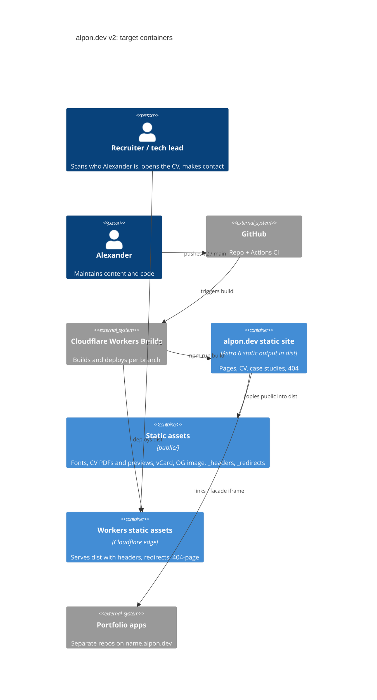

# Architecture map: alpon.dev (v2)

> **Greenfield foundation.** It describes the **target baseline** that `scaffold` materializes on
> branch `v2`. Until then, the repo only holds the static stub in `public/` (see `docs/stub-parity.md`).
> `CLAUDE.md` is the authored doc. This map reconciles with it and never overrides it.

## Stack

- Language / runtime: TypeScript 5, `strict` (extends `astro/tsconfigs/strict`), Node 24 LTS (`.nvmrc`), npm. See `CLAUDE.md:9`, `CLAUDE.md:13`.
- Framework: Astro 6, `output: 'static'`, `site: 'https://alpon.dev'`, `build.format: 'file'`, `trailingSlash: 'never'`. `/cv/en` builds to `dist/cv/en.html`, and the Workers `auto-trailing-slash` serves it at `/cv/en` with no redirect, the same URL shape as the stub. See ADR-0001.
- Styling: plain CSS with `--fjord-*` custom properties (`src/styles/tokens.css`). No Tailwind, CSS-in-JS or UI kits (`CLAUDE.md:10`).
- Client JS: zero by default. Interactive parts are vanilla-TS islands in Astro `<script>` (bundled to external files, CSP-friendly). React only when it clearly pays off, through its own ADR (`CLAUDE.md:11`, ADR-0002).
- Hosting: Cloudflare Workers static assets. `wrangler.jsonc` → `assets.directory: ./dist`, `not_found_handling: 404-page`, `html_handling: auto-trailing-slash`. Deployed by Workers Builds: `main` = production, `v2` and other branches = preview URLs (`CLAUDE.md:12`).
- Build / test / lint commands (the machine keys above):
  - `npm run build`: `astro build` → `dist/`
  - `npm run dev`: `astro dev`
  - `npm run preview`: `wrangler dev` serving `./dist` (production routing: `_headers`, `_redirects`, 404)
  - `npm run test`: Playwright (e2e + axe), `webServer` = build + `wrangler dev`
  - `npm run lint`: `astro check && eslint . && prettier --check .`
  - `npm run lhci`: Lighthouse CI against `dist/` with the CLAUDE.md budget (`CLAUDE.md:51`)

## C4: target containers

## Module inventory (target)

Astro's idiomatic layout, as fixed in `CLAUDE.md:65-83`. There are no runtime modules: everything is built at build time.

| Module | Path | Layers | Wired at | Responsibility |
|---|---|---|---|---|
| Pages | `src/pages/` | route files | file-based routing | One `.astro` file per route. Scaffold creates `index.astro` (placeholder) and `404.astro` |
| Layouts | `src/layouts/` | shell | imported by pages | `BaseLayout.astro`: `<html lang>`, head meta, skip-link slot. Later the theme bootstrap |
| Components | `src/components/{ui,layout,brand,prose}/` | presentational | imported by pages/layouts | Fjord components. Empty at scaffold (UI specs fill them) |
| Styles | `src/styles/` | tokens → base → prose | imported by `BaseLayout` | `tokens.css` (`--fjord-*`), `base.css`, `prose.css`. Created by the first UI spec, not scaffold |
| Data | `src/data/` | typed constants | imported where used | `contact.ts`, the single source for contacts (`CLAUDE.md:43`) |
| Content | `src/content/` + `src/content.config.ts` | collections (zod schemas) | Astro content layer | `projects` (one md file per project, `CLAUDE.md:58`). Later `thoughts` via an external loader (`CLAUDE.md:62`) |
| Static | `public/` | files | copied verbatim to `dist/` | Fonts, `cv/`, vCard, `og.png`, favicon, `img/`, `_headers`, `_redirects`, robots, sitemap |
| Tests | `tests/{e2e,a11y,visual}/` | Playwright specs | `playwright.config.ts` | Smoke, parity (`docs/stub-parity.md`), axe, visual |
| Scripts | `scripts/` | node/ts CLI | `package.json` scripts | Build-time checks (e.g. contrast check, from the tokens spec) |
| Design refs | `design/` | read-only | — | `handoff/{design-system,site}/` (Claude Design exports), `brand/` (BRAND.md, tokens.json/.css, fonts TTF, patterns). Committed in `812f46f`. Never edited |

## Conventions (the rules a new feature must match)

Greenfield: citations point at the authored rules (`CLAUDE.md`, ADRs). Files marked *(target)* are created by scaffold.

- **Module wiring:** file-based routing. Pages compose layouts + components; no global registry. `src/pages/index.astro` *(target)*. See `CLAUDE.md:65`.
- **Error handling:** no runtime server, so errors are **build-time**. Content is validated by zod schemas in `src/content.config.ts`, and invalid content fails `npm run build`. TS `strict` + `astro check` fail CI. Runtime client islands degrade gracefully (the stub precedent: clipboard failure falls back to `mailto:`, `git show 89d375b:public/app.js`).
- **IDs:** content entries are keyed by file slug (`src/content/projects/<slug>.md` → `/projects/<slug>`). See `CLAUDE.md:58`.
- **Persistence:** none. Content and data live in the repo. See ADR-0003.
- **Migrations:** none (no datastore). `migration_tool: none`.
- **Tests:** Playwright against `wrangler dev` serving `dist/` (production routing). `tests/e2e/` (smoke + parity), `tests/a11y/` (`@axe-core/playwright`, zero violations), `tests/visual/` (390 / 834 / 1440 × Dag/Natt, from the first UI spec). Lighthouse CI is separate (`npm run lhci`). No unit-test runner at scaffold: Vitest gets added with an explanation in the PR when a feature has pure logic worth unit-testing. See `CLAUDE.md:14`.
- **Parity gate:** `tests/e2e/parity.spec.ts` mirrors `docs/stub-parity.md` (one test per P-id). Features flip their `test.fixme` items to active. `main` only gets v2 when none are left.
- **Lint / format:** ESLint flat config (`eslint-plugin-astro`, `typescript-eslint`) + Prettier (`prettier-plugin-astro`) + `astro check`. `eslint.config.js`, `.prettierrc` *(target)*.
- **Inter-module communication:** imports only. Islands talk to the DOM, not to each other.
- **UI / styling:** tokens only, two themes through `data-theme="dag|natt"`, motion tokens + reduced-motion, View Transitions as progressive enhancement. See `CLAUDE.md:26-32`.
- **Security headers:** `public/_headers`. CSP without `'unsafe-inline'` scripts: the inline theme script goes in through a hash (`CLAUDE.md:53`, `docs/stub-parity.md` P-16).
- **Dependencies:** each new dependency is explained in its PR (`CLAUDE.md:89`). Running cost stays zero.
- **Commits / branches:** small commits, one PR per spec, PR from `v2` (or a feature branch off `v2`). `main` stays the stub until parity.

## Datastores

None. See ADR-0003. Content: Astro content collections in the repo. The blog uses an external source read at **build** time (later spec) and is never a runtime datastore.

## Frontend / UI foundation

- **Component library / design system:** in-repo Fjord components under `src/components/{ui,layout,brand,prose}/` (`CLAUDE.md:72-77`). The source is `design/handoff/design-system/` + `design/brand/` (read-only, present since `812f46f`). Empty at scaffold.
- **Design tokens:** `src/styles/tokens.css` (`--fjord-*`), generated from `design/brand/tokens.json` + the handoff. Created by the first UI spec.
- **Styling approach:** plain CSS + custom properties, scoped `<style>` in `.astro` components (`CLAUDE.md:10`).
- **Shared primitives:** Button, Link, Badge, Tag, Stat, SectionHeader, Callout, CodeBlock, Toast, Contours, Header/Footer, SkipLink, ThemeToggle (`docs/reference/01-foundations.md` §5). None exist yet.
- **State / data-fetching:** none client-side. Data comes in at build time (content collections, `src/data/`). Theme choice is stored in `localStorage`.
- **Closest UI precedent:** the stub (`git show 89d375b:public/index.html`) for content and behaviour only, not styling. The real precedent is the Fjord handoff.

## Where things live / closest precedents

- A new page → `src/pages/<route>.astro` wrapped in `BaseLayout`. Precedent: `src/pages/index.astro` *(target)*.
- A new UI component → `src/components/<group>/<Name>.astro`, typed `Props`, tokens only, shown on `/styleguide`.
- A new interactive behaviour → `<script>` in the component (vanilla TS island), with a no-JS baseline. Precedent for behaviour: stub `app.js` (CV switch, copy email).
- A new portfolio project → `src/content/projects/<slug>.md`, rendered by `src/pages/projects/[slug].astro`.
- A new static download → `public/…`, linked with a `download` attribute. Headers go in `public/_headers`.

## Constraints & known tech-debt

- **Workers Builds build command is shared across branches.** `main` (the stub) has no `package.json`, so a dashboard build command `npm run build` would break production. Scaffold resolves this branch-locally (preferred: `build.command` in `v2`'s `wrangler.jsonc`, if Workers Builds honours it for an assets-only Worker; otherwise a non-production-only setting) and verifies a `v2` preview deploy.
- **`/cv` collision ahead:** with `build.format: 'file'`, a future `src/pages/cv/en.astro` competes with the `_redirects` rule for `/cv/en`. `_redirects` wins on Workers. The CV spec must pick one (see `docs/stub-parity.md` P-01..P-03).
- **CSP vs inline theme script:** the no-flash theme bootstrap is inline. `_headers` must carry its `sha256-` hash, so the hash must be regenerated when the script changes (automate in the theme spec).
- **Fonts incomplete:** `public/fonts/` has Schibsted 400/500/600 and JetBrains Mono 400/500. The 700 weights required by `CLAUDE.md` get converted from the TTFs in `design/brand/fonts/` in the tokens/fonts spec.
- **Design refs incomplete:** `design/brand/qr/` (contact QR SVGs) and `design/screenshots/` are not committed yet. `public/qr/` doesn't exist, and Release 1 needs it (`docs/stub-parity.md`). Visual tests need the screenshots before the first UI spec.
- **Stub assets in `public/`:** `index.html`, `styles.css`, `app.js`, `404.html` are deleted on `v2` by scaffold (they stay on `main` and in history). `sitemap.xml` is static until a sitemap integration is chosen.

## Reconciliation with the authored architecture doc

`CLAUDE.md` is the authored doc. This map agrees with it on every point and adds the decisions it left open: URL format, test server, lint toolchain, stub retirement, no unit runner at scaffold.
Drift found between the early draft `docs/reference/01-foundations.md` and `CLAUDE.md`:
- The draft (§9) wants CI to fail on U+2014/U+2013 dashes in `src/`. `CLAUDE.md` (Content rules) explicitly allows them. **CLAUDE.md wins, so no dash check.**
- The draft lets the scaffold pick `build.format` `'file'` or `'directory'`. This map fixes `'file'` + `trailingSlash: 'never'` (ADR-0001).
