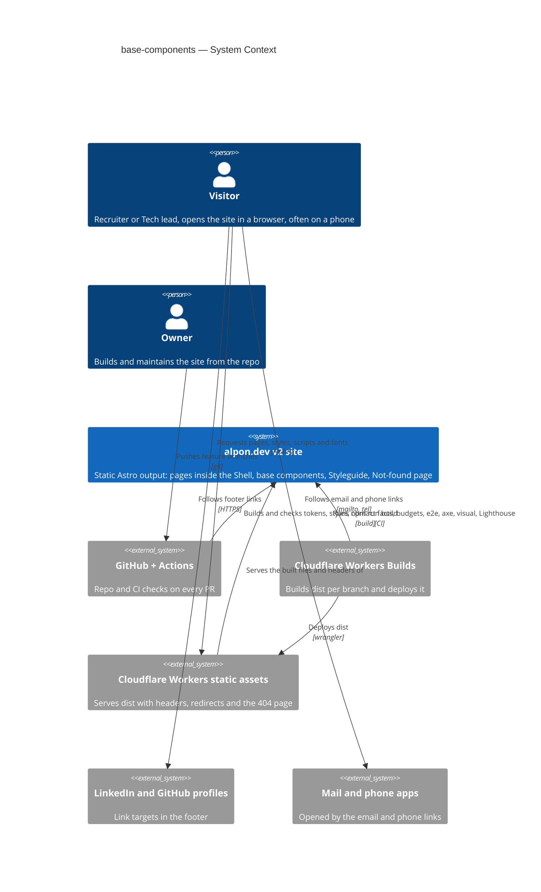
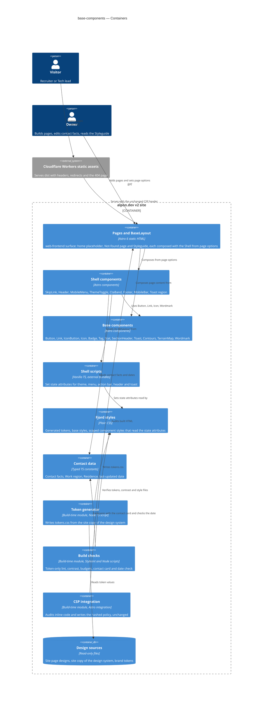
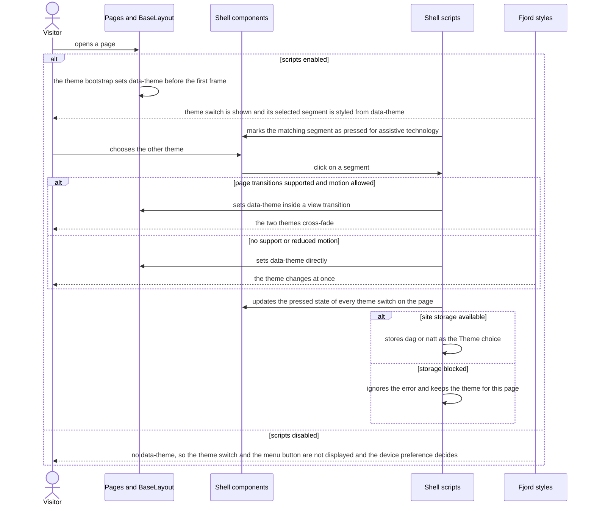
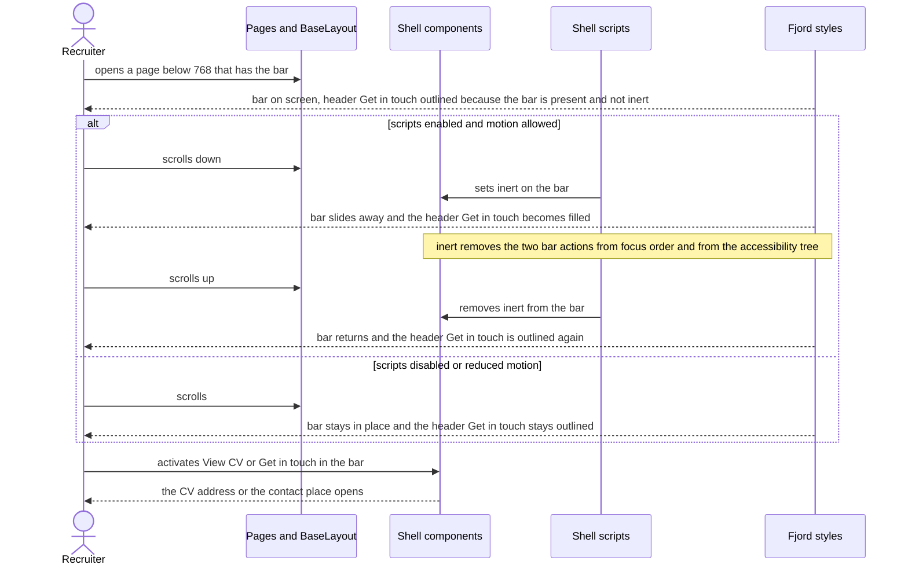
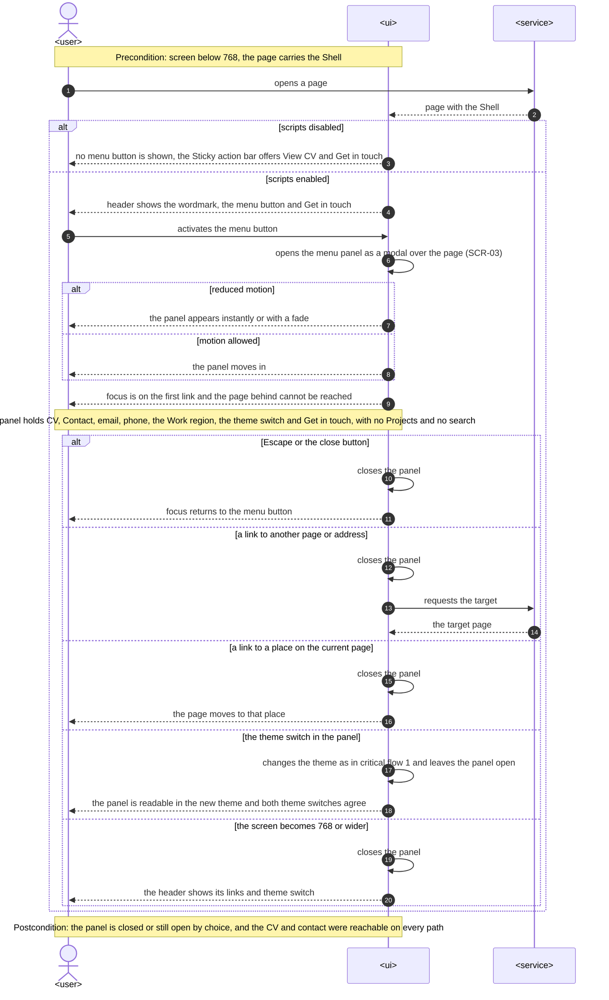

# Software Architecture Document — base-components

> **Upstream:** [spec](./spec.md) · [ux-flows](./ux-flows.md) · [CONTEXT](../../../CONTEXT.md) (repo root; no feature-level CONTEXT) · [fjord-foundation SAD](../fjord-foundation/sad.md) and its ADRs [0001](../fjord-foundation/adr/0001-pair-a-validating-theme-bootstrap-with-generated-natt-blocks.md), [0002](../fjord-foundation/adr/0002-generate-the-bootstrap-hash-into-a-single-csp-rule-at-build.md), [0003](../fjord-foundation/adr/0003-enforce-token-only-styles-with-stylelint-built-in-rules.md) · repo ADRs [0001](../../adr/0001-build-a-static-astro-site-served-by-workers-static-assets.md), [0002](../../adr/0002-ship-zero-client-js-by-default-with-vanilla-ts-islands.md), [0003](../../adr/0003-keep-all-content-in-the-repo-with-no-datastore.md). `docs/architecture-map.md` reflects `812f46f` and is stale; the current code was scanned for this document (§3).

## 1. Introduction and goals

**Intent.** Base components gives every v2 page of alpon.dev the same Shell (skip link, header, mobile menu, theme switch, closing call-to-action band, footer, Sticky action bar) and the base Fjord components that Home (step 4) and CV (step 5) are built from. A Recruiter on a phone gets a way to the CV and to contact on any page, with scripts on or off; a Visitor gets a theme switch wherever scripts run; the Owner gets page options that compose the Shell without editing a shared file, a Styleguide as the checked reference for every component, and a Not-found page rebuilt to its page design. It turns stub-parity P-25 on, rewords P-41 and opens P-50 and P-51 for steps 4 and 5.

**Top-3 quality goals (1-liners; full scenarios in §10):**

1. **A script-light Shell that needs no trust** — every way to the CV and to contact works with scripts off, the security policy is not widened, and all Shell scripts together stay small.
2. **Accessible and calm on a phone** — zero axe violations, 44 px targets, correct focus handling in the menu, no movement under reduced motion, and one primary action per screen.
3. **Composable and guarded** — later pages set page options only; the Styleguide and the token-only checks catch a regression before a Visitor does.

**Stakeholders.**

| Role | Interest | Sign-off owner? |
|---|---|---|
| Recruiter | Reaches the CV and contact from any page, on a phone, within thumb reach | No |
| Tech lead | Sees interactive parts added with care: scripts off still works, strict policy, small scripts | No |
| Visitor | Theme switch that remembers, skip link, footer facts, a way back from a dead link, calm under reduced motion | No |
| Owner | Builds Home and CV in parallel from ready parts; contact facts in one place; guardrails stay strict | Yes (architect and approver of this SAD) |

- Decision override: the header's scroll border (AC-03) appears only where scripts run — rationale: one mechanism in every browser (a script that sets `data-scrolled`), one test path and no new allow-list entry; the border is a visual cue, and content and navigation do not depend on it. Recorded as spec §1.3 D-13 (Owner decision, 2026-10-04, critic pass).

## 2. Constraints

**Technical.**
- TypeScript 5.9.3 (`strict`), Node 24 LTS, npm. Astro 6.4.8, `output: 'static'`, `build.format: 'file'`, `trailingSlash: 'never'` (repo ADR-0001).
- Cloudflare Workers static assets via Wrangler 4.146.0; headers only through `public/_headers`; no Worker script.
- The security policy is fixed: `script-src 'self'` plus the theme-bootstrap hash, `style-src 'self'`. The CSP integration fails the build on any inline executable script other than the bootstrap, any inline `<style>`, `style=""` or `on*=""` attribute. `build.inlineStylesheets: 'never'` and `vite.build.assetsInlineLimit: 0` keep component scripts and styles in external files (fjord-foundation ADR-0002). `tests/contracts/csp.contract.json` must be unchanged at the end of this feature (spec §6.1).
- Token-only styles are enforced by Stylelint 17.16.0 with the targeted rules of ADR-0004, which supersedes fjord-foundation ADR-0003 (AC-26).
- Theme invariant from fjord-foundation ADR-0001: with scripts on, the bootstrap always sets `data-theme` to `dag` or `natt` before the first frame; with scripts off it is never set. Storage key `fjord-theme`.
- Zero client JS by default; interactivity is vanilla TS in Astro `<script>` (repo ADR-0002). No React, no UI kit, no QR or icon library.
- Test toolchain: Playwright 1.63.0 (projects desktop and mobile, against `wrangler dev` on `dist/`), `@axe-core/playwright` 4.13.0, Vitest 5.0.3 for pure logic, Lighthouse CI 0.15.1. Vitest was added by fjord-foundation (`npm run test:unit`). Visual baselines are Linux only.

**Organisational.**
- Single maintainer (the Owner); size S, route quick. No fixed date, but this is roadmap wave 2 and the only step in it: Home (step 4) and CV (step 5) are blocked until it lands.
- Lane rule: shared files belong to the Shell steps. Steps 4 and 5 run in parallel worktrees and must not edit Shell, component or layout files.
- If the task breakdown goes above about 25 tasks, `tasks` proposes the 3a / 3b split of spec §1 before writing tasks.
- At most two review rounds (`CLAUDE.md` Review policy). Running cost stays zero; every new dependency is explained in its PR. This design adds none.

**Conventions.**
- `CLAUDE.md` is the authored architecture doc. Page designs in `design/handoff/site/` are the source of truth for what a page looks like; the site bundles its own, newer copy of the design system in `design/handoff/site/project/_ds/`; `BRAND.md` wins over both. `design/` is read-only.
- Components are `.astro` files in `src/components/{ui,layout,brand}/` with typed `Props` and a scoped `<style>`; a page is `src/pages/<route>.astro` on `BaseLayout`.
- Motion only through motion tokens; reduced motion means fades only. View Transitions are progressive enhancement and are disabled under reduced motion.
- Parity gate: the step that builds a behaviour flips its `test.fixme` in `tests/e2e/parity.spec.ts`.

**Regulatory / external.**
- Data classification public (spec §6.1). Personal data is the Owner's own published contact facts; the Residence is a municipality with coordinates at two decimals. The only Visitor data is the Theme choice (`dag` or `natt`) in the Visitor's own browser storage, now written by this feature; no cookie, nothing sent.
- Security review: N/A while the policy contract is unchanged; a lightweight review of the delivered policy on the preview URL is required if it has to change (spec §6.1).

## 3. Context and scope

alpon.dev is the Owner's public professional home during a job search in Norway. Visitors, mostly Recruiters on a phone and sometimes Tech leads, open it in a browser without signing in. This feature adds no external system: it changes what the static site delivers on every page (the Shell and its small scripts) and what CI checks. The trust boundary is the browser: everything shipped is static, and the only untrusted inputs are the Visitor's stored Theme choice and the requested address, which the Not-found page never shows back.

<!-- brownfield: scanned at 0423d3f. BaseLayout has props title/description/lang/noindex and renders head only (no Shell, no skip link); src/components/ is empty; 404.astro is the interim page with local .home-link and .ridge-contours; index.astro is a placeholder; tokens.css is generated from design/handoff/design-system/project/tokens and has no layer (z) tokens; no View Transitions anywhere in src/; public/sitemap.xml and _redirects (/cv, /cv/en, /cv/no, /linkedin, /github) are static. -->

**External systems (in / out):**

| Actor or system | Type | Interaction |
|---|---|---|
| Visitor (incl. Recruiter, Tech lead) | Person | Opens pages over HTTPS; uses the Shell; may hold a stored Theme choice |
| Owner | Person | Builds pages from components and page options; edits contact facts; reads the Styleguide; pushes branches |
| GitHub (repo + Actions CI) | System (external) | Runs lint, token, contrast, contact and budget checks, Playwright e2e / axe / visual and Lighthouse CI on every PR |
| Cloudflare Workers Builds | System (external) | Builds `dist/` per branch and deploys it |
| Cloudflare Workers static assets (edge) | System (external) | Serves `dist/` with `_headers` and `_redirects`; unknown addresses get `404.html` with a 404 status |
| LinkedIn, GitHub profile pages | System (external) | Link targets from the footer only; opened without a handle on this page; nothing is loaded from them |
| Visitor's mail and phone apps | System (external) | Opened by the email and phone links |

External: none new that the site loads from. No third-party script, style or font origin.

**C4 Context (L1):**



## 4. Solution strategy

**Top strategic choices (the seeds for ADRs):**

1. **One web surface, rendered at build time** — `target_surfaces: [web-frontend]`. ux-flows.md lists four screens (SCR-01 to SCR-04) and no other surface; there is no backend, worker or API. The UI architecture is inherited: static HTML from Astro (repo ADR-0001), zero client JS by default with vanilla TS in component scripts (repo ADR-0002), and it reuses the Fjord foundation (tokens, base styles, BaseLayout) instead of adding a second styling approach. *(Single surface, inherited UI architecture: below the ADR gate, inline.)*
2. **The site's copy of the design system is the token source** — the page designs use tokens that the generated file lacks (layer order, the fifth space step, the not-found top space, UI text sizes, compact header height). The site's copy under `design/handoff/site/project/_ds/` defines all of them and changes no value the generator emits today, so the generator reads that copy instead of `design/handoff/design-system/`. Tokens still enter only through the generator (AC-26). → [ADR-0001](./adr/0001-read-fjord-tokens-from-the-site-copy-of-the-design-system.md)
3. **Platform features first, state in the DOM** — each Shell behaviour is a small script colocated with its component that sets one state attribute and, where one exists, its ARIA mirror (`data-theme` on `<html>`, `open` on the menu dialog, `inert` on the Sticky action bar, `data-scrolled` on the header); CSS derives every visual consequence, including the header call-to-action style through `:has()`. Controls that cannot work without a script (theme switch, menu button) are hidden by one CSS rule on `:root:not([data-theme])`, which is exactly the scripts-off case by the fjord-foundation invariant, so nothing is revealed by script and nothing shifts. Serves quality goals 1 and 2. → [ADR-0003](./adr/0003-keep-shell-state-in-dom-attributes-and-let-css-derive-the-rest.md)
4. **The mobile menu is a native modal dialog** — `<dialog>` opened with `showModal()` gives the focus move, the focus trap, Escape, the inert page behind and focus return from the platform; the script adds only open, close on any link, and close when the screen becomes 768 or wider. With scripts off the menu button is not shown (D-12) and AC-06 is met by the Sticky action bar. Serves quality goal 2. → [ADR-0002](./adr/0002-open-the-mobile-menu-as-a-native-modal-dialog.md)
5. **The Shell is composed in BaseLayout from page options** — as spec §1.1 fixes. `BaseLayout` renders skip link, header, `<main id="main">`, closing band, footer, Sticky action bar and the Toast region, and takes the options of AC-24 as props. Shell components take the same values as their own props, so the Styleguide can show variants as samples. Steps 4 and 5 pass props and never edit these files. Serves quality goal 3. *(Fixed by the spec, no alternative left to weigh: inline.)*
6. **Transitions are CSS-first** — page navigation uses cross-document View Transitions in the form `CLAUDE.md` gives (`@view-transition { navigation: auto }`, and `navigation: none` under `prefers-reduced-motion: reduce`), with a `view-transition-name` on the header so it stays still (AC-32). The theme switch wraps its attribute change in `document.startViewTransition` when it exists and motion is allowed (AC-29). Astro's client router is not used: `CLAUDE.md` already prescribes the native form, and the router would add script to every page. *(Prescribed by `CLAUDE.md`: inline.)*

Each tactical decision in later sections traces to one of these seeds. Tactical decisions that contradict a strategic choice are red flags and go to §11.

## 5. Building block view

Astro's file-based layering, unchanged: pages compose `BaseLayout`, the layout composes the Shell components, components import typed data and pure helpers. Client behaviour sits next to its component as a `<script>` that imports its logic from `src/scripts/shell/`, so the logic is unit-testable and the bundle stays external. Build-time code stays in `scripts/`. No new module kind; the new folders are `src/scripts/shell/` and `tests/visual/` specs for the Styleguide.

**Internal decomposition:**

```
design/handoff/site/project/_ds/…/tokens/     token source from now on (read-only)      ADR-0001
scripts/
├── tokens/                 generator reads the site copy; emits the new tokens        ADR-0001
├── check-contact.ts        contact.ts vs the .vcf, field by field; last-updated date rule (AC-15, AC-16)
├── check-budgets.ts        + Shell scripts ≤ 5 KB gzip, Not-found HTML ≤ 20 KB gzip
└── contrast-pairs.ts       + the pairs the new components use (Dag, Natt, on spruce)
stylelint.config.js         token-only rules per AC-26 (ADR-0004)
src/
├── data/contact.ts         contact facts, Work region, Residence + coordinates, lastUpdated, link targets
├── scripts/shell/          pure logic, one module per behaviour
│   ├── theme.ts            read / validate / apply / persist the Theme choice, sync every switch
│   ├── menu.ts             open, close on link, close at 768 and wider
│   ├── action-bar.ts       scroll direction → inert, skipped under reduced motion
│   ├── header.ts           top sentinel → data-scrolled
│   └── toast.ts            fjord:toast event → live region, auto-dismiss
├── components/
│   ├── ui/                 Button, Link, IconButton, Icon, Badge, Tag, Stat, SectionHeader (Eyebrow), Toast
│   ├── brand/              Contours, TerrainMap, Wordmark
│   └── layout/             SkipLink, Header, MobileMenu, ThemeToggle, CtaBand, Footer, MobileBar
├── layouts/BaseLayout.astro   head contract (unchanged) + the Shell + page options (AC-24)
├── styles/base.css         + @view-transition rules, scripts-off gate, bar clearance
└── pages/
    ├── index.astro         home placeholder, now inside the Shell (SCR-01)
    ├── 404.astro           Not-found page rebuilt to the page design (SCR-02)
    └── styleguide.astro    every component in every state, noindex, not linked (SCR-04)
tests/
├── e2e/                    shell, menu, theme-switch, action-bar, primary-count, styleguide, not-found, parity (P-25 on, P-41 reworded, P-50 and P-51 fixme)
├── a11y/                   axe on SCR-01, SCR-02, SCR-04, Dag and Natt, and with SCR-03 open
└── visual/                 styleguide per component section + not-found, 390 / 834 / 1440 × Dag / Natt
```

**Page options (the AC-24 contract of `BaseLayout`).** Existing props `title`, `description`, `lang`, `noindex` stay. New, all optional:

| Prop | Values | Default | Effect |
|---|---|---|---|
| `current` | `'cv'` \| `'contact'` | none | Marks that navigation link as current (`aria-current="page"` and the visible marker) in the header and the menu |
| `headerVariant` | `'default'` \| `'on-spruce'` | `'default'` | The static header variant; step 4 toggles the same attribute from its own script |
| `headerCta` | `'auto'` \| `'secondary'` | `'auto'` | `auto` follows the Sticky action bar below 768 (§8 One primary); `secondary` forces the outlined style at any width |
| `mobileBar` | boolean | `true` | Leaves the Sticky action bar out when `false` |
| `ctaBand` | boolean | `true` | Leaves the closing call-to-action band out when `false` |
| `cvLang` | `'en'` \| `'no'` | `'en'` | Which CV PDF "Download CV" downloads |

**C4 Container (L2):**



The one declared surface (`web-frontend`) is **Pages and BaseLayout**; Shell components, Base components, Shell scripts, Fjord styles and Contact data ship inside it and are drawn separately only to show what depends on what. Token generator, Build checks and CSP integration are build-time modules of the same surface and run nowhere at request time.

## 6. Runtime view

Participants are the §5 containers; the Visitor's browser runs the scripts and applies the styles. These two flows seed the stage; `sequences` covers every §5 AC.

**Critical flow 1: switch the theme** (AC-10, AC-11, AC-12, AC-29)



**Critical flow 2: Sticky action bar and the header action on a phone** (AC-07, AC-08, AC-09, AC-23)



### Mobile menu

US-02 · AC-04, AC-05, AC-06 (and the menu side of AC-02, AC-10, AC-28). Added by `sequences`; runs in the Recruiter's browser below 768 on SCR-01, SCR-02 or SCR-04. `<ui>` is the rendered page with the Shell, `<service>` the static edge.



**Scope of this stage.** By the Owner's instruction, `sequences` covers three flows only: the theme switch (critical flow 1), the Sticky action bar with the header action (critical flow 2), both drawn by `design` and left as they were, and the mobile menu above. Everything else is a single render step, a build-time check or browser enforcement and is not drawn; the tables say where each is shown instead.

**Coverage (spec §4 → flows).**

| User story | Flow(s) |
|---|---|
| US-02 Navigate on a phone | Mobile menu |
| US-03 Keep the two main actions at hand | Critical flow 2 |
| US-04 Switch the theme | Critical flow 1; Mobile menu, branch `the theme switch in the panel` |
| US-01 Find the way from the header | Not drawn (scope): only its header-action state is in critical flow 2; the rest is ux-flows Flow US-01 |
| US-13 A Shell that needs no trust | Scripts-off branches of all three flows; the policy half is not drawn (browser enforcement) |
| US-14 Calm for reduced motion | Reduced-motion branches of all three flows; skip link, Toast and page links are not drawn (scope) |
| US-05, US-06, US-07, US-08, US-09, US-10 | Not drawn (scope): single render steps, see ux-flows Flows US-05 to US-10 |
| US-11, US-12 | Not runtime: build-time checks (ux-flows "Out of scope") |

**Coverage (spec §5 → flows).**

| AC | Shown in |
|---|---|
| AC-04 | Mobile menu, steps from `activates the menu button` to `focus is on the first link` |
| AC-05 | Mobile menu, branches `Escape or the close button`, `a link to another page or address`, `a link to a place on the current page` |
| AC-06 | Mobile menu, branch `scripts disabled`; critical flow 2, branch `scripts disabled or reduced motion` |
| AC-07 | Critical flow 2, first two steps (bar shown below 768). "Never covers the last lines or the focused element" is not drawn: a layout rule, §8 Sticky action bar clearance |
| AC-08 | Critical flow 2, branch `scripts enabled and motion allowed` |
| AC-09 | Critical flow 2, branch `scripts disabled or reduced motion` |
| AC-10 | Critical flow 1, `chooses the other theme` to `stores dag or natt`; Mobile menu, branch `the theme switch in the panel` |
| AC-11 | Critical flow 1, branches `storage blocked` and `scripts disabled` |
| AC-12 | Critical flow 1, steps before `chooses the other theme` |
| AC-23 | Critical flow 2, the header action in every branch. The count itself is an e2e check |
| AC-29 | Critical flow 1, branch `page transitions supported and motion allowed` and its `else` |
| AC-02 | Partly: Mobile menu, note on the panel content. Header side not drawn (scope), ux-flows Flow US-01 |
| AC-28 | Partly: reduced-motion branches of the three flows. Skip link, Toast and header border not drawn (scope), ux-flows Flow US-14 |
| AC-01, AC-03, AC-13, AC-14, AC-17 to AC-22, AC-24, AC-25, AC-30, AC-32 | Not drawn (scope): single render or one-step behaviour, see the ux-flows AC coverage table |
| AC-15, AC-16, AC-26, AC-31 | Not runtime: build-time checks and the release gate |
| AC-27 | Not runtime in this feature's code: browser enforcement of the unchanged policy, drawn in the fjord-foundation SAD §6 "Policy refuses an injected script" |

**Gaps the flows revealed.** Items 1 to 6 and 9 were decided by the Owner on 2026-10-04 (screens stage; screens.md §Decided gaps G-1 to G-7 carries them into the state tables). Items 7 and 8 are observations and need no decision.

1. Mobile menu, branch `a link to a place on the current page`: AC-05 fixes focus only for Escape and the close button. **Decided (G-1):** the panel closes and focus goes to the link target, not back to the menu button.
2. Mobile menu, branch `the screen becomes 768 or wider`: the menu button is not displayed at that width, so focus cannot return to it, and no AC covers the branch. **Decided (G-2):** platform default focus, no extra logic.
3. Mobile menu and critical flow 2 together: nothing said whether the page behind the open panel can scroll. **Decided (G-3):** page scroll is locked while the dialog is open with one CSS rule, `html:has(dialog[open]) { overflow: hidden }`, so the bar state cannot change under the panel.
4. Critical flow 2, `sets inert on the bar`: focus on a bar action would be dropped. **Decided (G-4):** the script does not hide the bar while focus is inside it.
5. Critical flow 2: the scroll distance that hides and returns the bar was not specified. **Decided (G-5):** the prototype's threshold: a scroll change smaller than 8 px is ignored, and within 40 px of the top of the page the bar is always shown.
6. Critical flow 1, branch `sets data-theme inside a view transition` taken from inside the open panel. **Decided (G-6):** a theme change inside the open panel is instant, with no cross-fade; the cross-fade of AC-29 applies to the header switch.
7. Critical flows 1 and 2 use the `design` container names as participants, while the Mobile menu flow uses the generic vocabulary; they were left as drawn.
8. No new participant and no persist step beyond the Visitor's own stored Theme choice: nothing for `data-model`, no contract for `api`.
9. Styleguide with scripts off (raised by `screens`): the "Show toast" control cannot work. **Decided (G-7):** it is hidden by the scripts-off gate, like the other script-only controls.

## 7. Deployment view

<!-- N/A: reuses the existing deployment unit, no infra change -->

No topology change: the same Worker serves `dist/` as static assets, built and deployed by Workers Builds; the build command, `wrangler.jsonc`, `_headers` and `_redirects` are unchanged. The feature adds one static page (`/styleguide`, built to `dist/styleguide.html`) and a few external script and style files. Monitoring stays as in the fjord-foundation SAD §7: Lighthouse CI and the budget script in CI, no runtime alerting.

## 8. Crosscutting concepts

Everything not listed here is inherited unchanged from the fjord-foundation SAD §8 (tokens, theme bootstrap, fonts, head contract, security policy, testing set-up).

| Concept | Convention | Where defined |
|---|---|---|
| Shell state | A behaviour script sets one state attribute: `data-theme` on `<html>`, `open` on the menu `<dialog>`, `inert` on the Sticky action bar, `data-scrolled` on the header. Styles read the attribute. Two additions, neither of which styles read: the theme script mirrors the state as `aria-pressed` on every theme switch, and the Toast script writes the message into its own live region. Scripts never write classes or inline styles | ADR-0003 |
| Scripts off | `:root:not([data-theme])` hides the theme switch and the menu button (D-09, D-12). Navigation never depends on a script: header links at 768 and wider, the Sticky action bar below 768, the footer everywhere (AC-06). Without scripts the header has no scroll border (spec §1.3 D-13), the bar never moves and no Toast appears | ADR-0003; fjord-foundation ADR-0001 |
| One primary | The header "Get in touch" is a Button whose style follows CSS: below 768 it is secondary while the page has a Sticky action bar that is not `inert`, primary otherwise; from 768 it is primary. `headerCta: 'secondary'` forces secondary. An e2e check counts primary buttons in the three states of spec §6 | ADR-0003; AC-23 |
| Sticky action bar clearance | A page with the bar reserves the bar's height at the end of the page and as `scroll-padding-bottom` below 768, so the bar never covers the last lines or the focused element (AC-07). The Toast region sits above the bar by the same height while the bar is on screen (AC-30) | here |
| Bar left out | A Visitor page with `mobileBar: false` must link to the CV from its own content. An e2e check over the built Visitor pages enforces it; the Styleguide is exempt (AC-24) | here |
| Mobile menu | Native `<dialog>` with `showModal()`; the first link takes focus; Escape and the close button return focus to the menu button (platform behaviour); any link closes it, same-page links included; it closes when the screen becomes 768 or wider; choosing a theme leaves it open | ADR-0002 |
| Motion | Only motion tokens. Slide and rise distances collapse under reduced motion (fjord-foundation §8), so menu, bar, Toast and skip link change instantly or fade. The bar script does not hide the bar under reduced motion. `@view-transition` is set to `navigation: none` under `reduce`, and `startViewTransition` is skipped there | `CLAUDE.md`; §4 pillar 6 |
| Toast | One polite live region (`role="status"`) rendered by `BaseLayout`. Any script shows a Toast by dispatching `fjord:toast` on `document` with `{ message, meta?, lang? }`; it never takes focus and leaves by itself after the Toast duration token. AC-30 is checked on the home placeholder at 390, where the real bar is on screen, by dispatching the event from the test | here |
| Icons | `Icon.astro` renders an inline SVG from a typed name-to-path map (1.5 px stroke, `currentColor`, `aria-hidden`); no sprite file, no icon library | here |
| Contact data | `src/data/contact.ts` is the only place for email, phone, profile URLs, Work region, Residence with coordinates, and `lastUpdated` (ISO date). `scripts/check-contact.ts` runs in `npm run lint`: it compares the fields with `public/alexander-ponomarenko.vcf` and names the one that differs (AC-15), and fails on a `lastUpdated` that is not a real calendar date or lies after the day of the run (AC-16). The copyright year is taken at build time (D-10) and masked in visual tests | here |
| Links out | Profile links carry `rel="noopener noreferrer"`. Shell targets: CV `/cv`, contact `/#contact`, "Download CV" the PDF for `cvLang` with `download`. P-50 and P-51 stay `fixme` until steps 4 and 5 (AC-31) | spec §6.1; AC-31 |
| Styleguide states | Interactive components accept a `data-demo-state` attribute (`hover`, `focus`, `active`) whose selector is listed next to the real pseudo-class in the component's style, so the Styleguide shows each state statically and the visual test captures it without pointer choreography. It has no effect unless the attribute is present | here |
| Token-only styles | Colour literals are banned in every property and the enforced properties take Fjord tokens only; the rule set, the property list and the accepted gaps are in ADR-0004 (AC-26). New tokens come from the generator only | ADR-0001; ADR-0004 |
| Accessibility | One `h1` per page; `<main id="main" tabindex="-1">` as the skip-link target; landmarks `header`, `nav`, `main`, `footer`; `aria-current="page"` on the current link; theme switch as a group of two buttons with `aria-pressed`; Norwegian details carry `lang="no"`; decorative SVG is `aria-hidden` | `CLAUDE.md` quality bar |
| Testing | Vitest for `src/scripts/shell/*` and `scripts/check-contact.ts`; Playwright e2e with reduced motion emulated by default; tests with motion allowed for AC-29 and AC-32, and also for AC-08 and the "bar scrolled away" state of AC-23, because the bar script does not hide the bar under reduced motion; a scripts-off context for AC-06, AC-09, AC-11; axe incl. the open menu; visual per Styleguide section | spec §1, §6 |
| Error handling | Build time: checks fail closed and name file and line, field, or value and rule. Run time: storage errors are swallowed (AC-11); a missing API (`startViewTransition`, `showModal`) falls back to the direct state change | here |
| ID strategy / events / persistence / observability | N/A — no entities or datastore (repo ADR-0003); the only event is the in-page `fjord:toast`; the only state is the Visitor's `fjord-theme` value | — |

## 9. Architecture decisions

| # | Title | Status | Section |
|---|---|---|---|
| 0001 | Read Fjord tokens from the site copy of the design system | Accepted | §4 |
| 0002 | Open the mobile menu as a native modal dialog | Accepted | §4 |
| 0003 | Keep Shell state in DOM attributes and let CSS derive the rest | Accepted | §4 |
| 0004 | Enforce token-only styles with targeted rules | Accepted | §8 |

ADR files live under `docs/features/base-components/adr/NNNN-<title>.md`. Inherited decisions: repo ADR-0001 to 0003 and fjord-foundation ADR-0001 and 0002 (links at the top). fjord-foundation ADR-0003 is superseded by ADR-0004.

## 10. Quality requirements

Each top-3 goal from §1 expanded into scenarios. Numbers are quoted from spec §6.

**QG-1. A script-light Shell that needs no trust**
- **When:** a Recruiter opens the home placeholder or the Not-found page on a phone with scripts off; and when the built site is measured.
- **Then:** the CV and the contact action are reachable from the Shell (AC-06) and the theme switch and menu button are not offered; the policy contract `tests/contracts/csp.contract.json` is unchanged and an injected inline script or style is refused (AC-27); initial JS per page is "≤ 50 KB gzip in total; all Shell scripts together ≤ 5 KB gzip", and above 5 KB the measurement is reported to the Owner before anything is changed; the Not-found page is "HTML ≤ 20 KB gzip, with the map panel inline".
- **How verify:** Playwright context with `javaScriptEnabled: false` at 390 on SCR-01 and SCR-02; `tests/e2e/headers.spec.ts` plus a diff of the contract file in CI; `scripts/check-budgets.ts` on `dist/` after the build.

**QG-2. Accessible and calm on a phone**
- **When:** axe, the box-measurement and the primary-count tests run on the built pages; and when a Visitor with reduced motion uses the menu, the theme switch, the skip link, the page scroll and a Toast.
- **Then:** "0 axe violations on the home placeholder, the Not-found page and the Styleguide, in Dag and Natt, and with the menu panel open"; "every interactive element of the Shell ≥ 44 × 44 px at 390"; primary buttons "page content ≤ 1, visible screen ≤ 2, at 390 / 834 / 1440, on every page except the Styleguide", counted at 390 in the three states of spec §6; wrong selection on the theme switch "0 across the 6 combinations (stored Dag / Natt / none × device light / dark)"; contrast "body ≥ 4.5:1; large text, borders and focus ring ≥ 3:1" for every pair the new components use, in Dag, Natt and on spruce; under reduced motion nothing slides, grows or loops (AC-28).
- **How verify:** `tests/a11y/` with axe, including a run with the menu dialog open; e2e bounding-box and primary-count specs (the "bar scrolled away" state runs with motion allowed, the other two states with reduced motion and with scripts off); the theme-switch spec over the 6 combinations; `scripts/check-contrast.ts` with the extended pair manifest; an e2e spec with `reducedMotion: 'reduce'` that asserts the bar keeps its position and no transform change occurs.

**QG-3. Composable and guarded**
- **When:** the Owner builds a page by setting page options only; and when a style uses a function, unit, breakpoint form or token outside the recorded lists.
- **Then:** the page gets the matching Shell with no change to a shared file (AC-24); Stylelint reports "0 findings over all page and component styles" and fails with file and line on a violation (AC-26); visual regression stays "≤ 0.1 % differing pixels per screenshot", the Styleguide captured per component section and the Not-found page full page, "all at 390 / 834 / 1440 in Dag and Natt"; Design match is "0 differences between the Not-found page and `design/screenshots/`" other than those listed in spec §1.3; Lighthouse mobile stays "Performance, Accessibility, Best Practices, SEO each ≥ 95" with "≤ 2.0 s / ≤ 0.02 / ≤ 100 ms" for LCP / CLS / TBT on the home placeholder and the Not-found page (SEO not asserted on the noindex Not-found page).
- **How verify:** the home placeholder, Not-found page and Styleguide pass different option sets through `BaseLayout` and the e2e Shell spec asserts the result of each; Stylelint in `npm run lint` with a passing and a failing fixture per enforced group (Vitest, ADR-0004); Playwright visual tests in CI; manual side-by-side review in the PR; `npm run lhci`. The KPI "edits to shared files in the step 4 and step 5 PRs = 0" is measured at their review.

## 11. Risks and technical debt

| Risk / debt | Severity | Mitigation | Owner |
|---|---|---|---|
| The site copy of the design system restructures `colors.css` (shared `:root, [data-theme="dag"]` block, contour and terrain line tokens, an on-spruce Natt block); the generator's parser may need changes and could alter an emitted value | Medium | ADR-0001: the first task switches the source and requires that no existing declaration in `tokens.css` changes value, checked by a diff of the generated file; the contrast check and the Natt-block identity check run on the result | Owner |
| The breakdown may exceed about 25 tasks (about twenty components, four pages, five scripts, checks) | Medium | `tasks` proposes the 3a / 3b split of spec §1 before writing tasks; the part that first shows the Shell on the Not-found page owns that page's e2e and baseline changes | Owner |
| Visual baselines grow from 6 to several dozen (Styleguide sections × 3 widths × 2 themes) and are Linux only while the Owner works on Windows | Medium | Baselines are written only in CI or the Playwright image (`FJORD_VISUAL=write`); one screenshot per component section keeps a change local to its section | Owner |
| Each component `<script>` is emitted as its own small external module, so a page with the Shell makes about five extra requests | Low | Lighthouse CI budget on every PR; if LCP or TBT moves, the scripts are imported from one entry module in `BaseLayout` without changing any behaviour module | Owner |
| The bootstrap ran but an external Shell script failed to load: the theme switch and menu button are shown and do nothing | Low | Navigation does not depend on them (AC-06 paths stay); accepted, because the alternative is revealing the controls by script, which shifts the header | Owner |
| Cross-document View Transitions are not available in every browser, and a sticky header inside a transition can flicker if it is not named | Low | Progressive enhancement by design (AC-32); the header has its own `view-transition-name`; a motion-allowed e2e test covers the supported path | Owner |
| The inline map may push the Not-found HTML above the limit once header, menu and footer are in the page | Low | Spec §6 fixes the path: move the map to a cached SVG file that still meets AC-17, AC-19 and AC-26, or propose a new limit with the measured size in the PR | Owner |
| `docs/architecture-map.md` is stale (reflects `812f46f`, before fjord-foundation) | Low | Run `/sdd:survey` after this feature merges; this SAD was drafted from a fresh scan | Owner |
| Astro's handling of component scripts and cross-document transitions can change between versions | Low | Check the Astro Docs MCP before using an option (`CLAUDE.md`); the CSP integration fails the build if a script is ever inlined | Owner |

**Accepted debt (acceptable in v1, plan to fix later):**
- With scripts off the header never shows its scroll border (spec §1.3 D-13) and no Toast can appear; both are scripted states with a working static state.
- Interim surfaces IS-01 to IS-05 (spec §1.2): Shell links lead to targets that steps 4 and 5 build; P-50 and P-51 stay open.
- `data-demo-state` selectors ship in production styles for the Styleguide's sake.

## 12. Glossary

| Term | Meaning |
|---|---|
| Shell | The parts every page shares around its content: skip link, header, mobile menu, closing call-to-action band, footer and Sticky action bar |
| Sticky action bar | The two-action bar fixed to the bottom of the screen on phones ("View CV", "Get in touch"); never shown at 768 and wider |
| Styleguide | The page that shows every Fjord component in every state, in Dag and Natt; not a page for Visitors |
| Not-found page | The "Ikke funnet" page served with a 404 status for any address the site does not have |
| Dag / Natt | The light and the dark Fjord theme |
| Fjord token | A named design value (`--fjord-*`) that is the only allowed source of that value on the site |
| Theme choice | The theme a Visitor explicitly picked, kept only in their own browser (`fjord-theme`) |
| Theme bootstrap | The single inline script that sets `data-theme` before the first frame; it never saves a Theme choice |
| Work region / Residence | "Oslo, Norge", the hiring fact, and "Nittedal, Norge", the place of residence; kept as separate fields |
| Interim surface | A part knowingly shipped unfinished because a later roadmap step owns it (spec §1.2) |
| Published project | A portfolio project ready to be presented; none exist in this feature |
| Owner / Visitor / Recruiter / Tech lead | Roles as defined in the root `CONTEXT.md` glossary |
| Page options | The optional `BaseLayout` props through which a page chooses its Shell (§5) *(technical term)* |
| State attribute | The one DOM attribute a Shell script sets and the styles read (§8 Shell state) *(technical term)* |
| Scripts-off gate | The CSS rule on `:root:not([data-theme])` that hides controls which cannot work without a script *(technical term)* |
| Site copy of the design system | `design/handoff/site/project/_ds/`, the newer design-system bundle the page designs were made with *(technical term)* |
