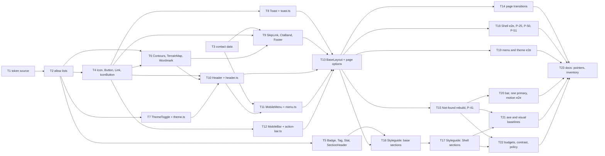

# Epic — base-components

> **Spec:** [spec.md](../spec.md) · **Design:** [sad.md](../sad.md) · **Screens:** [screens.md](../screens.md) · **UX flows:** [ux-flows.md](../ux-flows.md) · **API:** N/A (static site, no external interface) · **Data model:** N/A (no datastore, repo ADR-0003) · **ADRs:** [adr/](../adr/)

## Goal

Give every v2 page the same Shell and the base Fjord components, so that Home (step 4) and CV (step 5) are built in parallel from ready parts and page options, without editing a shared file ([spec §2](../spec.md)). The Styleguide becomes the checked reference for every component in Dag and Natt, and the Not-found page is rebuilt to its page design. Stub-parity P-25 turns on, P-41 follows the page design, and P-50 and P-51 open for steps 4 and 5.

## Scope

- **In:** the `web-frontend` surface only (`target_surfaces` in [sad.md](../sad.md)): `ui` tasks for components, Shell parts and the screens SCR-01 to SCR-04; the build-time modules of that surface (token generator, allow lists, contact, budget and contrast checks) as `wiring`, `domain` and `tests` tasks; one `docs` task. No backend layers (infra / app / ports) and no migrations.
- **Out** ([spec §3](../spec.md)): Home content, contact block, copy-email, QR tile, head meta (step 4); CV pages, language switch, BackToTop (step 5); Stat count-up, Contours drift, the header turning spruce over the hero (step 4); command palette (step 8); "Projects" and "See projects" (step 7); Prose, CodeBlock, Callout (step 7); a performance budget for the Styleguide.

## Split decision

23 tasks. This is under the "about 25" limit of [spec §1 Traceability](../spec.md) and [sad §11](../sad.md), so the feature is **not** split into 3a / 3b. The rule behind the split still holds inside the one feature: the task that first shows the Shell on the Not-found page (T13) keeps that page's existing e2e and axe specs green in the same commit, and the rebuild (T15) owns its e2e and P-41 changes.

## Task map

The same DAG as [tasks.json](../tasks.json). Waves by dependency:

1. T1 ∥ T3
2. T2
3. T4 ∥ T5 ∥ T7
4. T6 ∥ T8 ∥ T12
5. T9 ∥ T10
6. T11
7. T13
8. T14 ∥ T15 ∥ T16 ∥ T18 ∥ T19
9. T17 ∥ T20
10. T21 ∥ T22
11. T23

Lanes that `implement` serializes because the files overlap: T7 → T13 → T14 (`src/styles/base.css`); T10 → T14 (`Header.astro`); T15 → T18 (`parity.spec.ts`, `docs/stub-parity.md`); T13 → T15 (`not-found.spec.ts`, `_404.test.ts`); T16 → T17 (`styleguide.astro`).

## Shared hooks (decided at breakdown)

Tasks that run in parallel meet at these four DOM hooks. They follow [ADR-0003](../adr/0003-keep-shell-state-in-dom-attributes-and-let-css-derive-the-rest.md) (state in attributes, styles derive the rest) and add no new mechanism. A task may rename a hook only by changing every task file that cites it.

| Id | Hook | Set by | Read by |
|---|---|---|---|
| H-1 | `data-needs-script` on a control that cannot work without a script; `:root:not([data-theme]) [data-needs-script]` is not displayed (the scripts-off gate of sad §8) | T7 (rule in `base.css`, theme switch), T10 (menu button), T17 ("Show toast") | T18, T19 |
| H-2 | `data-shell-bar` on the root of the live Sticky action bar; its state is the `inert` attribute | T12 | T10 (header call-to-action rule), T8 (Toast offset), T13 (clearance), T20 |
| H-3 | `data-sample` on the root of a Shell part rendered as a Styleguide sample; Shell scripts and cross-component rules ignore anything inside it | T7, T10, T11, T12 (the `sample` prop) | T17 |
| H-4 | `data-demo-state` (`hover`, `focus`, `active`), listed next to the real pseudo-class in each interactive component (sad §8 Styleguide states) | T4, T7, T10 | T16, T17, T21 |

## Tasks

See [tracker.md](./tracker.md) for status. Machine contract: [tasks.json](../tasks.json).

| # | Task | Layer | Blocked by | DoD (short) |
|---|---|---|---|---|
| T1 | [Point the token generator at the site copy of the design system and emit the new tokens](./t01-token-source-site-copy.md) | wiring | — | scripts/tokens/build.test.ts proves the generator reads design/handoff/site/project/_ds/, that every declaration tokens.css had before keeps its value, and that the layer, space-5, not-found space, UI text size, compact header height and Toast duration tokens are emitted |
| T2 | [Extend the token-only allow lists for the Shell styles, one recorded entry per form](./t02-stylelint-allow-lists.md) | wiring | T1 | scripts/lint/stylelint.test.ts has, for every new allow-list entry, one fixture that passes and one that is rejected with file and line (color-mix() with a literal colour, a raw number inside an allowed function, ch, an unknown --fjord-* token) |
| T3 | [Add src/data/contact.ts and the contact check against the vCard and the last-updated date](./t03-contact-data-and-check.md) | domain | — | scripts/check-contact.test.ts proves the check passes on the repo, fails naming the field when contact.ts and public/alexander-ponomarenko.vcf differ, and fails showing the value and the rule for a lastUpdated that is not a real calendar date or lies in the future |
| T4 | [Build Icon, Button, Link and IconButton with all interactive states](./t04-action-components.md) | ui | T2 | src/components/ui/actions.test.ts renders the four components and asserts the variants of the screens.md Styleguide rows Button, Link, IconButton and Icon, the data-demo-state selectors next to each pseudo-class, aria-hidden icons from the typed map and rel on external links |
| T5 | [Build Badge, Tag, Stat and SectionHeader with Eyebrow](./t05-content-components.md) | ui | T2 | src/components/ui/content.test.ts renders the variants of the screens.md Styleguide rows Badge, Tag, Stat and SectionHeader and asserts that Stat prints its final number in the HTML with no script |
| T6 | [Build Contours, the Terrain map panel and Wordmark](./t06-brand-components.md) | ui | T2, T4 | src/components/brand/brand.test.ts asserts that Contours (ridge, corner) and the whole TerrainMap panel are aria-hidden inline SVG with class-based token colours and no style attribute, that the panel has the 4 × 4 grid, dashed route, pin with "You are here" and the coordinates label, and that Wordmark links to / in its default and on-spruce variants |
| T7 | [Build ThemeToggle, the theme script and the scripts-off gate](./t07-theme-toggle.md) | ui | T2 | src/scripts/shell/theme.test.ts proves that only dag and natt are applied and stored, that a storage error is swallowed while the theme still changes, that aria-pressed is synced on every live switch and never on a sample, and that startViewTransition is used only when it exists, motion is allowed and the switch is not inside the menu dialog |
| T8 | [Build Toast, its polite live region and the fjord:toast script](./t08-toast.md) | ui | T4 | src/scripts/shell/toast.test.ts proves that a fjord:toast event writes message, meta and lang into the role="status" region, that focus does not move, that the Toast is removed after the Toast duration, and that a second event replaces the first |
| T9 | [Build SkipLink, CtaBand and Footer from the contact data](./t09-static-shell-parts.md) | ui | T3, T4, T6 | src/components/layout/static-parts.test.ts asserts the footer content of AC-14 read from contact.ts (lang="no" on the Residence and on "Sist oppdatert", <time>, rel="noopener noreferrer", coordinates with two decimals, build-time year), the CtaBand copy with a primary "Get in touch" and a "Download CV" that has download and follows cvLang, and a SkipLink that targets #main |
| T10 | [Build Header with its variants, the scroll border script and the one-primary rule](./t10-header.md) | ui | T4, T6, T7 | src/components/layout/header.test.ts asserts the header-compact and header-wide content of screens.md, no "Projects" and no search, aria-current on the link named by current, the on-spruce variant, the forced secondary call to action and the menu button behind the scripts-off gate |
| T11 | [Build the mobile menu panel as a native modal dialog (SCR-03)](./t11-mobile-menu.md) | ui | T3, T10 | src/scripts/shell/menu.test.ts proves open through showModal, close on any link click including a same-page link without sending focus back to the button (G-1), close when the 768 media query matches, and no close on a theme change |
| T12 | [Build the Sticky action bar and its scroll script](./t12-sticky-action-bar.md) | ui | T4 | src/scripts/shell/action-bar.test.ts proves the G-5 thresholds (a change under 8 px is ignored, down sets inert, up removes it, within 40 px of the top the bar is shown), that the bar is never made inert while focus is inside it (G-4) and that nothing happens under reduced motion |
| T13 | [Compose the Shell in BaseLayout from page options and keep the existing suites green](./t13-base-layout-shell.md) | wiring | T8, T9, T10, T11, T12 | src/layouts/BaseLayout.test.ts builds fixture pages and asserts the order skip link, header, <main id="main" tabindex="-1">, band, footer, bar, Toast region, each page option of sad §5 (current, headerVariant, headerCta, mobileBar, ctaBand, cvLang) with its default, and the unchanged head contract |
| T14 | [Add cross-document page transitions with a still header](./t14-view-transitions.md) | ui | T13 | tests/e2e/transitions.spec.ts, run with motion allowed, follows a site link and observes a view transition whose header group does not animate, and with reduced motion observes no transition and the new page open |
| T15 | [Rebuild the Not-found page to its page design (SCR-02) and reword P-41](./t15-not-found-rebuild.md) | ui | T13 | tests/e2e/not-found.spec.ts asserts a 404 status with the SCR-02 content (code line "404 / Ikke funnet" with lang="no", h1 "This page is off the map.", the body, one primary "Back to home" with an arrow as the only action inside main, no "See projects", no echoed path, noindex, no closing band, the bar below 768), two columns from 1024 and stacked below, and an accessibility snapshot of main without the map panel |
| T16 | [Build the Styleguide page with the base component sections (SCR-04)](./t16-styleguide-base-sections.md) | ui | T5, T13 | src/pages/_styleguide.test.ts asserts that dist/styleguide.html has noindex, the real header and footer, no real bar and no real band, and one data-section block for each of Button, Link, IconButton, Icon, Badge, Tag, Stat, SectionHeader, Toast (sample), Contours, Terrain map and Wordmark with the states of screens.md |
| T17 | [Add the Shell samples and the Toast trigger to the Styleguide](./t17-styleguide-shell-sections.md) | ui | T16 | src/pages/_styleguide.test.ts asserts the sections Skip link, Theme switch, Header variants (default, bordered, on spruce, secondary call to action, one with a current link), Mobile menu panel (static sample, no dialog), Sticky action bar and Closing band, each marked data-sample |
| T18 | [Verify the Shell end to end, flip P-25 and open P-50 and P-51](./t18-shell-e2e-parity.md) | tests | T13 | tests/e2e/shell.spec.ts passes for the header at 390, 834 and 1440, the scroll border, the skip link as first Tab stop that moves focus to main, the footer facts, the band downloads, every Shell control at least 44 × 44 at 390, CV and contact reachable with scripts off, and the rule that a Visitor page without the bar links to the CV from its own content |
| T19 | [Verify the mobile menu and the theme switch end to end](./t19-menu-theme-e2e.md) | tests | T13 | tests/e2e/menu.spec.ts passes for open with focus on the first link and the page behind inert and not scrollable, close by Escape and by the close button with focus back on the menu button, close by a link to another page and by a same-page link, close on resize to 768, and a theme change that leaves the panel open |
| T20 | [Verify the Sticky action bar, the one-primary rule, the Toast position and reduced motion](./t20-bar-primary-motion-e2e.md) | tests | T15 | tests/e2e/action-bar.spec.ts passes for the bar below 768 only, the clearance of the last line and of the focused element, hide and return with motion allowed with inert actions out of the focus order, and a bar that keeps its position with scripts off or reduced motion |
| T21 | [Add axe checks for the three pages and the open menu, and the Styleguide and Not-found visual baselines](./t21-axe-and-visual.md) | tests | T15, T17 | tests/a11y reports 0 axe violations on /, the Not-found page and /styleguide in Dag and Natt and on / with the menu panel open |
| T22 | [Extend the budget and contrast checks and prove the security policy is unchanged](./t22-budgets-contrast-policy.md) | tests | T15, T17 | scripts/check-budgets.test.ts proves the check fails, naming file and size, when the Shell scripts of a page exceed 5 KB gzip together or 404.html exceeds 20 KB gzip, and npm run check:budgets passes on dist |
| T23 | [Close the cross-document pointers and register the built components](./t23-docs-pointers-inventory.md) | docs | T14, T18, T19, T20, T21, T22 | fjord-foundation spec AC-07 and AC-08 hold only the one-line "superseded by base-components AC-17 / AC-18" pointer, its §3 transitions line points to AC-29 and AC-32 and §8 OQ-02 is closed |

## AC coverage

| AC | Tasks |
|---|---|
| AC-01 | T10, T18 |
| AC-02 | T10, T11, T18 |
| AC-03 | T10, T18 |
| AC-04 | T11, T19, T21 |
| AC-05 | T11, T19 |
| AC-06 | T13, T18 |
| AC-07 | T12, T13, T20 |
| AC-08 | T12, T20 |
| AC-09 | T12, T20 |
| AC-10 | T7, T19 |
| AC-11 | T7, T19 |
| AC-12 | T7, T19 |
| AC-13 | T9, T13, T18 |
| AC-14 | T9, T18 |
| AC-15 | T3 |
| AC-16 | T3 |
| AC-17 | T6, T15, T21, T22, T23 |
| AC-18 | T15, T23 |
| AC-19 | T6, T15 |
| AC-20 | T9, T18 |
| AC-21 | T5, T16, T17, T21, T23 |
| AC-22 | T16 |
| AC-23 | T10, T20 |
| AC-24 | T13, T18 |
| AC-25 | T4, T5, T18 |
| AC-26 | T1, T2 |
| AC-27 | T22 |
| AC-28 | T8, T11, T14, T20 |
| AC-29 | T7, T19 |
| AC-30 | T8, T13, T20 |
| AC-31 | T18 |
| AC-32 | T14 |

NFR rows of [spec §6](../spec.md) without an AC of their own: Lighthouse, initial JS, Not-found weight and contrast are T22; touch targets T18; primary buttons T20; visual regression and axe T21; token-only styles T2 and every `ui` task; wrong selection on the theme switch T19; Design match is the manual review in the PR, prepared by T15 and T21.

## Risks / Hard rules

- **Tokens only** ([fjord-foundation ADR-0003](../../fjord-foundation/adr/0003-enforce-token-only-styles-with-stylelint-built-in-rules.md), `CLAUDE.md`): no literal colour, size, space, radius, duration or easing in any style. A token the page design needs comes from the generator (T1); a function, unit or media form outside the lists enters only with a recorded row and a rejecting fixture (T2).
- **Security policy is not widened** ([spec §6.1](../spec.md)): no inline script, inline style, `style=` or `on*=`; scripts never write classes or inline styles ([ADR-0003](../adr/0003-keep-shell-state-in-dom-attributes-and-let-css-derive-the-rest.md)); `tests/contracts/csp.contract.json` and the theme bootstrap are not edited. If a task needs to change the contract, stop and tell the Owner.
- **Scripts off still works** (AC-06): navigation never depends on a script; script-only controls are hidden through H-1, never revealed by script.
- **No value of an existing token may change** in T1 ([ADR-0001](../adr/0001-read-fjord-tokens-from-the-site-copy-of-the-design-system.md)); a changed value is reported, not accepted.
- **Lane rule:** after T13 no later page may need to edit a Shell, component or layout file. A missing option is a finding for this feature, not a patch in step 4 or 5.
- **Read-only sources:** `design/` is never edited. The `.vcf` and the QR files are not regenerated.
- **Visual baselines are Linux-only** ([sad §11](../sad.md)): written by the `visual-baselines` workflow, reviewed by the Owner, never committed from Windows (T21).
- **No push between T13 and T21** (Owner instruction, 2026-10-04): from T13 the Not-found page carries the Shell, so the CI visual check is red until T21 writes new baselines. `implement` does not push in between and never updates baselines locally. At T21 it pushes once (visual red is expected), stops, and asks the Owner to add the `visual-baselines` label; the Owner reviews the Linux baselines before anything else happens.
- **Budgets are reported, not bent** ([spec §6](../spec.md)): Shell scripts above 5 KB gzip go to the Owner before any change; a Not-found page above 20 KB follows the spec path and the map is not simplified (T22).
- **No new dependency** is planned ([sad §2](../sad.md)); one that turns out to be needed is explained in the PR. Check the Astro Docs MCP before using an Astro option (T4, T13, T14).
- **Parity gate:** P-25 flips to `test`, P-41 is reworded, P-50 and P-51 are added as `test.fixme`; the open `fixme` count goes 11 → 12 ([spec §7](../spec.md)).
- **Decided gaps G-1 to G-7** ([screens.md](../screens.md)) are built and tested as written and are not reopened.
