# UX flows — base-components

> User flows for every UI-touching §4 user story of [spec.md](./spec.md), produced by `ux-flows`
> (after `specify`, before `design`) and read by `design` (target-surface evidence), `sequences`,
> `screens` (details every inventory row) and `plan-tests` (the e2e-through-UI paths).
> Flow altitude only: movement between screens and the branches the ACs demand. No layout, no
> components, no styling.

## Platform decisions

- **Posture:** mobile-first, per `docs/design-system.md`. Unlike fjord-foundation, the flows here do branch by width: at 768 (navigation shape, Sticky action bar) and at 1024 (arrangement of the Not-found page). The phone path is drawn first and the wide path is its branch.
- **Navigation shape:** flat, one level. Three targets from the Shell: the home page (wordmark), the CV and the contact place. At 768 and wider they sit in the header; below 768 the header keeps the wordmark, the menu button and "Get in touch", and the rest moves into the Mobile menu panel.
- **Mobile menu modality:** a panel over the current page, not a page of its own. When it opens, focus moves to its first link; it closes on Escape, on the close button and on any link. Choosing a theme inside it leaves it open. The mechanism is chosen in `design` (spec §1.3 D-12).
- **Sticky action bar:** a persistent part of the Shell below 768 only, never an overlay that blocks the page. A page for Visitors may leave it out (AC-24) only if it is the CV page itself or its own content links to the CV; in the page designs only the CV page does, and no Visitor page in this feature does. The Styleguide is exempt from this rule, as it is from AC-23. On such a page with scripts off, contact stays reachable through the header "Get in touch" and the footer email and phone, so AC-06 holds.
- **Theme switch:** changes the page in place, with no reload and no navigation. Offered only where scripts run.
- **Not-found modality:** a full page inside the Shell, delivered with a not-found response. Not an overlay and not a redirect.
- **Styleguide:** a standalone page reached only by typing its address. No flow from a Visitor page leads to it. It uses the real header (its theme switch is how the Owner changes between Dag and Natt) and the real footer. It leaves out the real Sticky action bar and the closing call-to-action band and shows both as samples: a fixed bar would overlap the sample sections and make the per-section screenshots unstable.
- **Toast:** transient and non-blocking. It never takes focus and goes away by itself.
- **Scripts off:** every navigation flow still completes. The theme switch is not offered (D-09), and for the same reason the menu button is not shown if the menu mechanism needs a script.
- **Motion:** with reduced motion every state change is instant or a fade; the flows end in the same states either way.
- **Interim targets:** the CV address and the contact place are exits of these flows, not screens of this feature (spec §1.2 IS-01, IS-02). They are drawn as exit nodes with their interim result.
- **Design input (not decided here):**
  - How the menu panel opens and closes (D-12). If the chosen mechanism needs a script, the menu button is not shown with scripts off; AC-06 is met by the Sticky action bar either way.
  - The menu panel is open and the screen becomes 768 or wider (rotation, resize): not covered by an AC.
  - Storage blocked (AC-11): the flows assume "this visit" means the page the Visitor is on, because nothing can be kept for the next page.
  - How the header gains its bottom border on scroll (AC-03), with scripts off as well.
  - AC-30 needs a surface where a Toast and the real Sticky action bar are on screen together. In this feature only the Styleguide triggers a Toast, and it has no real bar; `design` and `plan-tests` name the surface the check runs on.

## Screen inventory

| ID | Screen | Purpose | Entry | Exit |
|---|---|---|---|---|
| SCR-01 | Home placeholder | Temporary home page, now inside the Shell, until the real Home (step 4) | Direct visit to `/`; the wordmark; "Back to home" on SCR-02; "Contact" and "Get in touch" while the contact place does not exist (IS-01) | Shell links to the CV address and the contact place; SCR-03; footer links to other sites |
| SCR-02 | Not-found page ("Ikke funnet") | Turns a dead or mistyped link into the Fjord page from the page design, with one clear way back | Any address the site does not have | "Back to home" to SCR-01; the Shell links; SCR-03 |
| SCR-03 | Mobile menu panel | Gives a phone the navigation, the contact facts and the theme switch that a wide screen has in the header | The menu button in the header, below 768, on SCR-01, SCR-02 or SCR-04 | Escape or the close button back to the page it was opened on; a link to its target |
| SCR-04 | Styleguide | Shows every component in every state in Dag and Natt, as the surface for visual and accessibility checks | Typing its address; nothing links to it | The header and footer links; SCR-03 |

## Flows

### Flow: US-01 — Find the way from the header

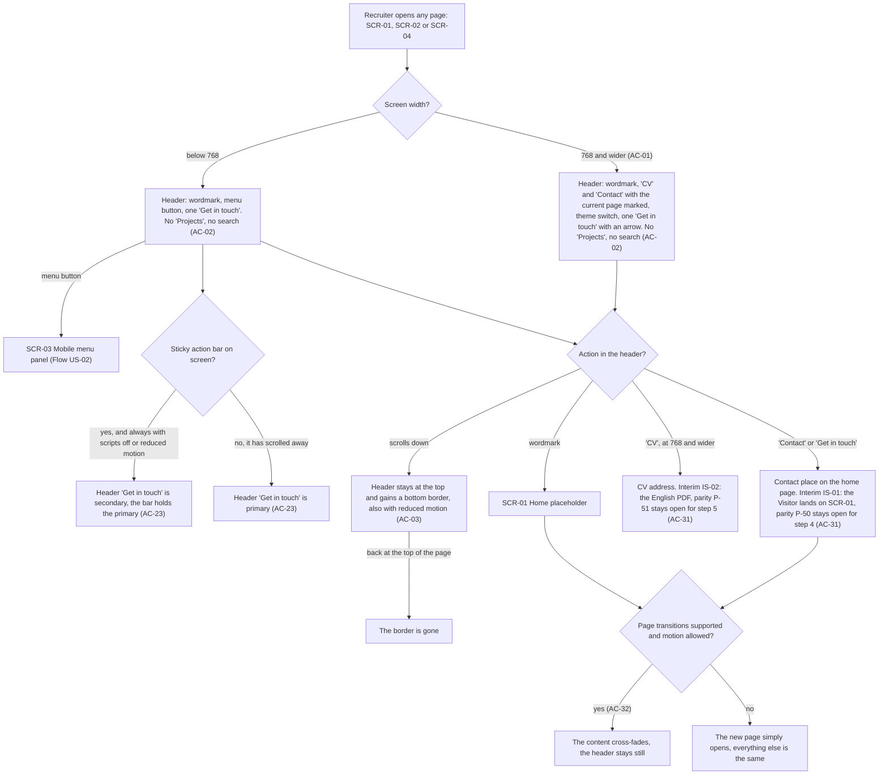

A Recruiter opens any page. Below 768 the header shows the wordmark, the menu button and one "Get in touch"; at 768 and wider it shows the wordmark, "CV" and "Contact" with the current page marked, the theme switch and one "Get in touch". Neither width shows "Projects" or a search trigger. On a phone the menu button opens the Mobile menu panel, and the header's "Get in touch" is secondary while the Sticky action bar is on screen (always so with scripts off or reduced motion) and primary once the bar has scrolled away. From the header the wordmark leads to the Home placeholder; "Contact" and "Get in touch" lead to the contact place, which for now lands on the Home placeholder (parity P-50 open); "CV" leads to the CV address, which for now answers with the English PDF (parity P-51 open). Scrolling down keeps the header at the top and gives it a bottom border, which goes away again at the top of the page, with reduced motion too. When a link opens another page of the site, the content cross-fades and the header stays still where page transitions are supported and motion is allowed; otherwise the new page simply opens.

### Flow: US-02 — Navigate on a phone

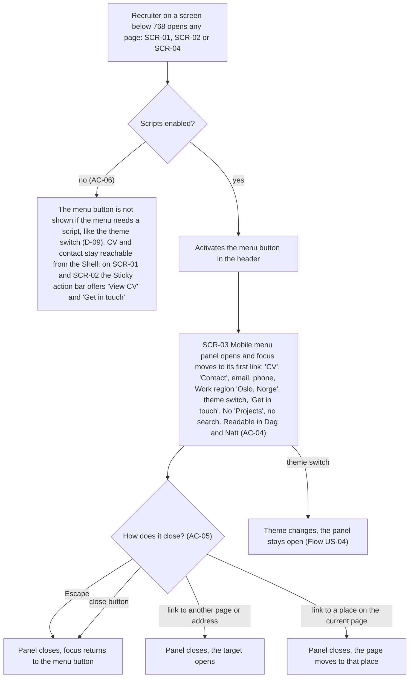

A Recruiter on a phone opens any page. With scripts off, the menu button is not shown if the menu needs a script, the same way the theme switch is not offered; the CV and the contact action are still reachable from the Shell, because the Sticky action bar offers both, so navigation never waits for a script. With scripts on, the menu button opens the Mobile menu panel and focus moves to its first link. The panel holds "CV", "Contact", the email and phone as links, the Work region "Oslo, Norge", the theme switch and "Get in touch", and no "Projects" or search. It closes in four ways: Escape and the close button close it and return focus to the menu button; a link to another page closes it and opens the target; a link to a place on the current page closes it too and moves the page there. Choosing a theme inside the panel changes the theme and leaves the panel open.

### Flow: US-03 — Keep the two main actions at hand

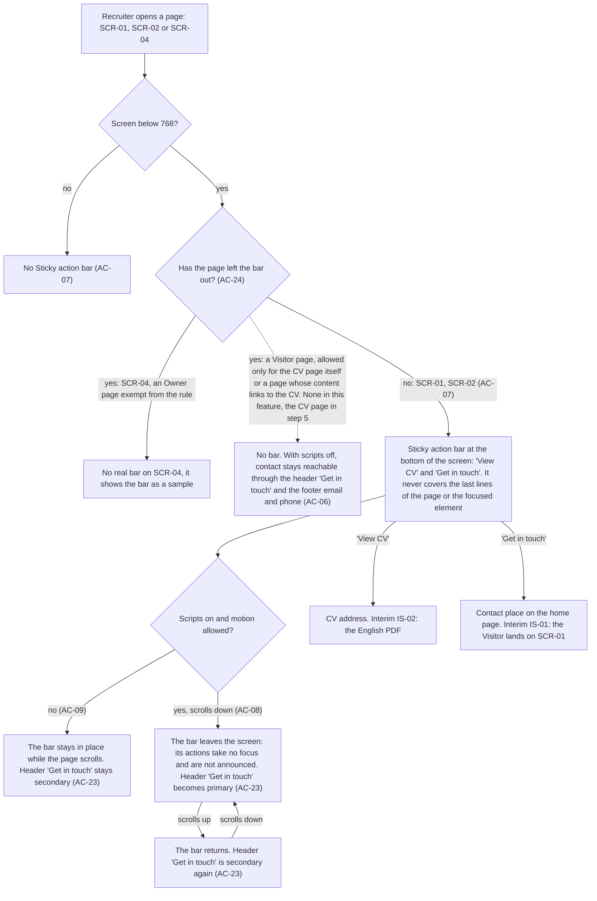

A Recruiter opens a page. At 768 and wider there is no Sticky action bar. Below 768 the Styleguide leaves the real bar out and shows it only as a sample; it is an Owner page and exempt from the rule. A page for Visitors may leave the bar out only if it is the CV page itself or its own content links to the CV; none in this feature does (the dashed branch, the CV page in step 5), and on such a page with scripts off contact stays reachable through the header "Get in touch" and the footer email and phone. On the Home placeholder and the Not-found page the bar sits at the bottom of the screen with "View CV" and "Get in touch" and never covers the end of the page or the focused element. With scripts off or reduced motion it stays in place while the page scrolls, and the header's "Get in touch" stays secondary. With scripts on and motion allowed it leaves the screen on the way down, where its two actions cannot be focused and are not announced and the header's "Get in touch" becomes primary; on the way up it returns and the header action is secondary again. "View CV" leads to the CV address (for now the English PDF) and "Get in touch" to the contact place (for now the Home placeholder).

### Flow: US-04 — Switch the theme

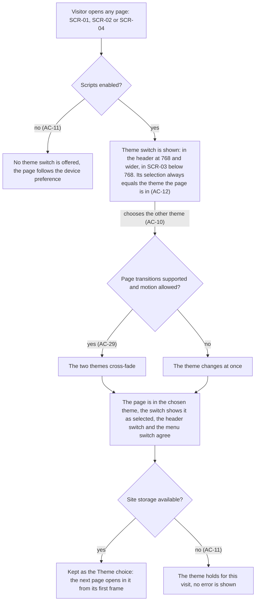

A Visitor opens any page. With scripts off no theme switch is offered and the page follows the device preference. With scripts on the switch is shown, in the header on a wide screen and in the Mobile menu panel on a phone, and whatever was stored before, its selection always equals the theme the page is in. Choosing the other theme changes the page in place: as a cross-fade where page transitions are supported and motion is allowed, at once otherwise. The switch then shows the new theme as selected, and the header switch and the menu switch agree. If site storage is available the choice is kept and the next page opens in that theme from its first frame; if storage is blocked the theme still holds for this visit and no error is shown. Choosing the first theme again does the reverse along the same path.

### Flow: US-05 — Skip to the content

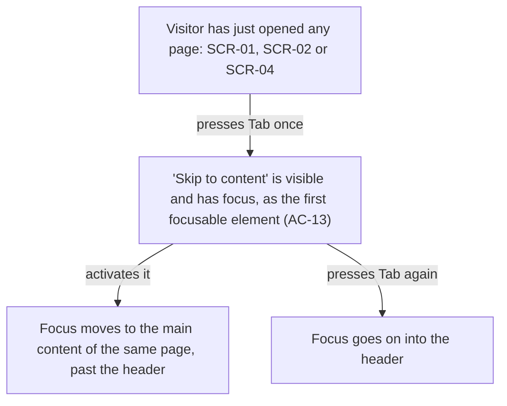

A Visitor has just opened any page and presses Tab once. A visible "Skip to content" link has focus; it is the first focusable element of the page. Activating it moves focus to the main content of the same page, past the header. Pressing Tab again instead carries on into the header as usual.

### Flow: US-06 — See who and where

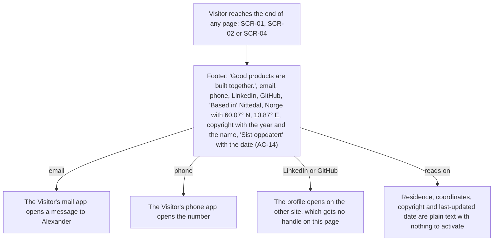

A Visitor reaches the end of any page and reads the footer: the line "Good products are built together.", the email and phone, the LinkedIn and GitHub profiles, "Based in" with the Residence and its coordinates, the copyright line and "Sist oppdatert" with the date. The email opens the Visitor's mail app and the phone their phone app. LinkedIn and GitHub open the profile on the other site, which gets no handle on the page it came from. The Residence, the coordinates, the copyright line and the date are plain text.

### Flow: US-07 — Recover from a dead link

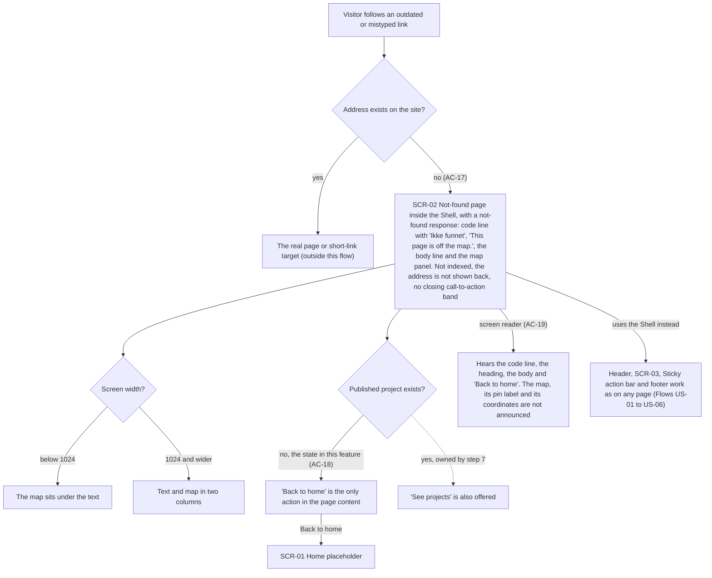

A Visitor follows a link to an address the site does not have. Known addresses and short links go to their real target and are outside this flow. Any unknown address returns a not-found response with the Not-found page inside the Shell: the code line with "Ikke funnet", the heading "This page is off the map.", the body line and the map panel. The page is not indexed, never repeats the requested address and has no closing call-to-action band. Below 1024 the map sits under the text; from 1024 they are two columns. Because no Published project exists, "Back to home" is the only action in the page content and leads to the Home placeholder; the dashed branch with "See projects" belongs to step 7. A screen reader user hears the code line, the heading, the body and "Back to home", and nothing of the map. The Shell around the page works as on any other page.

### Flow: US-08 — Be invited to get in touch

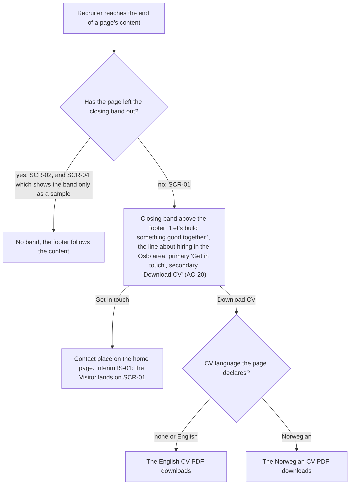

A Recruiter reaches the end of a page's content. The Not-found page leaves the closing band out, so the footer follows directly; the Styleguide leaves the real band out too and shows it as a sample. On the Home placeholder, and on later pages that keep it, the band sits above the footer with "Let’s build something good together.", the line about hiring in the Oslo area, a primary "Get in touch" and a secondary "Download CV". "Get in touch" leads to the contact place (for now the Home placeholder). "Download CV" downloads the English PDF, or the Norwegian one on a page that declares Norwegian as its CV language; no page in this feature does.

### Flow: US-09 — A reference for every component

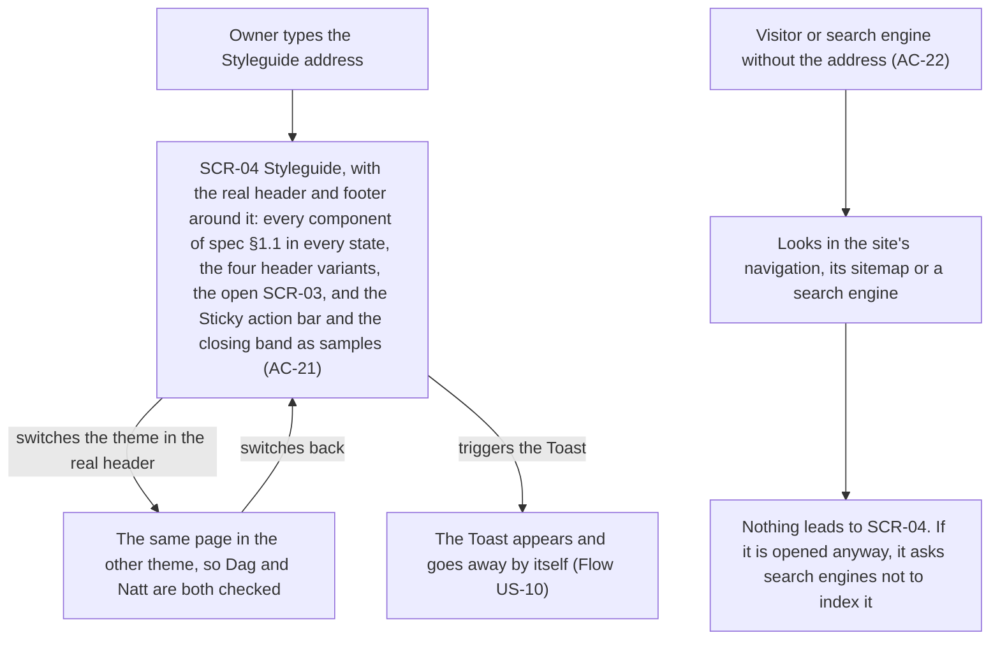

The Owner types the Styleguide address and gets the page with every component of spec §1.1 in every state it has, the four header variants, the open Mobile menu panel, the Sticky action bar and the closing band. The page has the real header and the real footer; the Sticky action bar and the closing band appear only as samples, not as real Shell parts. Switching the theme in the real header shows the same page in the other theme, so both Dag and Natt can be checked; the Owner can also trigger a Toast. A Visitor or a search engine that was not given the address finds nothing that leads there, in the navigation, the sitemap or a search engine, and the page itself asks not to be indexed.

### Flow: US-10 — Build pages without touching the Shell

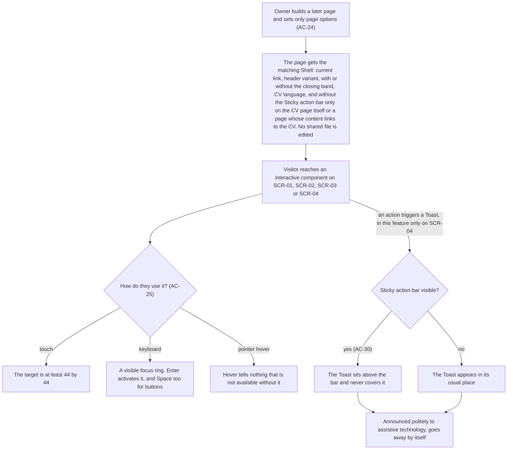

The Owner builds a later page and sets only page options: the current link, the header variant, whether the Sticky action bar and the closing band are left out, and the CV language. The Sticky action bar may be left out only on the CV page itself or on a page whose own content links to the CV. The page gets the matching Shell and no shared file is edited. A Visitor then reaches any interactive component: by touch its target is at least 44 by 44; by keyboard it shows a focus ring and works with Enter, and with Space for buttons; hover never carries information that is missing otherwise. When an action triggers a Toast (in this feature only the Styleguide does), it sits above the Sticky action bar if the bar is visible and never covers it, is announced politely and goes away by itself.

### Flow: US-14 — Calm for reduced motion

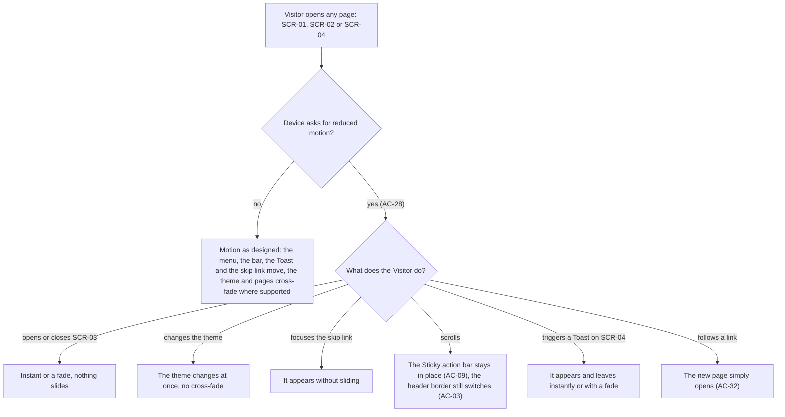

A Visitor opens any page. Without a reduced-motion preference the Shell moves as designed. With it, nothing slides, grows or loops: the Mobile menu panel opens and closes instantly or with a fade; the theme changes at once; the skip link appears without sliding; the Sticky action bar stays in place on scroll while the header border still switches, because that is a change of state; a Toast appears and leaves instantly or with a fade; and a link simply opens the new page.

### Out of scope (no human-facing UI flow)

- **US-11 — Contact facts in one place:** the Owner works in the repository and CI. The single source and its checks are build-time behaviour; the visible result is the footer (Flow US-06) and the Mobile menu panel (Flow US-02).
- **US-12 — Guardrails stay strict:** style checks run in CI, with no screen the Owner moves through.
- **US-13 — A Shell that needs no trust:** the browser enforces the security policy without any visible step. The scripts-off half of the story is visible and is drawn in Flows US-02, US-03 and US-04.

## AC coverage

| AC | Shown by | Notes |
|---|---|---|
| AC-01 | Flow US-01, branch `768 and wider (AC-01)` | Current page marked |
| AC-02 | Flow US-01, both header nodes; Flow US-02, node "SCR-03 Mobile menu panel opens" | No "Projects", no search |
| AC-03 | Flow US-01, branch `scrolls down` and `back at the top of the page` | Also in Flow US-14, branch `scrolls` |
| AC-04 | Flow US-02, node "SCR-03 Mobile menu panel opens and focus moves to its first link" | |
| AC-05 | Flow US-02, the four branches of "How does it close?" | Focus returns after Escape and the close button |
| AC-06 | Flow US-02, branch `no (AC-06)` of "Scripts enabled?"; Flow US-03, dashed branch `yes: a Visitor page` of "Has the page left the bar out?" | Met by the Sticky action bar; on a page without the bar, by the header action and the footer |
| AC-07 | Flow US-03, branch `no` of "Screen below 768?" and branch `no: SCR-01, SCR-02 (AC-07)` of "Has the page left the bar out?" | |
| AC-08 | Flow US-03, branch `yes, scrolls down (AC-08)`, then `scrolls up` | Off screen: no focus, not announced |
| AC-09 | Flow US-03, branch `no (AC-09)` | Also in Flow US-14, branch `scrolls` |
| AC-10 | Flow US-04, branch `chooses the other theme (AC-10)` to "Kept as the Theme choice" | Header and menu switches agree |
| AC-11 | Flow US-04, branch `no (AC-11)` of "Scripts enabled?" and branch `no (AC-11)` of "Site storage available?" | |
| AC-12 | Flow US-04, node "Theme switch is shown" | The six stored × device combinations are test cases for plan-tests |
| AC-13 | Flow US-05, whole flow | |
| AC-14 | Flow US-06, whole flow | |
| AC-15 | N/A: build-time single source and its check, Owner in CI, no UI | Visible result: Flow US-06 and Flow US-02 |
| AC-16 | N/A: build-time date check, Owner in CI, no UI | US-11 out of scope here |
| AC-17 | Flow US-07, branch `no (AC-17)` to SCR-02, and the "Screen width?" branches | |
| AC-18 | Flow US-07, branch `no, the state in this feature (AC-18)` | The `yes` branch is dashed: step 7 owns it |
| AC-19 | Flow US-07, branch `screen reader (AC-19)` | |
| AC-20 | Flow US-08, branch `no: SCR-01` and the "CV language" branches | SCR-02 leaves the band out; SCR-04 shows it as a sample |
| AC-21 | Flow US-09, node "SCR-04 Styleguide" and the theme branches | |
| AC-22 | Flow US-09, nodes from "Visitor or search engine without the address" | |
| AC-23 | Flow US-01, branches of "Sticky action bar on screen?"; Flow US-03, nodes for bar in place, off screen and returned | The count itself is an e2e check |
| AC-24 | Flow US-10, nodes "Owner builds a later page" and "The page gets the matching Shell" | Its options also appear as decisions in Flows US-03 and US-08 |
| AC-25 | Flow US-10, branches `touch`, `keyboard`, `pointer hover` | The Stat's final number is shown on SCR-04 (Flow US-09) |
| AC-26 | N/A: build-time style check, Owner in CI, no UI | US-12 out of scope here |
| AC-27 | N/A: browser-level enforcement with no visible step; covered by e2e in plan-tests | US-13 out of scope here |
| AC-28 | Flow US-14, branch `yes (AC-28)` and its six branches | |
| AC-29 | Flow US-04, branches `yes (AC-29)` and `no` of "Page transitions supported and motion allowed?" | |
| AC-30 | Flow US-10, branch `yes (AC-30)` of "Sticky action bar visible?" | SCR-04 has no real bar; the surface for this check is design input |
| AC-31 | Flow US-01, exit nodes "Contact place" (P-50) and "CV address" (P-51) | The release gate itself is a CI check |
| AC-32 | Flow US-01, branches of "Page transitions supported and motion allowed?" | Reduced-motion side also in Flow US-14, branch `follows a link` |
