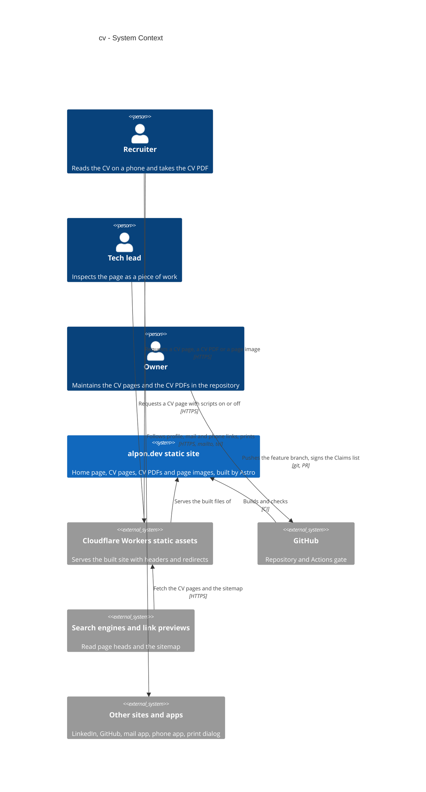
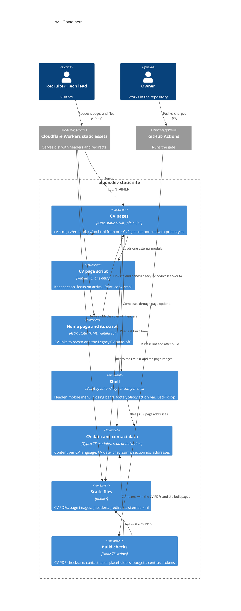
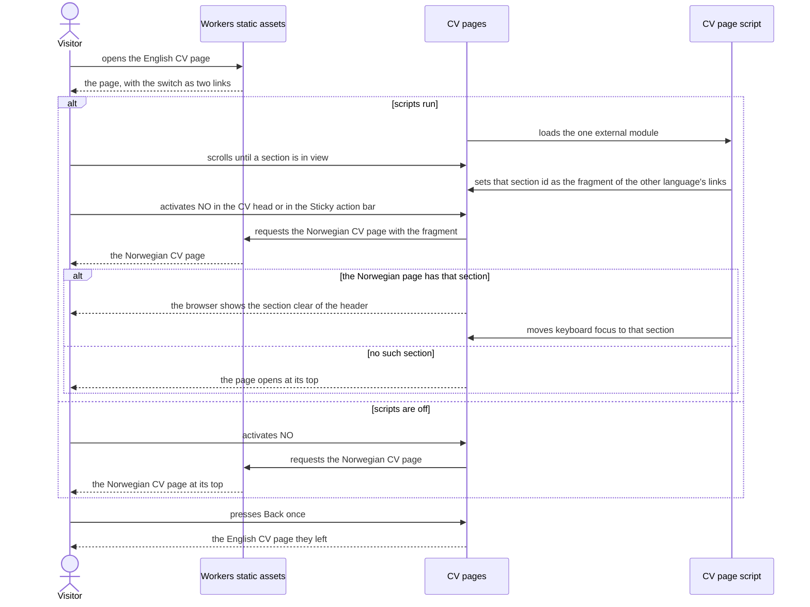

# Software Architecture Document — cv

> Upstream: [spec.md](./spec.md), [ux-flows.md](./ux-flows.md), [CONTEXT](../../../CONTEXT.md).
> Facts live in the spec; this document cites them by id (AC-xx, D-xx) and does not copy them.

## 1. Introduction and goals

**Intent.** Build one CV page per CV language from the page design, with the CV PDF as the source of truth for what the page says, so a Recruiter reads the whole CV on a phone and takes the file in that language with one action (spec §2). Every address that led to the CV keeps leading to it: the short CV address, the Shell's links and the Legacy CV addresses. The feature closes the nine stub-parity items of roadmap step 5 and adds BackToTop to the Shell.

**Top-3 quality goals (1-liners; full scenarios in §10):**

1. **Truth to the file**: a CV page cannot differ from its CV PDF in silence, and contact facts on it equal the single contact source.
2. **Complete without scripts, inside the budgets**: content and every route to the file work with scripts off; scripts only add Print, the copy-email action and the kept section, and keep the link of the current language from reloading the page.
3. **A readable print from either theme**: the printed CV is the content alone, in the light colours.

**Stakeholders.**

| Role | Interest | Sign-off owner? |
|---|---|---|
| Recruiter | Reads the CV page on a phone, takes the CV PDF | No |
| Tech lead | Judges the page as a piece of work: no-script baseline, accessibility, one primary action | No |
| Visitor | Arrives by a short address, an old link or a search result and lands on the right page | No |
| Owner | Keeps the CV page and the CV PDF in step; signs the Claims list | Yes |

**Decision overrides.**

- Decision override: internal CV links point at `/cv/en`, so the home page changes in more than its one new script (`Hero.astro` and `ExperienceList.astro` read `contact.links.cv`; `home.spec.ts` follows) — rationale: links inside the site lead to the canonical address; `/cv` stays for people who type or share it (Owner, 2026-10-09). Spec §1 "Shared files" and AC-13 are reworded to match.
- Decision override: `copy-email.ts` moves from `src/scripts/home/` to `src/scripts/shared/`, with its test and the import in `home/index.ts` — rationale: the CV side column is its second consumer, and a shared module belongs in a shared folder (Owner, 2026-10-09). Covered by the same rewording of the spec.
- Decision override: with scripts on, the link of the current language in the switch does not navigate — rationale: activating the language already shown must not reload the page or lose the reading position; with scripts off it stays a link, so the switch is still two links (Owner, 2026-10-09). Spec §1 "Bar actions" is reworded to match; AC-23 is unchanged, because nothing is absent with scripts off.

## 2. Constraints

**Technical.**
- TypeScript 5.9 (strict), Node 24 LTS, npm. Astro 6, `output: 'static'`, `build.format: 'file'`, `trailingSlash: 'never'` (repo ADR-0001).
- Cloudflare Workers static assets: `html_handling: auto-trailing-slash`, `not_found_handling: 404-page`. A rule in `_redirects` is followed even when a page exists at that path, and every matching `_headers` rule adds its headers (Cloudflare docs, Workers static assets: Redirects, Headers; checked 2026-10-09).
- Zero client JS by default, vanilla TS page scripts bundled to external files (repo ADR-0002). No datastore (repo ADR-0003).
- The security policy is one line with exactly one script hash, written by `src/integrations/csp.ts`, which also fails the build on any inline script other than the Theme bootstrap, any inline style, `style=` attribute or `on*` handler.
- `src/integrations/one-stylesheet.ts` merges only plain `<link rel="stylesheet" href="/_astro/…">` tags; a `<link media="print">` is not merged.
- Fjord tokens only (`src/styles/tokens.css` is generated by `scripts/tokens/`); Stylelint enforces it.
- No new dependency (spec §6, CV PDF checksum row).

**Organisational.**
- One phase, one pull request into `v2`; above about 20 tasks the `tasks` stage proposes a split (spec §1).
- No date; this is the last step before Release 1. At most two review rounds (`CLAUDE.md` Review policy).
- Running cost stays zero.

**Conventions.**
- `CLAUDE.md` (design rules, content rules, quality bar, workflow).
- Page options go through `BaseLayout`; Shell actions are typed descriptors (home ADR-0002); Shell state lives in DOM attributes (base-components ADR-0003).
- Pure logic sits in modules with a `*.test.ts` next to them (Vitest); `tests/` is Playwright only.

**Regulatory / external.**
- Public data only; the Owner's own personal data (spec §6.1). No third party's data, no cookie, nothing stored in the Visitor's browser by this feature.
- Non-disclosure: the client of the consulting employer is never named; the CV PDF text is cleared and repeated as it is (spec §1).

## 3. Context and scope

The site gains two CV pages and a short CV address that shows the English one. Visitors read them through Cloudflare's edge; the Owner changes them only through the repository, where the gate ties each page to the CV PDF it was checked against. The pages take no input.

<!-- brownfield: docs/architecture-map.md is stale (reflects 812f46f, before the scaffold); the current code was mapped by an explorer pass on 2026-10-09 at 5cd0cf1. -->

**External systems (in / out):**

| Actor or system | Type | Interaction |
|---|---|---|
| Recruiter, Tech lead (Visitors) | Person | Read a CV page, switch the CV language, download or open the CV PDF, print |
| Owner | Person | Replaces a CV PDF, updates the CV data and the checksum, signs the Claims list |
| Cloudflare Workers static assets | System (external) | Serves the built pages and files with the rules of `_headers` and `_redirects` |
| GitHub (repository and Actions) | System (external) | Runs the gate: lint with the CV PDF checksum check, unit tests, build, budgets, e2e, axe, visual, Lighthouse |
| Search engines and link previews | System (external) | Read the head of each CV page and the sitemap |
| Other sites and apps | System (external) | LinkedIn, GitHub and code links; mail and phone apps; the browser's print dialog |

**C4 Context (L1):**



## 4. Solution strategy

**Top strategic choices (the seeds for ADRs):**

1. **One web surface, rendered at build time.** `target_surfaces: [web-frontend]`. ux-flows.md lists six screens (SCR-01 to SCR-06) and no other surface; there is no backend, worker or API. The UI architecture is inherited: static HTML from Astro (repo ADR-0001), zero client JS by default with vanilla TS scripts (repo ADR-0002), built from the existing Fjord tokens and base components. *(Single surface, inherited UI architecture: below the ADR gate, inline.)*
2. **Three addresses, one page component.** `src/pages/cv.astro`, `src/pages/cv/en.astro` and `src/pages/cv/no.astro` each render `CvPage.astro` with a CV language. The short CV address renders the English page and names `/cv/en` as canonical (spec D-09). The three CV rules leave `public/_redirects`, because a redirect is followed even when the page exists (§2). Internal CV links, in the Shell and on the home page, point at `/cv/en`, the canonical address; `/cv` stays for people who type or share it. Serves quality goal 2. *(Addresses are fixed by the roadmap and the spec: inline.)*
3. **The page is typed data, tied to its file by a checksum.** CV content sits in typed modules per CV language next to `contact.ts`; the same module holds the CV date and the sha256 of each CV PDF. A check in `npm run lint` hashes the two files with `node:crypto` and fails naming the file and the CV page (AC-25). Contact facts are not copied into the CV data: the page reads `contact.ts`, and the built contact check covers the CV pages (AC-27). Serves quality goal 1. *(Fixed by the spec: inline.)*
4. **The language switch is navigation, and the section travels as a shared fragment id.** Both CV pages use the same language-neutral section ids. The CV page script keeps the fragment of the other language's link in step with the section in view; the browser does the arrival, so a deep link works with scripts off, Back returns in one press and an unknown id opens the page at its top. Serves quality goal 2. → [ADR-0001](./adr/0001-carry-the-section-across-the-language-switch-as-a-shared-fragment-id.md)
5. **Print is styles only, and the light colours come from the token layer.** The token generator emits a print block that re-applies the Dag set for any theme, so a print from Natt equals a print from Dag by construction. The CV page's print styles then only remove the Shell and the controls, show the contact line and control sheet breaks. Serves quality goal 3. → [ADR-0002](./adr/0002-generate-a-print-block-that-reapplies-the-dag-tokens.md)
6. **Content first, scripts add.** The Original PDF preview is a native `<details>`; BackToTop is a link; the language switch is two links; the downloads are links. Controls that need a script ("Print", "Copy") carry the existing `data-needs-script` gate and are absent when scripts are off. The one thing a script takes away is the reload when the current language is activated (§8 Language switch). The Legacy hand-off is the first statement of the home page's own script entry. Serves quality goal 2. *(Extends the home strategy and the `CONTEXT.md` invariant: inline.)*

Each tactical decision in later sections traces to one of these seeds. Tactical decisions that contradict a strategic choice are red flags and go to §11.

## 5. Building block view

Astro's file-based layering, unchanged: a page file composes `BaseLayout` and the page's components, components compose base components and read typed data, the layout composes the Shell. The CV sections are a new component group, `src/components/cv/`, because they belong to the CV pages; Breadcrumbs and the segmented language switch are general and go to `src/components/ui/`. BackToTop is a Shell part in `src/components/layout/`. Client logic is pure modules in `src/scripts/cv/` behind one script entry.

**Internal decomposition:**

```
public/
├── _headers                 `/cv/*` removed; explicit rules (§8 Response headers)
├── _redirects               the three CV rules removed; /linkedin and /github stay
├── sitemap.xml              + /cv/en and /cv/no (hand-written, as today)
└── cv/                      unchanged: two CV PDFs, four page images
scripts/
├── check-cv-pdf.ts          new: sha256 of each CV PDF against the CV data; in `npm run lint` as check:cv (AC-25)
├── check-contact.ts         built half also reads dist/cv.html, dist/cv/en.html, dist/cv/no.html (AC-27)
├── check-budgets.ts         page groups: the three CV addresses are one page (§8 Script budgets)
├── contrast-pairs.ts        + pairs of the new components
└── tokens/                  generator emits the print block                                   ADR-0002
src/
├── data/
│   ├── contact.ts           links.cvPages { en: '/cv/en', no: '/cv/no' }; links.cv becomes '/cv/en'
│   ├── shell-actions.ts     BarAction becomes a link or a language switch; a link may carry `lang`   home ADR-0002
│   ├── samples.ts           + marked sample CV data for the Styleguide (AC-29)
│   └── cv/
│       ├── types.ts         Cv, CvSection, CvJob, ClientProject, DatedRow, SkillGroup, labels
│       ├── en.ts, no.ts     content and page labels per CV language, title and description
│       ├── sections.ts      the shared section ids, in order                                   ADR-0001
│       └── index.ts         cvDate, cvPdf { en, no }: href, download name, sha256, page images
├── scripts/
│   ├── cv/                  new, pure modules, one entry
│   │   ├── index.ts         entry imported by CvPage.astro
│   │   ├── section-in-view.ts   which section id is in view, or none above the first
│   │   ├── lang-switch.ts   sets the fragment of the other language's links; stops the current one   ADR-0001
│   │   ├── arrive.ts        focus on the section the fragment names, if it is a CV section
│   │   └── print.ts         "Print" calls the browser's print
│   ├── shared/copy-email.ts moved from home/: second consumer (CV side column)
│   └── home/
│       ├── legacy-cv.ts     new: exact map of the two Legacy CV addresses to the CV pages
│       └── index.ts         first statement: replace the location when legacy-cv names a target (AC-13)
├── components/
│   ├── cv/                  new: CvPage, CvHead, OriginalPdfPreview, CvSection, SkillGroup, LanguageList,
│   │                        CvJob, DatedRows, CvProjects, CvAside (contents list, contact list, download),
│   │                        PrintContactLine
│   ├── ui/                  + Breadcrumbs, LangSwitch (two links, segmented)
│   └── layout/              + BackToTop; Header and MobileMenu (CV link by page option, menu marker);
│                            MobileBar (language-switch action, `lang` on a link)
├── layouts/BaseLayout.astro + canonical, alternates, backToTop; Shell parts marked English on a Norwegian page
├── styles/                  tokens.css regenerated (print block); base.css + BackToTop reserve
└── pages/
    ├── cv.astro             short CV address: English page, canonical /cv/en          (SCR-05)
    ├── cv/en.astro          (SCR-05)
    ├── cv/no.astro          (SCR-06)
    ├── index.astro          "View CV" and "Full CV" read contact.links.cv              (SCR-01)
    └── styleguide.astro     + a section per new component and BackToTop                (SCR-04)
tests/
├── e2e/                     cv, cv-lang-switch, cv-preview, cv-print, back-to-top, legacy-cv, headers,
│                            primary-count (+ CV pages, B-35), parity (P-01 to P-03 rewritten, six items on)
├── a11y/                    axe on both CV pages: Dag and Natt, scripts on and off, preview closed and open
└── visual/                  both CV pages + new Styleguide sections; home and Not-found re-baselined (BackToTop)
```

`CLAUDE.md` "Project structure" gains `components/cv/`, `data/cv/`, `scripts/cv/` and `scripts/shared/` with this feature.

**Page options (changes to the `BaseLayout` contract).** Existing options keep their meaning unless listed.

| Option | Values | Default | Effect |
|---|---|---|---|
| `canonical` | site path | the page's own path | Overrides the computed canonical address and `og:url`. `cv.astro` passes `/cv/en` |
| `alternates` | list of `{ hreflang, href }` | none | One `<link rel="alternate" hreflang>` each. All three CV page files pass `en`, `no` and `x-default` (the English page), AC-17 |
| `lang` | `'en'` \| `'no'` | `'en'` | Extended: when it is `'no'`, every Shell part is rendered with `lang="en"` (AC-02) |
| `cvLang` | `'en'` \| `'no'` | `'en'` | Extended: with `current="cv"` the "CV" link of the header and the mobile menu leads to `links.cvPages[cvLang]` (AC-16) |
| `mobileBarActions` | pair of `BarAction` | the default pair | Extended type: one slot may be a language switch (two links, current marked); a link may carry `lang`. Still no style field |
| `backToTop` | boolean | `true` | Renders BackToTop. The Styleguide passes `false` and shows it as a sample |

**Section ids** (ADR-0001): `profile`, `skills`, `languages`, `experience`, `projects`, `education`, `courses`, `community`. A CV page renders the ones its CV PDF has, numbered in the order shown.

**C4 Container (L2):**



## 6. Runtime view

Seeded here: the one flow with a moving part. The `sequences` stage covers the remaining ACs.

**Critical flow 1: switch the CV language and keep the section (AC-07, AC-08)**



**Critical flow 2: Legacy CV hand-off (AC-13, AC-14)** — the home page's script entry reads the fragment first; for exactly `#cv` or `#cv-no` it replaces the location with the CV page, so Back skips the home page; for anything else it continues as before. Drawn in full by `sequences`.

## 7. Deployment view

<!-- N/A: reuses the existing deployment unit (Workers static assets from dist/), no infra change. The feature changes two files the edge reads, public/_headers and public/_redirects; their rules are in §8. -->

## 8. Crosscutting concepts

Repo defaults apply (logging, auth, ids, events: none on a static site). The rows below are the ones this feature adds or changes.

| Concept | Convention | Where defined |
|---|---|---|
| Addresses | `/cv`, `/cv/en`, `/cv/no` are pages; `/cv` is canonical to `/cv/en`. Internal links use `contact.links.cv` (`/cv/en`) or `links.cvPages[cvLang]`; no component writes a CV address as a literal | here; `src/data/contact.ts` |
| Response headers | `/cv/*` is removed, because matching rules add up and it would give the pages the one-hour rule. Explicit rules instead: `/cv`, `/cv/en`, `/cv/no` get the rule of `/`; each of the two CV PDFs and four page images gets the one-hour rule by its full path; the PDFs keep `Content-Disposition: inline` with their file names (AC-18) | `public/_headers`; `tests/e2e/headers.spec.ts` |
| Internationalisation | The CV language is a page property: `<html lang>`, title, description, labels and content. The Shell stays English and is marked `lang="en"` on the Norwegian page; the two bar actions the Norwegian page sets carry `lang="no"` (AC-02, AC-19) | here; `BaseLayout` |
| Current page | `aria-current="page"` on "CV" in the header and the mobile menu. Menu marker: an accent rule at the start of the row plus the semibold weight, so it differs by more than colour (AC-20). In the language switch the current language carries `aria-current="true"` | `Header`, `MobileMenu`, `LangSwitch` |
| Language switch | Two links with scripts off. With scripts on, the link of the current language does not navigate (the script stops it, no reload and no jump); the other link carries the section fragment (ADR-0001). The bar's switch is the same markup and the same script hooks | `LangSwitch`, `src/scripts/cv/lang-switch.ts` |
| Script-only controls | "Print" and "Copy" carry `data-needs-script`, the existing scripts-off gate in `base.css`; no new mechanism | base-components; `base.css` |
| Original PDF preview | Native `<details>`; each page image is `` with `width` and `height` inside a link that opens the CV PDF in a new tab with its own name. No script. A failed image leaves the link and its reserved box (AC-09, AC-10) | `OriginalPdfPreview` |
| Print | One `@media print` block in the CV page's own stylesheet (a separate `<link media="print">` would escape the one-stylesheet merge). It hides everything outside `<main>` and the screen-only parts inside it, shows the contact line, keeps entries whole (`break-inside: avoid`) and headings with their content (`break-after: avoid`), and prints the address of links to other sites. Colours come from the generated print block (ADR-0002). No `@page` rule: it cannot read custom properties, so sheet margins stay the browser's | `src/components/cv/`; `tokens.css` |
| BackToTop | A Shell link to `#top` (no element has that id, so the browser scrolls to the top and resets the focus start), `position: fixed`, from 768 only. Appearance by `animation-timeline: scroll()` under `@supports`, animating opacity and visibility; without support it is always visible; with reduced motion no movement. Its space is reserved the way `base.css` reserves the Sticky action bar's: `scroll-padding-bottom` plus a block at the end of the page (AC-21, AC-22) | `BackToTop`, `base.css` |
| Script budgets | The budget check counts a file as a page's own when only pages of one page group load it; `/cv`, `/cv/en` and `/cv/no` are one group. Today any file two pages load counts as Shell, which would put the CV page script in the Shell budget | `scripts/check-budgets.ts` |
| Security policy | Unchanged: no new source, no inline script or style. Both new scripts are bundled modules; the hand-off knows two exact fragments and two fixed targets; arrival focus honours only ids of CV sections | `tests/contracts/csp.contract.json`; spec §6.1 |
| Checksum gate | `check:cv` runs in `npm run lint` before `astro check`; it reads the two files and the CV data and extracts no text | `scripts/check-cv-pdf.ts` |

## 9. Architecture decisions

| # | Title | Status | Section |
|---|---|---|---|
| 0001 | Carry the section across the language switch as a shared fragment id | Accepted | §4 |
| 0002 | Generate a print block that re-applies the Dag tokens | Accepted | §4 |

ADR files live under `docs/features/cv/adr/NNNN-<title>.md`. Decisions this feature builds on: repo ADR-0001 to 0003, fjord-foundation ADR-0002 (one CSP hash), base-components ADR-0003 (state in DOM attributes), home ADR-0002 (Shell actions as typed descriptors).

## 10. Quality requirements

Numbers are the rows of spec §6, cited as they stand.

**QG-1. Truth to the file**
- **When:** the Owner replaces a CV PDF and the gate runs without the recorded checksum being updated; or a CV page states a contact fact differently from the contact source.
- **Then:** the gate fails on 2 of 2 replaced files in a test with a changed file and adds 0 dependencies (spec §6 "CV PDF checksum"); the contact check fails (AC-27); 0 bracketed placeholders on the CV pages (spec §6 "Placeholders").
- **How verify:** unit test of `check-cv-pdf` with a changed fixture file; `package.json` diff; `check:contact:built` and `check:placeholders` on the three built CV files in CI.

**QG-2. Complete without scripts, inside the budgets**
- **When:** a Visitor opens a CV page with scripts off, or on a phone over a mobile connection.
- **Then:** everything AC-23 lists is usable; 0 axe violations on both CV pages in Dag and Natt, with scripts on and off, with the Original PDF preview closed and open; initial JS ≤ 50 KB gzip in total on a CV page, the CV page's own scripts ≤ 10 KB gzip, the home page's own scripts, the hand-off included, stay ≤ 10 KB gzip, Shell scripts stay ≤ 5 KB gzip; 0 requests for a page image before the Original PDF preview is opened; Lighthouse mobile Performance, Accessibility, Best Practices, SEO each ≥ 95 with LCP ≤ 2.0 s, CLS ≤ 0.02, TBT ≤ 100 ms on both CV pages; with scripts on, the other CV page opens at the section in view for each of the sections both pages have, the heading 0 px under the header.
- **How verify:** Playwright e2e with JavaScript disabled; axe in Playwright; `check-budgets` with page groups in CI; e2e request log; Lighthouse CI (mobile) on the built site; e2e per section for the language switch.

**QG-3. A readable print from either theme**
- **When:** a Visitor prints a CV page from Dag or from Natt, by "Print" or by the browser's menu.
- **Then:** in print media, started from Dag and from Natt: 0 Shell parts and controls rendered; the contact line rendered once; background of the sheet white; 0 entries split across sheets on A4 (spec §6 "Print").
- **How verify:** e2e in print media (computed styles from both themes) and a printed-PDF check through Playwright's PDF output; manual print in two browsers recorded in the PR.

## 11. Risks and technical debt

| Risk / debt | Severity | Mitigation | Owner |
|---|---|---|---|
| `/cv` must be served from `dist/cv.html` while the folder `dist/cv/` exists beside it; not confirmed in the Cloudflare docs for this exact shape | Medium | First task builds the three empty pages and runs the rewritten P-01 to P-03 against `wrangler dev`; if `/cv` does not resolve, the short address becomes `src/pages/cv/index.astro` and the spec's "no redirect" wording is re-checked with the Owner | Owner |
| Page images inside a closed `<details>` with `loading="lazy"`: "no request before opening" is checked only in the browsers Playwright runs | Medium | e2e request log (AC-09); manual check in Firefox and Safari recorded in the PR; if a browser requests them early, the result is a performance cost, not a broken page | Owner |
| The budget check classifies by "two or more pages"; without page groups the CV page script lands in the 5 KB Shell budget, and a shared `copy-email` chunk loaded by home and CV counts as Shell | Medium | Page groups in `check-budgets.ts` with a unit test; the shared chunk is small and is reported by the check; if the Shell budget is exceeded, the copy action stays duplicated per page entry | Owner |
| The print block changes how every page prints (home and Not-found print in the light colours too); wider than the spec's scope | Low | Accepted in ADR-0002; no print styles are added to other pages; the token generator's tests cover the block | Owner |
| A Visitor from a Legacy CV address sees the home page for a moment before the hand-off, because the home script is a deferred module | Low | Accepted (Owner, 2026-10-09): no blocking script is added to the home page for a rare arrival; the history entry is replaced, so Back is right | Owner |
| Internal CV links move from `/cv` to `/cv/en`: assertions on `href="/cv"` change in `hero.test.ts`, `BaseLayout.test.ts`, `tests/e2e/action-bar.spec.ts`, `home.spec.ts` and `shell.spec.ts`; `Hero.astro` and `ExperienceList.astro` stop writing the literal | Low | One task; tests that read `contact.links.cv` follow the data by themselves | Owner |
| Sheet margins cannot come from Fjord tokens (`@page` reads no custom properties) | Low | No `@page` rule; compactness comes from token sizes in the CV page's own print styles; checked in the manual print | Owner |
| Explicit `_headers` rules name six files: a new file in `public/cv/` gets no cache rule until one is added | Low | `headers.spec.ts` lists the files of `public/cv/` and fails on one without the rule | Owner |
| `animation-timeline` is not supported everywhere | Low | By design: without support BackToTop is always visible (AC-21); visual tests pin the supported state | Owner |
| `docs/architecture-map.md` is stale (reflects 812f46f) | Low | Run `/sdd:survey` after this feature merges | Owner |

**Accepted debt (acceptable in v1, plan to fix later):**
- Comparing the text of a CV page with its CV PDF stays the Owner's manual check; the checksum only proves that the file did not change unnoticed (spec §3).
- `public/sitemap.xml` stays hand-written; a sitemap integration is chosen when the page count grows (steps 7 and 8).

## 12. Glossary

Canonical definitions are in [CONTEXT](../../../CONTEXT.md); this table lists the terms the document uses.

| Term | Meaning |
|---|---|
| CV page, CV PDF, CV language, CV date | As in `CONTEXT.md` |
| Original PDF preview | As in `CONTEXT.md` |
| Legacy CV address | As in `CONTEXT.md` (`#cv`, `#cv-no` on the home page) |
| Shell, Sticky action bar, Styleguide, Claims list | As in `CONTEXT.md` |
| Residence, Work region | As in `CONTEXT.md` |
| Dag, Natt, Fjord token, Theme bootstrap, No-JS Natt block | As in `CONTEXT.md` |
| Short CV address, Section id, Page group, Print block | As in `CONTEXT.md` (added with this design; ADR-0001 for Section id, ADR-0002 for Print block) |
