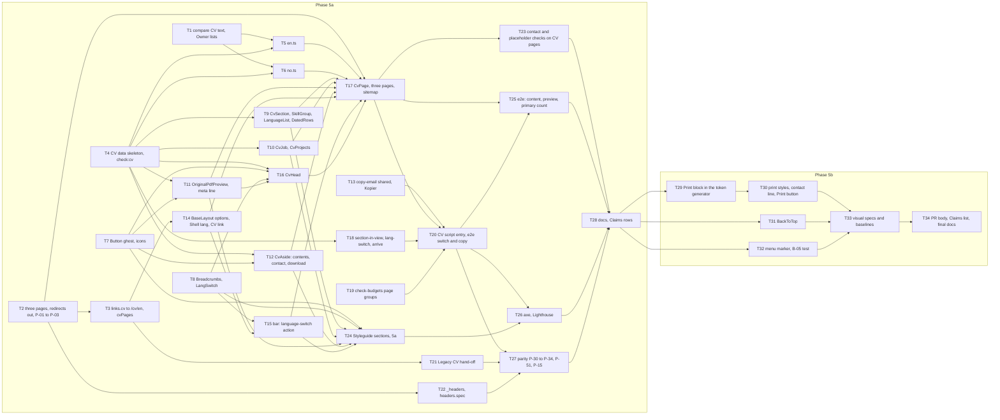

# Epic — cv

> **Spec:** [spec.md](../spec.md) · **Design:** [sad.md](../sad.md) · **Screens:** [screens.md](../screens.md) · **UX flows:** [ux-flows.md](../ux-flows.md) · **API:** N/A (static site, no external interface) · **Data model:** N/A (no datastore, repo ADR-0003) · **ADRs:** [adr/](../adr/)

## Goal

Build one CV page per CV language from the page design, with the CV PDF as the source of truth, so a Recruiter reads the whole CV on a phone and takes the file in that language with one action ([spec §2](../spec.md)). Keep every address that led to the CV working, tie each page to its file by a checksum in the gate, and close the nine stub-parity items of roadmap step 5, the last step before Release 1.

## Scope

- **In:** the `web-frontend` surface only (`target_surfaces` in [sad.md](../sad.md)): `ui` tasks for the CV sections, the Shell changes and the screens SCR-01 to SCR-06; typed CV data and addresses as `domain`; page scripts as `app`; page composition, `BaseLayout` options, response headers and the token generator as `wiring`; build checks, e2e, axe, visual and parity as `tests`; `docs`.
- **Out** ([spec §3](../spec.md)): generating the CV PDF or extracting its text in the build; an embedded PDF viewer; a separate "Open PDF" button; aligning the two CV languages or the home page with the CV; the "Projects" link, "Search", analytics and the Message form; BackToTop below 768. No `migration`, `infra` or `ports` layer: there is no datastore and no API.

## Phases

34 tasks, above the "about 20" of [spec §1](../spec.md). Decided by the Owner on 2026-10-09: **one breakdown in two phases as a work order only**. One branch (`feat/cv`) and one pull request into `v2`. It is opened as a draft at the start of T33, because the `visual-baselines` workflow needs an open pull request, and is marked ready for review after T34; there is no pull request after phase 5a and no second one. The tasks stay as fine as they are and are not merged to lower the count.

- **Phase 5a (T1 to T28):** the CV pages, their data and checks, the language switch, the Legacy CV hand-off, the response headers and the parity items. It depends on nothing in 5b.
- **Phase 5b (T29 to T34):** Print, BackToTop, the marker of the current link in the mobile menu, the draft pull request with the visual baselines, and the pull request body. T29, T31 and T32 depend on T28, so 5b starts when 5a is closed.

Until 5b lands, AC-11, AC-12, AC-21 and AC-22 are open, and AC-20 and AC-29 hold only in part (the header's link and `aria-current` from T14; the Styleguide sections of T24).

## Task map

The same DAG as [tasks.json](../tasks.json). Waves by dependency:

1. T1 ∥ T2 ∥ T4 ∥ T7 ∥ T8 ∥ T13 ∥ T19
2. T3 ∥ T5 ∥ T6 ∥ T9 ∥ T10 ∥ T11 ∥ T12 ∥ T18 ∥ T22
3. T14 ∥ T16 ∥ T21
4. T15
5. T17 ∥ T24
6. T20 ∥ T23
7. T25 ∥ T26 ∥ T27
8. T28
9. T29 ∥ T31 ∥ T32
10. T30
11. T33
12. T34

Lanes that `implement` serializes because the files overlap:

- T1 → T28 → T34: `docs/features/cv/owner-inputs.md`
- T2 → T17: `src/pages/cv.astro`, `src/pages/cv/en.astro`, `src/pages/cv/no.astro`
- T2 → T27: `docs/stub-parity.md`, `tests/e2e/parity.spec.ts`
- T3 → T14 → T31: `src/layouts/BaseLayout.test.ts`
- T7 → T8 → T31 → T32: `scripts/contrast-pairs.ts`
- T13 → T21: `src/scripts/home/index.ts`
- T14 → T15 → T31: `src/layouts/BaseLayout.astro`
- T14 → T31: `src/components/layout/static-parts.test.ts`
- T14 → T32: `src/components/layout/MobileMenu.astro`, `src/components/layout/menu.test.ts`
- T16 → T30: `src/components/cv/CvHead.astro`, `src/components/cv/head.test.ts`
- T17 → T20 → T30: `src/components/cv/CvPage.astro`
- T20 → T30: `src/scripts/cv/index.ts`
- T23 → T30: `scripts/check-contact.test.ts`, `scripts/check-contact.ts`
- T23 → T33: `.github/workflows/ci.yml`
- T24 → T30 → T31 → T32: `src/pages/_styleguide.test.ts`, `src/pages/styleguide.astro`
- T28 → T32: `docs/backlog.md`
- T28 → T34: `docs/design-system.md`

## Tasks

See [tracker.md](./tracker.md) for status, owner and estimate. Machine contract: [tasks.json](../tasks.json).

| # | Task | Layer | Blocked by | ACs |
|---|---|---|---|---|
| T1 | [Compare the design's CV text with the two CV PDFs and list the differences for the Owner](./t01-compare-cv-text.md) | docs | — | AC-26 |
| T2 | [Serve the three CV addresses as pages and rewrite P-01 to P-03](./t02-cv-addresses-as-pages.md) | wiring | — | AC-15, AC-28 |
| T3 | [Point every internal CV link at the canonical CV address through the contact data](./t03-internal-cv-links.md) | domain | T2 | AC-16 |
| T4 | [Add the CV data skeleton and the CV PDF checksum check to the lint gate](./t04-cv-data-and-checksum.md) | domain | — | AC-05, AC-25 |
| T5 | [Write the English CV data from the text the Owner confirmed](./t05-cv-data-en.md) | domain | T1, T4 | AC-01, AC-03, AC-26 |
| T6 | [Write the Norwegian CV data from the current Norwegian CV PDF](./t06-cv-data-no.md) | domain | T1, T4 | AC-02, AC-03, AC-26 |
| T7 | [Add the ghost Button variant and the icons the CV page needs](./t07-button-ghost-and-icons.md) | ui | — | AC-06, AC-24 |
| T8 | [Build Breadcrumbs and the LangSwitch as two links](./t08-breadcrumbs-and-lang-switch.md) | ui | — | AC-01, AC-07 |
| T9 | [Build CvSection, SkillGroup, LanguageList and DatedRows](./t09-cv-section-parts.md) | ui | T4 | AC-01, AC-03 |
| T10 | [Build CvJob and CvProjects](./t10-cv-job-and-projects.md) | ui | T4 | AC-01, AC-03 |
| T11 | [Build the Original PDF preview and the meta line](./t11-original-pdf-preview.md) | ui | T4, T7 | AC-05, AC-09, AC-10 |
| T12 | [Build the side column: contents list, contact list and the second download](./t12-cv-aside.md) | ui | T4, T7 | AC-02, AC-04 |
| T13 | [Move copy-email to scripts/shared and let it follow the language of the page](./t13-copy-email-shared.md) | app | — | AC-02, AC-04, AC-23 |
| T14 | [Add canonical, alternates and cvLang to BaseLayout and mark the Shell English on a Norwegian page](./t14-layout-cv-options.md) | wiring | T3 | AC-02, AC-16, AC-17, AC-20 |
| T15 | [Let the Sticky action bar take a language switch and a link with a language](./t15-bar-language-switch.md) | ui | T8, T14 | AC-19 |
| T16 | [Build the CV head](./t16-cv-head.md) | ui | T4, T7, T8, T11 | AC-01, AC-02, AC-05, AC-06 |
| T17 | [Compose CvPage, give the three pages their head and list them in the sitemap](./t17-cv-page-composition.md) | wiring | T2, T5, T6, T9, T10, T11, T12, T14, T15, T16 | AC-01, AC-02, AC-04, AC-17, AC-20 |
| T18 | [Write the pure modules of the CV page script](./t18-cv-script-modules.md) | app | T4 | AC-08 |
| T19 | [Teach the budget check that the three CV addresses are one page](./t19-budget-page-groups.md) | tests | — | AC-23 |
| T20 | [Wire the CV page script and check the language switch and the copy action on the page](./t20-cv-script-entry.md) | app | T13, T17, T18, T19 | AC-04, AC-08, AC-19, AC-23 |
| T21 | [Hand the Legacy CV addresses over from the home page](./t21-legacy-cv-handoff.md) | app | T3 | AC-13, AC-14 |
| T22 | [Give the CV pages, the CV PDFs and the page images their response headers](./t22-cv-response-headers.md) | wiring | T2 | AC-18 |
| T23 | [Extend the contact check and the placeholder check to the built CV pages](./t23-cv-built-checks.md) | tests | T17 | AC-03, AC-27 |
| T24 | [Show the components of phase 5a on the Styleguide with marked sample data](./t24-styleguide-cv-components.md) | ui | T7, T8, T9, T10, T11, T12, T15 | AC-29 |
| T25 | [Check the CV pages end to end: content, downloads, preview, primary count and targets](./t25-cv-e2e.md) | tests | T17, T20 | AC-01, AC-02, AC-03, AC-04, AC-05, AC-06, AC-09, AC-10, AC-16, AC-23, AC-24 |
| T26 | [Run axe and Lighthouse on both CV pages](./t26-cv-axe-and-lighthouse.md) | tests | T20, T24 | AC-24 |
| T27 | [Switch on the CV parity items with their reworded behaviour](./t27-cv-parity.md) | tests | T20, T21, T22 | AC-28 |
| T28 | [Record the CV update rule and bring the documents in step with phase 5a](./t28-cv-docs.md) | docs | T23, T25, T26, T27 | AC-25, AC-26 |
| T29 | [Emit the Print block that re-applies the Dag tokens](./t29-tokens-print-block.md) | wiring | T28 | AC-12 |
| T30 | [Build the printed CV: print styles, the contact line and the Print button](./t30-cv-print.md) | ui | T29 | AC-06, AC-11, AC-12, AC-27, AC-29 |
| T31 | [Add BackToTop to the Shell with its reserve](./t31-back-to-top.md) | ui | T28 | AC-21, AC-22, AC-29 |
| T32 | [Mark the current link in the mobile menu and check the header's marker on the rendered page](./t32-menu-current-marker.md) | ui | T28 | AC-20, AC-29 |
| T33 | [Add the visual tests of the CV pages and re-take the baselines BackToTop changed](./t33-cv-visual-baselines.md) | tests | T30, T31, T32 | AC-24, AC-29 |
| T34 | [Write the pull request body with the Claims list and close the documents](./t34-cv-pr-body.md) | docs | T33 | AC-11, AC-24, AC-26 |

## Risks / Hard rules

- **The Owner sees the text first** ([spec §1 Content source](../spec.md), AC-26): no CV page is built from text the Owner has not seen compared. `implement` stops after T1 and waits for the decisions; T5 and T6 are blocked until then. The other root tasks (T2, T4, T7, T8, T13, T19) can run meanwhile.
- **The short CV address is unproven** ([sad §11](../sad.md)): T2 checks that `/cv` is served from `dist/cv.html` beside `dist/cv/`. If it is not, stop and tell the Owner before anything else builds on it.
- **Security policy is not changed** ([spec §6.1](../spec.md), AC-13, AC-23): `tests/contracts/csp.contract.json` is not edited; no inline script, inline style, `style=` or `on*=`. T22 changes cache and disposition rules in `public/_headers`, not the policy line. If a task needs to change the contract, stop and tell the Owner.
- **Tokens only** (`CLAUDE.md`, base-components ADR-0004): no literal colour, size, space, radius, duration or easing in any style, print styles included. A function or at-rule outside the stylelint allow lists (`animation-timeline` in T31) enters only with a recorded row in that ADR and a rejecting fixture. No `@page` rule ([sad §8 Print](../sad.md)).
- **Content first** ([sad §4 item 6](../sad.md)): every section, the switch, the downloads and the preview work with scripts off. Script-only controls ("Print", "Copy") sit behind the existing `data-needs-script` gate. Scripts add no class and no inline style (base-components ADR-0003).
- **One primary** (AC-06): "Download PDF" in the CV head is the only primary button of the page content; the side column's download, the contact button, "Print" and both bar actions are not. The bar's action type has no style field (home ADR-0002).
- **Facts:** contact facts only from `src/data/contact.ts`, never copied into the CV data; no bracketed placeholder on a CV page; every number and date is a Claims row the Owner ticks (T28, T34). The client of the consulting employer and its events are never named.
- **CV addresses are data** ([sad §8 Addresses](../sad.md)): no component writes a CV address as a literal.
- **Read-only sources:** `design/` is never edited. The CV PDFs, the page images, the `.vcf` and the QR files are not regenerated. No new npm dependency (spec §6, CV PDF checksum row).
- **Home changes are limited** ([spec §1 Shared files](../spec.md)): the hand-off script (T21), the address of its two CV links (T3) and the move of `copy-email` (T13). `src/data/home.ts` is not changed to match the CV.
- **Visual baselines are Linux-only** and come last (T33), because BackToTop (T31) changes every page from 768. They are written only by the `visual-baselines` workflow, reviewed by the Owner, never written with the local Docker command and never from Windows. T33 runs as on home: `implement` pushes once after a green gate and opens the pull request `feat/cv` → `v2` as a draft (the visual check is red, as expected), stops and asks the Owner to add the `visual-baselines` label; then it downloads the artifact, replaces the PNG folders, the Owner reviews the PNG files, the label is removed, and the baselines are committed and pushed. From T17 the CV pages have no baseline and from T31 the home and Not-found baselines are stale, so `implement` does not push before T33. The draft is marked ready for review after T34.
- **Budgets are reported, not bent** ([spec §6](../spec.md)): CV page scripts above 10 KB gzip, home scripts above 10 KB, Shell scripts above 5 KB or a failed Lighthouse number goes to the Owner before any limit changes (T13, T19, T20, T26).
- **Parity items are reworded, never deleted** (AC-28): the set of ids in `tests/e2e/parity.spec.ts` and `docs/stub-parity.md` is the same before and after (T2, T27).
- **Review policy** (`CLAUDE.md`): at most two review rounds; non-blocking findings go to `docs/backlog.md`.
