# UX flows — cv

> User flows for every UI-touching §4 user story of [spec.md](./spec.md), produced by `ux-flows`
> (after `clarify`, before `design`) and read by `design` (target-surface evidence), `sequences`,
> `screens` (details every inventory row) and `plan-tests` (the e2e-through-UI paths).
> Flow altitude only: movement between screens and the branches the ACs demand. No layout, no
> components, no styling.

## Platform decisions

- **Posture:** mobile-first, per `docs/design-system.md` (confirmed by the Owner, 2026-10-09). The phone path is drawn first; the flows branch at 768 (the Sticky action bar leaves, BackToTop arrives) and at 1024 (the side column appears beside the content; below 1024 it is not shown, screens C-1).
- **Two pages, three addresses:** the CV is one page per CV language. The short CV address shows the English CV page and is an entry of that screen, not a screen of its own (spec D-09).
- **Page shape:** a CV page is one long page. Its head, its numbered sections, the side column and the Original PDF preview are places on one screen; a Visitor moves between them by scrolling or by a link of "On this page".
- **Language switch:** navigation between the two CV pages, not a change in place (spec D-02). Where scripts run it keeps the section; with scripts off it opens the other page at its top.
- **Original PDF preview:** opens and closes in place on the CV page, with scripts on or off. The CV PDF itself opens in a new tab and is an exit of these flows, not a screen.
- **Download:** "Download PDF" and the closing band's "Download CV" save a file and open nothing.
- **Print:** leaves the site for the browser's print dialog; the printed document is an exit, not a screen. The Visitor returns to the page as it was.
- **Links that leave the site:** LinkedIn, GitHub and the code links of the personal projects open a new tab, announced (home D-09). Links inside the site stay in the same tab; the page images of the Original PDF preview are the one exception (spec §1).
- **Copy confirmation:** the existing copy-email action and Toast of the home page; nothing new at flow level. On the Norwegian CV page its wording is Norwegian, "Kopier" and "Kopiert" (screens C-4).
- **Sticky action bar:** below 768 only; on a CV page its two actions are the language switch and "Download PDF". Collapsing works as on the home page and holds for the page the Visitor is on.
- **"CV" on a CV page:** in the header and in the Mobile menu panel it is the link to the current page and keeps the CV language; from every other page the CV links lead to the English CV page (Owner, 2026-10-09; AC-16).
- **BackToTop:** a Shell link at 768 and wider on every page for Visitors; it moves within the page and never navigates.
- **Scripts off:** every section, both downloads, the language switch, the Original PDF preview and the contact links work. "Print", the copy-email action and keeping the section across the language switch are not offered.
- **Design input (not decided here):**
  - How the section in view is carried from one CV page to the other, and how the Legacy hand-off replaces the history entry (spec §1, notes for the design stage).
  - What activating the language that is already current does. The flows draw only the other language.
  - The form of the current-page marker in the Mobile menu panel (AC-20).

## Screen inventory

Ids SCR-01 to SCR-04 are the screens of the home and base-components inventories; this feature adds SCR-05 and SCR-06.

| ID | Screen | Purpose | Entry | Exit |
|---|---|---|---|---|
| SCR-01 | Home page | Unchanged content; its CV links now reach a CV page, and it hands a Legacy CV address over to the CV | Direct visit; the wordmark; "Get in touch" from any page (opens at the contact section) | "View CV" and "Full CV" to SCR-05; the hand-off to SCR-05 or SCR-06; SCR-03 |
| SCR-02 | Not-found page ("Ikke funnet") | Unchanged content; its CV links reach a CV page and it gets BackToTop | Any address the site does not have | "CV" and "View CV" to SCR-05; "Back to home" to SCR-01; SCR-03 |
| SCR-03 | Mobile menu panel | Phone navigation; marks "CV" as current when opened on a CV page | The menu button below 768 on any page | "CV" to SCR-05, or to the CV page it was opened on (SCR-05 or SCR-06); Escape or the close button back to the page |
| SCR-04 | Styleguide | Shows every component this feature adds, in its states, with marked sample data | Typing its address; nothing links to it | The header and footer links; SCR-03 |
| SCR-05 | English CV page | The CV in English as a readable page, with the file, the preview of the file and the contact routes beside it | The short CV address; the English CV address; every CV link of the Shell and of SCR-01; "EN" on SCR-06; the English Legacy CV address; a search result | "NO" to SCR-06; the English CV PDF (saved, or opened in a new tab); the print dialog; the mail and phone apps; LinkedIn, GitHub and code links; "Get in touch" to the contact section of SCR-01; SCR-03 |
| SCR-06 | Norwegian CV page | The CV in Norwegian, with the page's own labels in Norwegian | The Norwegian CV address; "NO" on SCR-05; the Norwegian Legacy CV address; a search result | "EN" to SCR-05; the header's and the menu's "CV" stay on SCR-06; the Norwegian CV PDF (saved, or opened in a new tab); the print dialog; the mail and phone apps; LinkedIn, GitHub and code links; "Ta kontakt" and "Get in touch" to the contact section of SCR-01; SCR-03 |

## Flows

### Flow: US-01 — Read the CV as a page

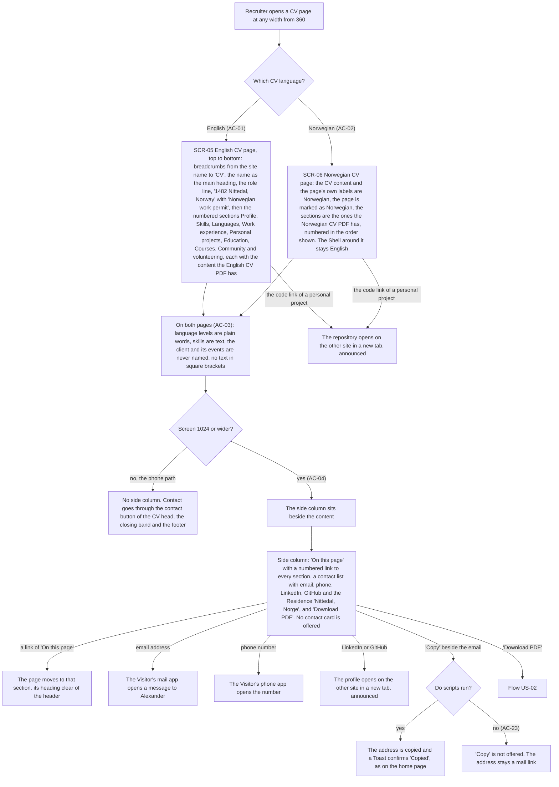

A Recruiter opens a CV page at any width from 360. The English CV page shows, top to bottom, breadcrumbs from the site name to "CV", the name as the main heading, the role line, "1482 Nittedal, Norway" with "Norwegian work permit", and the numbered sections from Profile to Community and volunteering, each with what the English CV PDF has. The Norwegian CV page shows the content and the page's own labels in Norwegian, is marked as Norwegian, and has the sections of the Norwegian CV PDF numbered in the order shown, while the Shell stays English. On both pages language levels are plain words, skills are text, the client is never named and no text in square brackets appears. From 1024 the side column sits beside the content; it holds "On this page", the contact list and "Download PDF", and offers no contact card. Below 1024 it is not shown, and contact goes through the contact button of the CV head, the closing band and the footer. A link of "On this page" moves the page to that section with its heading clear of the header. The email opens the mail app and the phone number the phone app; LinkedIn, GitHub and the code link of a personal project open the other site in a new tab, announced. "Copy" copies the address and a Toast confirms "Copied" ("Kopier" and "Kopiert" on the Norwegian page) where scripts run, and is not offered where they do not. "Download PDF" continues in Flow US-02.

### Flow: US-02 — Take the file

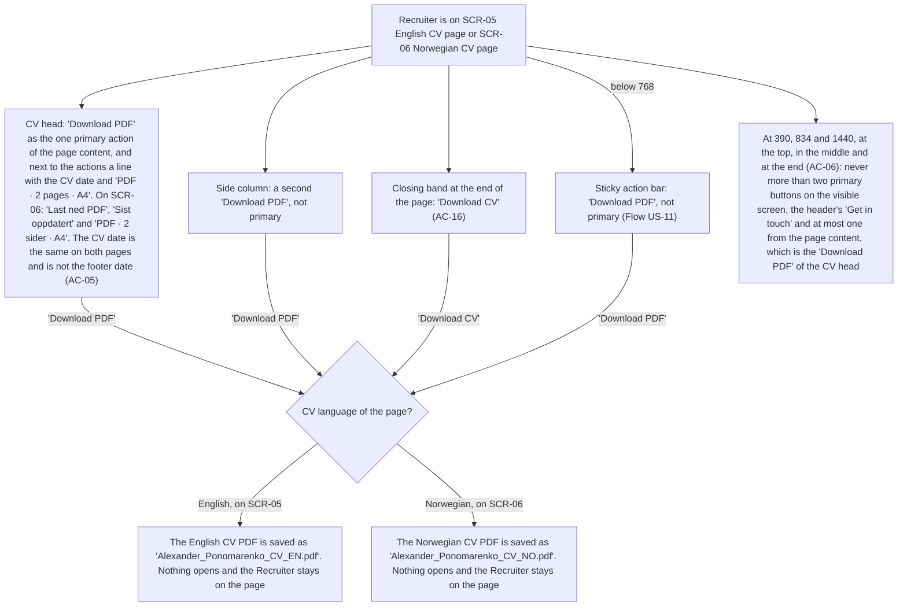

A Recruiter on either CV page finds the download in four places: "Download PDF" in the CV head, which is the one primary action of the page content; a second "Download PDF" in the side column; "Download CV" in the closing band at the end of the page; and, below 768, "Download PDF" in the Sticky action bar. Next to the head's actions a line shows the CV date and "PDF · 2 pages · A4"; the Norwegian page says "Last ned PDF", "Sist oppdatert" and "PDF · 2 sider · A4". The CV date is the same on both pages and is not the footer date. Every one of these saves the CV PDF in the CV language of the page, under "Alexander_Ponomarenko_CV_EN.pdf" or "Alexander_Ponomarenko_CV_NO.pdf"; nothing opens and the Recruiter stays on the page. At any scroll position the visible screen holds at most two primary buttons: the header's "Get in touch" and at most the head's "Download PDF".

### Flow: US-03 — Switch the language and keep my place

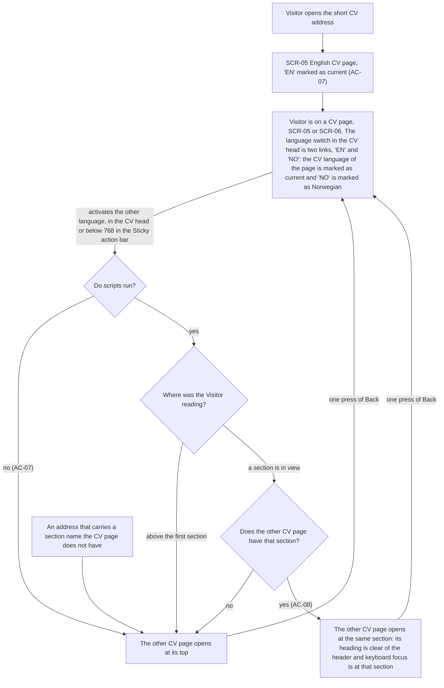

A Visitor who opens the short CV address gets the English CV page with "EN" marked as current. On either CV page the language switch in the CV head is two links, "EN" and "NO"; the CV language of the page is marked as current and "NO" is marked as Norwegian. The Visitor activates the other language there, or below 768 in the Sticky action bar. With scripts off the other CV page opens at its top. With scripts on it depends on where the Visitor was reading: above the first section, or in a section the other page does not have, the other page opens at its top; with a section in view that both pages have, the other page opens at that section, its heading clear of the header and keyboard focus there. In every case one press of Back returns to the page the Visitor left. An address that carries a section name the CV page does not have opens the page at its top.

### Flow: US-04 — See the original file

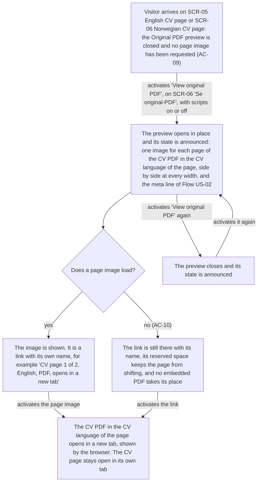

A Visitor arrives on a CV page with the Original PDF preview closed and no page image requested. Activating "View original PDF" ("Se original-PDF" on the Norwegian page), with scripts on or off, opens the preview in place and announces its state: one image for each page of the CV PDF in the CV language of the page, side by side at every width, with the meta line. Each image is a link with its own name that says the page, the language, that it is a PDF and that it opens in a new tab. If an image cannot be loaded, its link is still there with its name, the reserved space keeps the page from shifting and no embedded PDF takes its place. Activating an image or its link opens that CV PDF in a new tab, shown by the browser, and the CV page stays open in its own tab. Activating the control again closes the preview and announces the state; it can be opened again.

### Flow: US-05 — Print the page

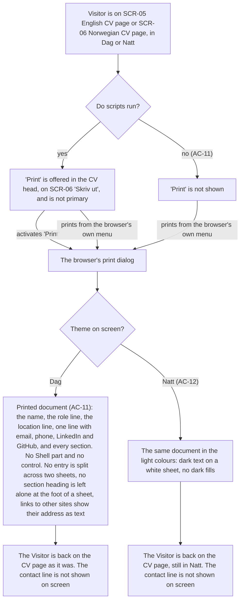

A Visitor is on a CV page in Dag or Natt. Where scripts run, "Print" ("Skriv ut" on the Norwegian page) is offered in the CV head and is not primary; with scripts off it is not shown. Activating it, or printing from the browser's own menu with scripts on or off, opens the browser's print dialog. The printed document holds the name, the role line, the location line, one line with email, phone, LinkedIn and GitHub, and every section; it holds no Shell part and no control, no entry is split across two sheets, no section heading is left alone at the foot of a sheet, and links to other sites show their address as text. Printed from Natt it is the same document in the light colours, dark text on a white sheet with no dark fills. After printing the Visitor is back on the CV page as it was, in the same theme, and the contact line is not shown on screen.

### Flow: US-06 — Arrive from an old link

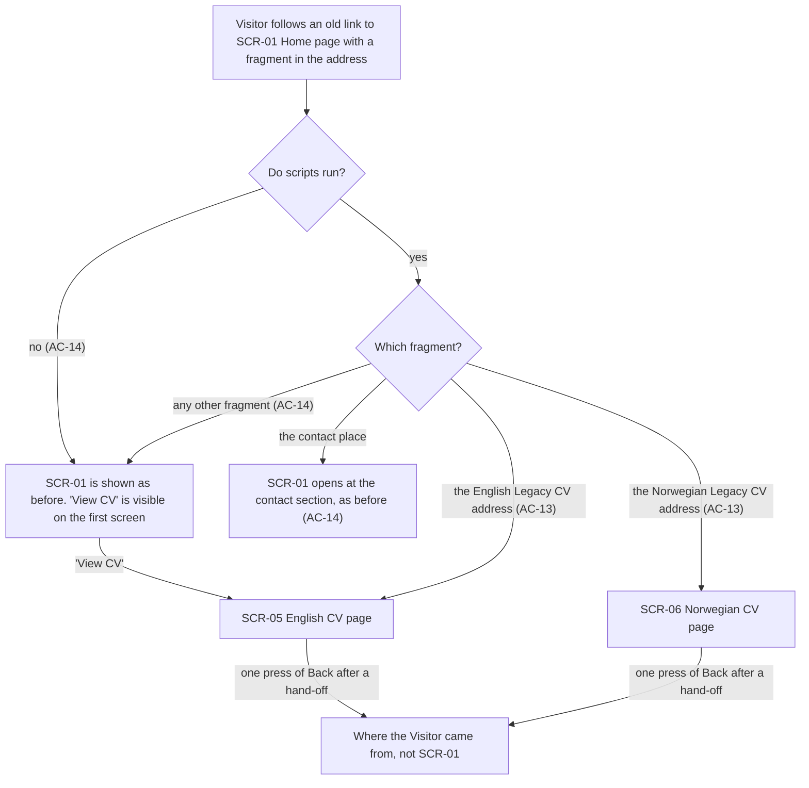

A Visitor follows an old link to the home page with a fragment in the address. With scripts off the home page is shown as before and "View CV" on the first screen leads to the English CV page. With scripts on, the English Legacy CV address hands the Visitor over to the English CV page and the Norwegian one to the Norwegian CV page while the home page starts to load; the contact place still opens the home page at the contact section, and any other fragment shows the home page as before. After a hand-off, one press of Back returns to where the Visitor came from, not to the home page.

### Flow: US-07 — Find the CV from anywhere

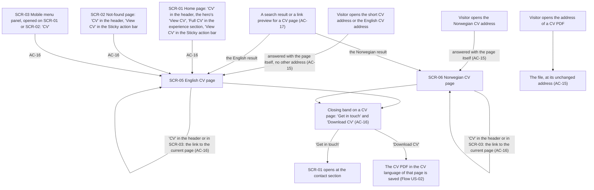

Every route to the CV ends on the right page. The short CV address and the English CV address answer with the English CV page itself, and the Norwegian CV address with the Norwegian CV page, without sending the Visitor to another address; the addresses of the two CV PDFs still answer with the files. A search result or link preview leads to the CV page of its language. From the home page and the Not-found page every CV link leads to the English CV page: "CV" in the header and in the Mobile menu panel, the hero's "View CV", "Full CV" in the experience section, and "View CV" in the Sticky action bar. On a CV page, "CV" in the header and in the Mobile menu panel is the link to the current page: it leads to the CV page in the CV language the Visitor is reading, so on the Norwegian CV page it leads to the Norwegian one (Owner, 2026-10-09). On a CV page the closing band offers "Get in touch", which opens the home page at the contact section, and "Download CV", which saves the CV PDF in the CV language of that page.

### Flow: US-08 — A page that holds up

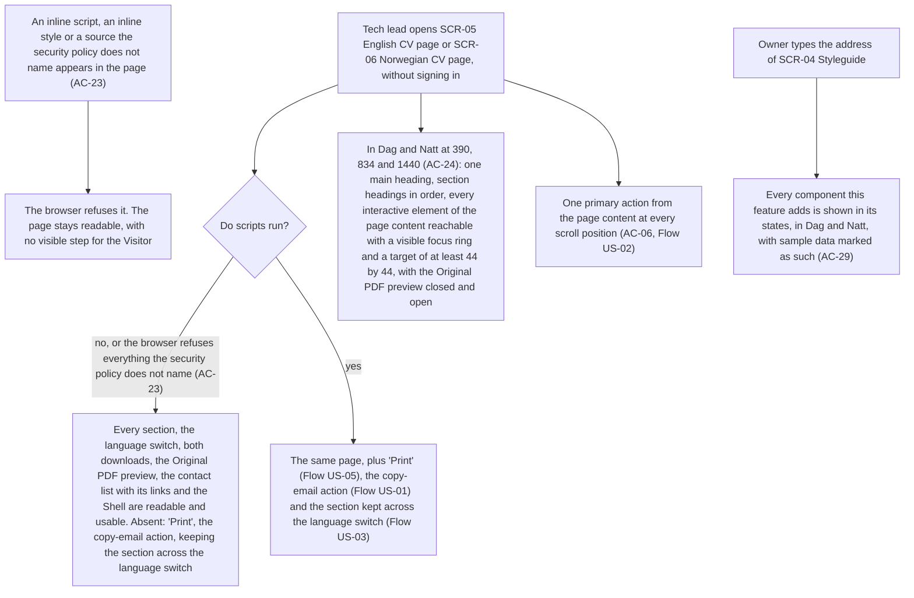

A Tech lead opens a CV page without signing in. With scripts off, or in a browser that refuses everything the security policy does not name, every section, the language switch, both downloads, the Original PDF preview, the contact list with its links and the Shell are readable and usable; only "Print", the copy-email action and keeping the section across the language switch are absent. With scripts on the same page gains those three. If an inline script, an inline style or an unnamed source appears in the page, the browser refuses it and the page stays readable, with no visible step. In Dag and Natt at 390, 834 and 1440 the page has one main heading and section headings in order, every interactive element of the page content has a visible focus ring and a target of at least 44 by 44, with the preview closed and open, and the page content holds one primary action at every scroll position. The Owner sees every component this feature adds on the Styleguide, in its states, in Dag and Natt, with marked sample data.

### Flow: US-10 — Get back to the top

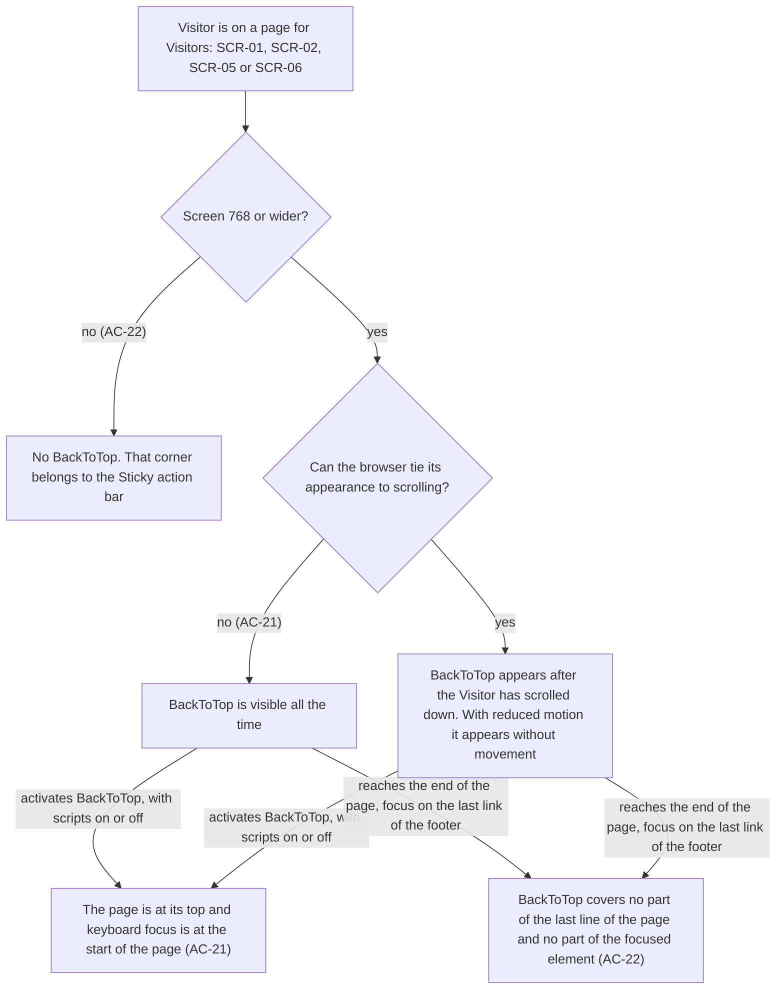

A Visitor is on a page for Visitors: the home page, the Not-found page or a CV page. Below 768 there is no BackToTop, because that corner belongs to the Sticky action bar. At 768 and wider BackToTop appears after the Visitor has scrolled down, without movement where the device asks for reduced motion; where the browser cannot tie its appearance to scrolling, it is visible all the time. Activating it, with scripts on or off, puts the page at its top and keyboard focus at the start of the page. At the end of the page, with focus on the last link of the footer, BackToTop covers no part of the last line and no part of the focused element.

### Flow: US-11 — Actions at my thumb

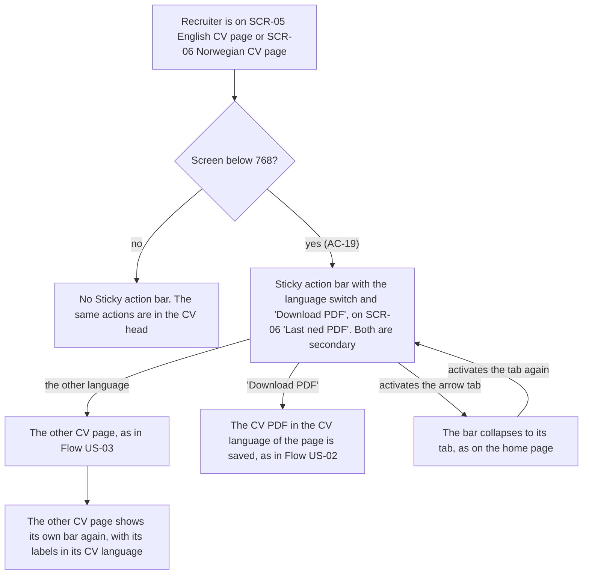

A Recruiter is on a CV page. At 768 and wider there is no Sticky action bar and the same actions are in the CV head. Below 768 the bar offers the language switch and "Download PDF" ("Last ned PDF" on the Norwegian page), both in the secondary style. The other language opens the other CV page exactly as the switch in the CV head does, and that page shows its own bar with its labels in its CV language. "Download PDF" saves the CV PDF in the CV language of the page. The arrow tab collapses the bar to its tab and brings it back, as on the home page.

### Flow: US-12 — Know where I am

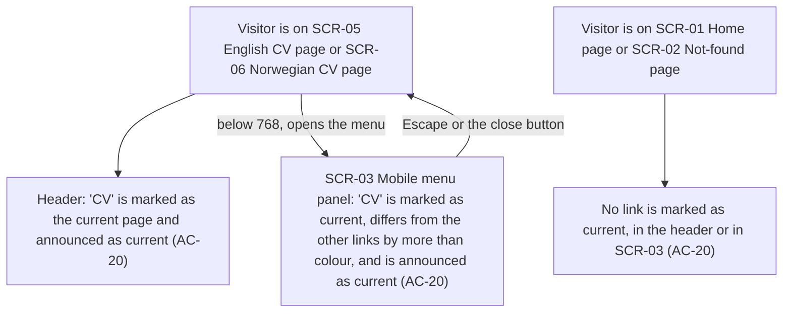

A Visitor on a CV page sees "CV" marked as the current page in the header, announced as current to assistive technology. Below 768, opening the Mobile menu panel shows "CV" marked as current there too, different from the other links by more than colour and announced as current; Escape or the close button returns to the page. On the home page and the Not-found page no link is marked, in the header or in the menu.

### Out of scope (no human-facing UI flow)

- **US-09 — A CV that stays true:** the Owner works in the repository, the gate and the pull request (CV PDF checksum check, contact check, Claims list, parity suite). The visible results are the CV content (Flow US-01), the meta line (Flow US-02) and the contact list (Flow US-01).

## AC coverage

| AC | Shown by | Notes |
|---|---|---|
| AC-01 | Flow US-01, branch `English (AC-01)` | The content per section is detailed in `screens` |
| AC-02 | Flow US-01, branch `Norwegian (AC-02)` | The bar labels are in Flow US-11 |
| AC-03 | Flow US-01, node "On both pages (AC-03)" | The placeholder part is also a build check |
| AC-04 | Flow US-01, both branches of "Screen 1024 or wider?" and the branches of node "Side column" | |
| AC-05 | Flow US-02, node "CV head" and both branches of "CV language of the page?" | |
| AC-06 | Flow US-02, node "At 390, 834 and 1440"; Flow US-08, node "One primary action" | The count itself is an e2e check |
| AC-07 | Flow US-03, node "SCR-05 English CV page, 'EN' marked as current" and branch `no (AC-07)` | |
| AC-08 | Flow US-03, branches of "Where was the Visitor reading?" and "Does the other CV page have that section?", and both `one press of Back` | Also reached from Flow US-11 |
| AC-09 | Flow US-04, whole flow | The request log is an e2e check |
| AC-10 | Flow US-04, branch `no (AC-10)` | |
| AC-11 | Flow US-05, both branches of "Do scripts run?" and node "Printed document (AC-11)" | |
| AC-12 | Flow US-05, branch `Natt (AC-12)` | |
| AC-13 | Flow US-06, both `Legacy CV address (AC-13)` branches and `one press of Back after a hand-off` | The script's origin, size and the unchanged policy are build checks |
| AC-14 | Flow US-06, branches `no (AC-14)`, `the contact place` and `any other fragment (AC-14)` | |
| AC-15 | Flow US-07, the three address entries | The rewritten parity tests run in CI |
| AC-16 | Flow US-07, the three Shell and home entries, both `the link to the current page (AC-16)` branches, node "Closing band on a CV page" and its branches | On a CV page "CV" keeps the CV language (Owner, 2026-10-09) |
| AC-17 | N/A: head data read by search engines and link previews, no screen of the site | The arrival is drawn in Flow US-07, node "A search result or a link preview" |
| AC-18 | N/A: response headers, no step for the Visitor | Visible result: the CV PDF is shown by the browser in Flow US-04 |
| AC-19 | Flow US-11, branch `yes (AC-19)` and its three actions | |
| AC-20 | Flow US-12, whole flow | The rendered-style check is an e2e check (B-05) |
| AC-21 | Flow US-10, branch `yes` of "Screen 768 or wider?" and both `activates BackToTop` | |
| AC-22 | Flow US-10, branch `no (AC-22)` and both `reaches the end of the page` | |
| AC-23 | Flow US-08, both branches of "Do scripts run?" and node "An inline script, an inline style or a source" | Also Flow US-01, branch `no (AC-23)` |
| AC-24 | Flow US-08, node "In Dag and Natt at 390, 834 and 1440" | The design match is a manual review |
| AC-25 | N/A: the gate and the project instructions, Owner in the repository | US-09 out of scope here |
| AC-26 | N/A: lists in the pull request, no screen of the site | US-09 out of scope here |
| AC-27 | N/A: build-time contact check, Owner in the gate | Visible result: Flow US-01, node "Side column" |
| AC-28 | N/A: the parity suite runs in CI | The behaviours are drawn in Flows US-03, US-04, US-06 and US-07 |
| AC-29 | Flow US-08, node for SCR-04 | |
