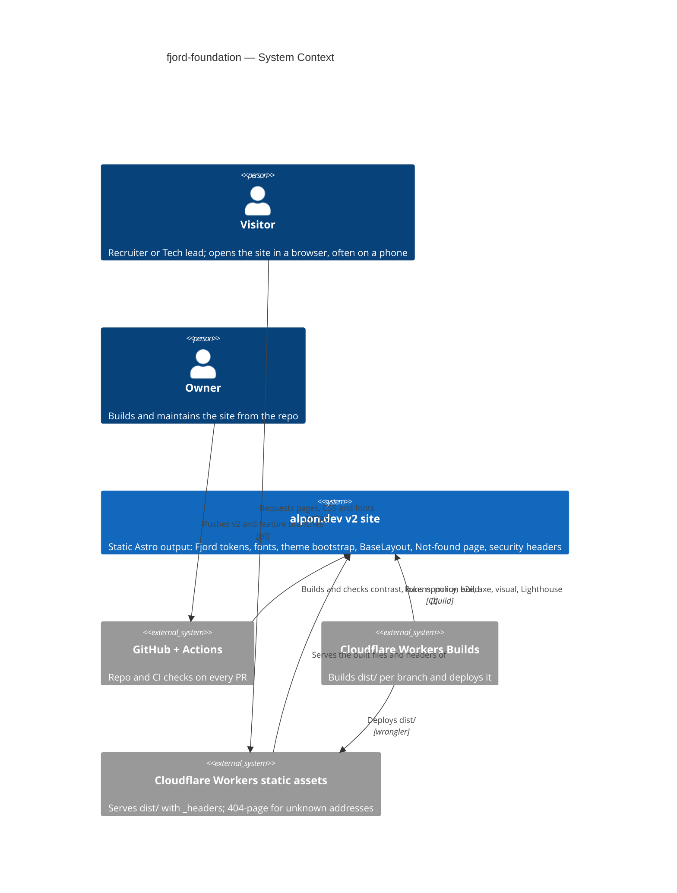
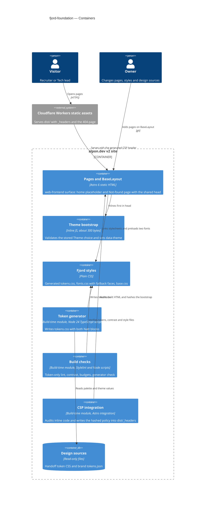
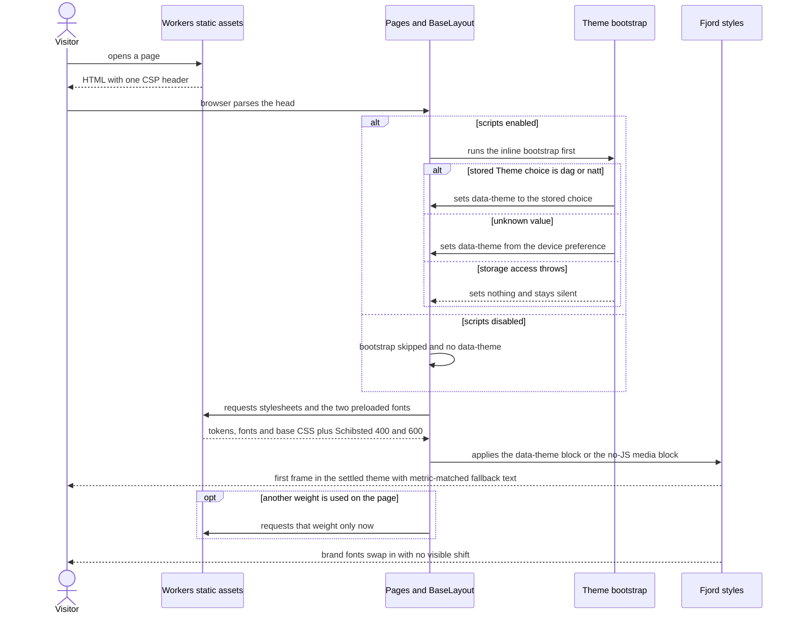
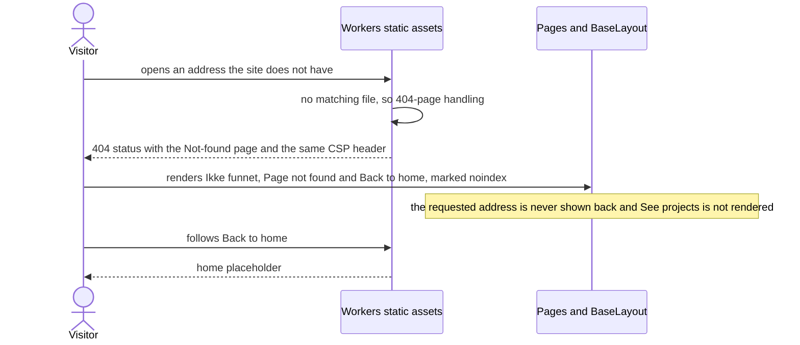
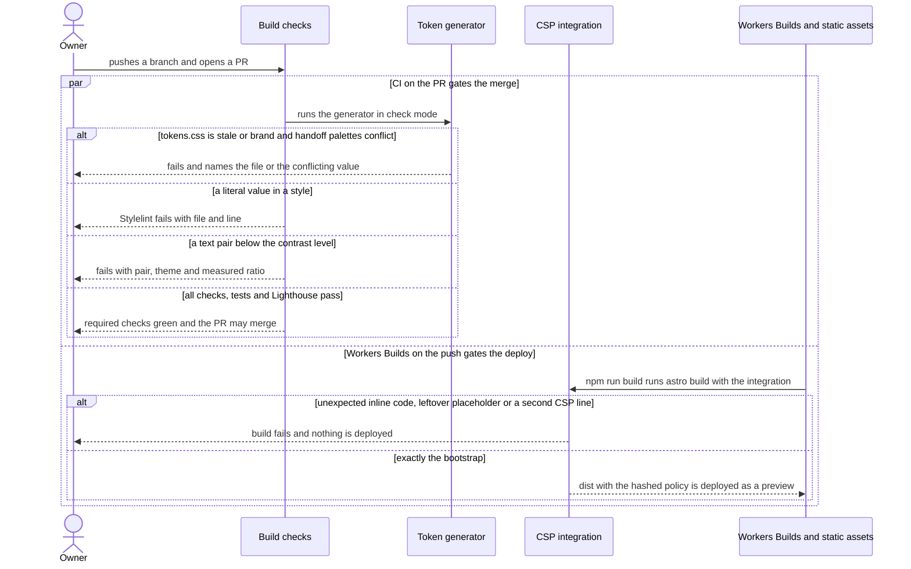

# Software Architecture Document — fjord-foundation

> **Upstream:** [spec](./spec.md) · [ux-flows](./ux-flows.md) · [CONTEXT](../../../CONTEXT.md) (repo root; no feature-level CONTEXT) · [architecture map](../../architecture-map.md) · repo ADRs [0001](../../adr/0001-build-a-static-astro-site-served-by-workers-static-assets.md), [0002](../../adr/0002-ship-zero-client-js-by-default-with-vanilla-ts-islands.md), [0003](../../adr/0003-keep-all-content-in-the-repo-with-no-datastore.md).

## 1. Introduction and goals

**Intent.** Fjord foundation is the one visual and security layer every v2 page of alpon.dev starts from: Fjord tokens as the only source of visual values, self-hosted brand fonts with size-matched fallbacks, the Dag/Natt theme resolved before the first frame (and still right with scripts off), one shared page layout, and the Fjord Not-found page as its first real page. It serves the Recruiter and Tech lead who open the site (often on a phone) and the Owner, who needs later steps (Base components, Home, CV) to inherit the layer without re-solving color, type and theme. The build guards the layer: contrast, token-only values and a security policy that matches the theme bootstrap are checked on every change. It also closes stub-parity items P-16, P-26 and P-41.

**Top-3 quality goals (1-liners; full scenarios in §10):**

1. **Theme correctness from the first frame** — zero wrong-theme frames for every stored-choice × device-preference combination, with or without scripts.
2. **Visual stability and speed on a phone** — brand fonts and theme arrive without layout shift and within the mobile Lighthouse budget.
3. **Build-enforced integrity** — contrast, token-only values and a script policy that names exactly the theme bootstrap are verified by the build/CI, never by memory.

**Stakeholders.**

| Role | Interest | Sign-off owner? |
|---|---|---|
| Recruiter | A calm, finished first impression on a phone: right theme, brand type, nothing jumps | No |
| Tech lead | Sees a site built with care: strict script policy, accessibility, performance | No |
| Visitor | A remembered Theme choice, a way back from a dead link, no motion when reduced motion is asked | No |
| Owner | Every new page gets the Fjord base for free; the build stops changes that break contrast, tokens or the policy | Yes (architect and approver of this SAD) |

<!-- Decision overrides (¶4) — populated by the critic resolution loop, empty otherwise. -->

## 2. Constraints

**Technical.**
- TypeScript 5.9.3 (`strict`, extends `astro/tsconfigs/strict`), Node 24 LTS (`.nvmrc`), npm.
- Astro 6.4.8, `output: 'static'`, `build.format: 'file'`, `trailingSlash: 'never'` (repo ADR-0001).
- Cloudflare Workers static assets via Wrangler 4.146.0: `assets.directory: ./dist`, `not_found_handling: 404-page`, `html_handling: auto-trailing-slash`; headers only through `_headers` (no Worker script, so no code can set headers at request time).
- Zero client JS by default; interactivity as vanilla-TS islands bundled to external files (repo ADR-0002). No datastore; content lives in the repo (repo ADR-0003).
- Plain CSS with `--fjord-*` custom properties; no Tailwind, CSS-in-JS or UI kits.
- Fonts: Schibsted Grotesk 400/500/600/700 and JetBrains Mono 400/500/700, self-hosted woff2, Latin subset with æ ø å. Today `public/fonts/` holds Schibsted 400/500/600 (25–26 KB each) and Mono 400/500 (21–22 KB); the three 700 weights are converted from `design/brand/fonts/*.ttf`.
- Test toolchain: Playwright 1.63 (e2e, visual), `@axe-core/playwright` 4.13, Lighthouse CI 0.15.1, run against `wrangler dev` serving `dist/` (production routing).

**Organisational.**
- Single maintainer (the Owner); size S (about a week, 2–5 PRs into `v2`).
- No fixed date, but this is roadmap wave 1: Base components (step 3), Home (step 4) and CV (step 5) are blocked until it lands. The site represents the Owner during an active job search.
- Running cost stays zero; every new dependency is explained in its PR.

**Conventions.**
- `CLAUDE.md` (authored architecture doc) and `docs/architecture-map.md` (conventions section).
- `design/handoff/` and `design/brand/` are read-only sources; where they conflict, `BRAND.md` wins and the conflict is listed in the PR.
- Tokens only (no hardcoded hex or magic numbers in components); two themes via `data-theme="dag|natt"` on `<html>`; 4px grid; breakpoints 360 / 768 / 1024 / 1440; motion only through motion tokens, reduced motion = fades only.
- Parity gate: the step that builds a behaviour flips its `test.fixme` in `tests/e2e/parity.spec.ts` (here P-16, P-26, P-41).

**Regulatory / external.**
- Data classification public (spec §6.1). No personal data: the Theme choice is one `dag`/`natt` value in the Visitor's own browser storage, never sent anywhere, no cookie; nothing to declare under GDPR/ePrivacy beyond that.
- Security review required (lightweight): the delivered policy is reviewed on the `v2` preview URL before merge (spec §6.1).

## 3. Context and scope

alpon.dev is the Owner's public professional home during a job search in Norway; Visitors (mostly Recruiters, sometimes Tech leads) open it in a browser, usually on a phone, without signing in. This feature does not add a new external system: it changes what the static site delivers (tokens, fonts, theme bootstrap, layout, Not-found page, security policy) and what CI checks before a build can be deployed. The trust boundary is the browser: everything the site ships is static, and the only untrusted input is the Visitor's own stored Theme choice and the requested address.

<!-- brownfield: scaffolded skeleton (b4512ec) — BaseLayout with lang/title/description/noindex, placeholder index and 404 pages, _headers with the CSP on `/` only (the 404 response and any other page currently get no CSP), fonts 400/500/600 + mono 400/500 in public/fonts, empty src/styles and scripts/. architecture-map.md (reflects 812f46f) describes this target and is current. -->

**External systems (in / out):**

| Actor or system | Type | Interaction |
|---|---|---|
| Visitor (incl. Recruiter, Tech lead) | Person | Opens pages and the Not-found page over HTTPS; may hold a stored Theme choice from an earlier visit |
| Owner | Person | Changes tokens, layout and pages in the repo; pushes branches |
| GitHub (repo + Actions CI) | System (external) | Hosts the repo; runs lint, contrast, token and policy checks, Playwright e2e/axe/visual and Lighthouse CI on every PR |
| Cloudflare Workers Builds | System (external) | Builds `dist/` per branch (`v2` → preview URL) and deploys it |
| Cloudflare Workers static assets (edge) | System (external) | Serves `dist/` with the `_headers` rules; unknown addresses get `404.html` with a 404 status |

External: none new. No third-party script, font or style origin is used (deliberate: the policy allows only the site itself).

**C4 Context (L1):**




## 4. Solution strategy

**Top strategic choices (the seeds for ADRs):**

1. **One web surface, rendered at build time** — `target_surfaces: [web-frontend]`. The Visitor-facing pages are the only runtime surface; there is no backend, worker or API. UI architecture is inherited, not re-decided: static HTML rendered by Astro at build time (repo ADR-0001) with zero client JS except the theme bootstrap (repo ADR-0002). Everything else in this feature (token generator, checks, CSP integration) runs at build or CI time and is a module of the same surface, not a separate one. *(Single surface, inherited UI architecture: below the ADR gate, inline.)*
2. **Theme decided before the first frame, CSS-first for the no-JS case** — a ~300-byte inline bootstrap accepts only a stored `dag`/`natt` Theme choice, else the device preference, and sets `data-theme` on `<html>`; `tokens.css` carries Dag, Natt, and a second Natt block under `@media (prefers-color-scheme: dark) { :root:not([data-theme]) }` that decides when the bootstrap could not run. Both Natt blocks are generated from the design sources so the values have one source. Serves quality goal 1. → [ADR-0001](./adr/0001-pair-a-validating-theme-bootstrap-with-generated-natt-blocks.md)
3. **A build-generated, fail-closed script policy** — one CSP line under `/*` in `_headers` (removed from `/`), whose `script-src` hash is written by a local Astro integration after it has audited the built HTML: exactly one inline script (the bootstrap), no inline styles or handler attributes, no leftover placeholder, no second CSP line. Astro's small-file inlining is turned off so bundled CSS/JS stay covered by `'self'`. Serves quality goal 3. → [ADR-0002](./adr/0002-generate-the-bootstrap-hash-into-a-single-csp-rule-at-build.md)
4. **Guardrails in the toolchain, not in memory** — token-only styles by Stylelint core rules with a documented keyword and breakpoint allowlist (→ [ADR-0003](./adr/0003-enforce-token-only-styles-with-stylelint-built-in-rules.md)); a contrast script over the generated tokens; a budget script for bootstrap, JS and font sizes; the generator's `--check` mode. All run on every PR. Serves quality goal 3.
5. **Brand fonts that hold still** — self-hosted woff2 in `public/fonts/` with hand-written `@font-face` (`font-display: swap`), exactly Schibsted Grotesk 400 and 600 preloaded, and metric-matched fallback faces for two local fonts (Arial for iOS/macOS/Windows, Roboto for Android) computed once from the TTFs. The Astro Fonts API was not used: it emits inline `<style>`, which pillar 3 forbids, and moves files to hashed URLs. Serves quality goal 2. *(Inline: reversible in under a day, one module.)*

Each tactical decision in later sections traces to one of these seeds. Tactical decisions that contradict a strategic choice are red flags and go to §11.

## 5. Building block view

Astro's file-based layering from the architecture map, unchanged: pages compose `BaseLayout`, global styles are imported once by the layout, and build-time code lives in `scripts/` (CLI checks) and `src/integrations/` (hooks into `astro build`). The design sources under `design/` are read, never edited. No new module kind is introduced; the only new folders are `src/scripts/`, `src/integrations/` and `tools/fonts/`.

**Internal decomposition:**

```
design/                                   read-only sources
├── handoff/design-system/project/tokens/   colors, spacing, typography, motion CSS
└── brand/tokens.json, brand/fonts/*.ttf    core palette (wins on conflict), font masters
scripts/
├── tokens/build.ts       generator → src/styles/tokens.css (+ --check)        ADR-0001
├── check-contrast.ts     every semantic text/background pair, Dag/Natt/on-spruce; Natt-block identity
├── contrast-pairs.ts     the pair manifest (text 4.5:1, large text / UI / focus 3:1)
└── check-budgets.ts      bootstrap ≤ 1 KB, JS per page, preload count, font file sizes
src/
├── scripts/theme-bootstrap.js   the one inline script                        ADR-0001
├── integrations/csp.ts          inline audit + hash → dist/_headers           ADR-0002
├── styles/
│   ├── tokens.css        generated, "do not edit"
│   ├── fonts.css         @font-face: 7 brand faces + Arial/Roboto fallback faces
│   └── base.css          element base styles, tokens only (ported from the handoff base.css)
├── layouts/BaseLayout.astro     head contract (§8), imports tokens → fonts → base
└── pages/
    ├── index.astro       home placeholder (SCR-01)
    └── 404.astro         Not-found page (SCR-02)
public/
├── _headers              policy template under /* (placeholder for the hash)  ADR-0002
└── fonts/*.woff2         + schibsted-grotesk-700, jetbrains-mono-700 (new)
tools/fonts/              subsetting + fallback-metric scripts (not deployed)
stylelint.config.js       token-only rules                                       ADR-0003
tests/
├── e2e/                  theme, headers, not-found, fonts specs; parity.spec.ts (P-16, P-26, P-41 flipped)
├── a11y/                 axe on SCR-01 and SCR-02, Dag and Natt
└── visual/not-found.spec.ts   390 / 834 / 1440 × Dag / Natt, Linux baselines
```

**C4 Container (L2):**



The one declared surface (`web-frontend`) is **Pages and BaseLayout**; the bootstrap and styles ship inside it. Token generator, Build checks and CSP integration are build-time modules of that same surface, drawn separately only to show what reads and writes what; they are not additional surfaces and run nowhere at request time.

## 6. Runtime view

Participants are the §5 containers; the Visitor's browser executes the bootstrap and applies the styles. The `sequences` stage completes AC coverage; these seed the critical flows.

**Critical flow 1: first frame — theme and fonts** (AC-01..AC-06, AC-14, AC-15)



**Critical flow 2: unknown address** (AC-07, AC-08)



**Critical flow 3: Owner change through CI and Workers Builds** (AC-10..AC-13)

Two independent paths start from one push. GitHub Actions CI gates the **merge** (branch protection, §7); Workers Builds gates the **deploy** only through `astro build`, which runs the CSP integration.



## 7. Deployment view

No topology change: the same single Worker (`alpon-dev`) serves `dist/` as static assets, deployed by Workers Builds (`v2` → preview URL via `npm run build && npx wrangler preview`; `main` keeps the stub). The build command is unchanged; the CSP integration runs inside `astro build`, so Workers Builds produces the hashed `_headers` with no extra step. What changes in the deployed config is `_headers` only: the CSP moves from `/` to `/*` with a build-written hash (ADR-0002). There is no runtime code, so no replicas or scaling thresholds apply.

**What gates what.** Workers Builds deploys on every push with no CI gate of its own: a preview for `v2` and feature branches, production for `main`. Only the CSP integration inside `astro build` can stop a deploy. Lint, contrast, the generator `--check`, tests and Lighthouse run in GitHub Actions and gate the **merge**, which holds only with branch protection. This feature therefore includes a repository-settings task: protect `v2` and `main` with required status checks (the CI workflow jobs) and allow no direct pushes to `main`. That matters most for `main`, where every push is a production deploy.

**Monitoring:**
- Metrics: Lighthouse CI (mobile) on every PR for the Not-found page and the home placeholder; the budget script's sizes printed in the CI log.
- Alerts: a failing required check blocks the merge into `v2` / `main` (lint, build, test, lhci) once branch protection is on; there is no runtime alerting and none is needed for static files.
- Verification after deploy: the security review reads the delivered headers on the `v2` preview URL before merge (spec §6.1).

**Scaling thresholds:**
- Not applicable: static assets on the Cloudflare edge, free tier, zero running cost.

## 8. Crosscutting concepts

| Concept | Convention | Where defined |
|---|---|---|
| Fjord tokens | Only `--fjord-*` values in styles. `tokens.css` is generated from the design sources (palette from `design/brand/tokens.json`, semantics from the handoff token CSS) and committed with a "generated — do not edit" header; `--check` in CI keeps it current | ADR-0001; `CLAUDE.md` design rules |
| Theme | `data-theme="dag\|natt"` on `<html>`, set by the validating bootstrap (key `fjord-theme`); Natt also applies through the no-JS media block; `color-scheme` set in every theme block; the bootstrap never writes storage in this feature (no visible switch until step 3) | ADR-0001 |
| Token-only styles | Stylelint core rules; keyword allowlist `0`, `100%`, `auto`, `none`, `inherit`, `currentColor`, `transparent`; breakpoints only 360 / 768 / 1024 / 1440 px, enforced by `media-feature-name-value-allowed-list`; `tokens.css` and `fonts.css` excluded, and `fonts.css` holds only `@font-face` rules | ADR-0003 |
| Security policy | One CSP line under `/*`, hash written at build, no `'unsafe-inline'`; no inline `<style>`, `style=` or `on*=` attributes anywhere; `build.inlineStylesheets: 'never'`, `vite.build.assetsInlineLimit: 0`; new origins are added to the same template line | ADR-0002 |
| Fonts | Seven brand faces (Schibsted 400/500/600/700, JetBrains Mono 400/500/700), woff2, Latin subset incl. æ ø å and the en/em dashes, each ≤ 30 KB, `font-display: swap`, from `public/fonts/`; preload exactly Schibsted 400 and 600 with `crossorigin`; metric-matched fallback faces "… Fallback Arial" and "… Fallback Roboto" (`size-adjust`, `ascent-override`, `descent-override`, `line-gap-override`) listed in the token font stacks before the generic family; subsetting and metrics computed in `tools/fonts/`; CI installs Roboto only (no Arial), so the mobile Lighthouse and visual runs exercise the Roboto fallback as on Android | §4 pillar 5 |
| Shared layout (head contract) | `BaseLayout` props `title`, `description`, `lang`, `noindex`; head order: charset → viewport → inline bootstrap → two font preloads → stylesheets (tokens → fonts → base) → title, description, robots, icons. A page sets only title and description (AC-13) | §5 |
| Error handling | Build time: every check fails closed and names file/line, pair/theme/ratio, or the conflicting value. Run time: the bootstrap swallows storage errors silently and the CSS fallback decides (AC-03); a missing font keeps the matched fallback | ADR-0001, ADR-0002 |
| Motion | No animation in this feature. Motion tokens collapse under `prefers-reduced-motion: reduce` (durations to 0, rise and parallax to 0) as in the handoff `motion.css`; base styles use transitions only through tokens; no View Transitions yet (step 3) | `CLAUDE.md` motion rules |
| Internationalisation | Page language `en`; Norwegian warm details (the "Ikke funnet" code line) carry `lang="no"` per the design readme | design readme › Languages |
| Accessibility | Semantic landmarks and one `h1` per page; visible `:focus-visible` from tokens; 44 px targets via `--fjord-tap-min`; axe with zero violations in Dag and Natt | `CLAUDE.md` quality bar |
| Testing | Playwright e2e against `wrangler dev` (theme matrix incl. scripts off, headers, not-found, fonts, parity P-16/P-26/P-41); axe; visual at 390 / 834 / 1440 × Dag / Natt with Linux-only baselines (CI or the official Playwright Docker image); Vitest for the pure logic in `scripts/` and `src/integrations/` (added with a PR explanation per `CLAUDE.md`) | architecture map › Tests |
| Observability | None at run time (static site). CI logs carry check results, budgets and Lighthouse reports | §7 |
| ID strategy / events / persistence | N/A — no entities, events or datastore (repo ADR-0003); the only state is the Visitor's own `fjord-theme` value | — |

## 9. Architecture decisions

| # | Title | Status | Section |
|---|---|---|---|
| 0001 | Pair a validating theme bootstrap with generated Natt blocks for the no-JS case | Accepted | §4 |
| 0002 | Generate the bootstrap hash into a single `/*` CSP rule at build | Accepted | §4 |
| 0003 | Enforce token-only styles with Stylelint built-in rules | Accepted | §4 |

ADR files live under `docs/features/fjord-foundation/adr/NNNN-<title>.md`. Inherited repo-level decisions: [repo ADR-0001](../../adr/0001-build-a-static-astro-site-served-by-workers-static-assets.md) (static Astro on Workers static assets), [repo ADR-0002](../../adr/0002-ship-zero-client-js-by-default-with-vanilla-ts-islands.md) (zero client JS by default), [repo ADR-0003](../../adr/0003-keep-all-content-in-the-repo-with-no-datastore.md) (no datastore).

## 10. Quality requirements

Each top-3 goal from §1 expanded into scenarios. Numbers are quoted from spec §6.

**QG-1. Theme correctness from the first frame**
- **When:** a page is opened in each of the 6 combinations (stored Dag / Natt / none × device light / dark), plus an unknown stored value, blocked storage, and scripts off with device light and dark.
- **Then:** wrong-theme frames are "0 across the 6 combinations (stored Dag / Natt / none × device light / dark)"; the unknown-value, blocked-storage and scripts-off cases render in the device-preference theme with no error; native controls follow `color-scheme`.
- **How verify:** `tests/e2e/theme.spec.ts`, reading the theme before first paint — Playwright `colorScheme` emulation × storage seeded by an init script (plus a context where storage access throws). An `addInitScript` (runs before any page script) records every change of `data-theme` with a `MutationObserver` and captures the computed `<html>` background and `color-scheme` in the first `requestAnimationFrame` callback, which runs before the first paint; the test asserts that the captured value equals the settled value at `load` and that `data-theme` was set at most once. The scripts-off context (`javaScriptEnabled: false`, where no init script can run) asserts the computed background, `color-scheme` and a screenshot after load, which is sufficient because without scripts only CSS decides the theme.

**QG-2. Visual stability and speed on a phone**
- **When:** Lighthouse CI (mobile, cold cache) runs on the built Not-found page and home placeholder; the budget script runs on `dist/`.
- **Then:** CLS "≤ 0.02 on the not-found page and the home placeholder"; LCP "≤ 2.0 s"; TBT "≤ 100 ms"; "Performance, Accessibility, Best Practices, SEO each ≥ 95"; initial JS "≤ 50 KB gzip in total; the render-blocking theme bootstrap ≤ 1 KB unminified"; critical fonts "exactly 2 preloaded font files, ≤ 60 KB combined; every shipped font file ≤ 30 KB".
- **How verify:** `npm run lhci` assertions in CI on a runner with Roboto installed and no Arial, so the metric-matched Roboto fallback is the one measured; the Arial fallback overrides are covered by a Vitest test of the `tools/fonts/` metric script against the TTF metrics; `scripts/check-budgets.ts` after `npm run build`; the e2e fonts spec + P-26 for the preload set, the lazily requested weights (AC-06) and æ ø å rendered from brand files (AC-15).

**QG-3. Build-enforced integrity**
- **When:** a PR changes tokens, styles, the bootstrap or `_headers`.
- **Then:** contrast stays at "body text ≥ 4.5:1; large text, UI borders and focus ring ≥ 3:1; every semantic text/background pair in Dag and Natt", else the check fails naming pair, theme and ratio (AC-10); a literal value fails with file and line (AC-11); the delivered policy allows exactly the current bootstrap, and a mismatch fails the build before deploy (AC-12); exactly one CSP header without `'unsafe-inline'` on `/`, a 404 response and the CV PDF, and an injected inline script is refused (AC-09).
- **How verify:** `scripts/check-contrast.ts` and `stylelint` in `npm run lint` (each with a failing-fixture Vitest case); the CSP integration's unit tests plus a CI build; `tests/e2e/headers.spec.ts` and P-16.

**Supporting scenarios (spec §6 rows not tied to one goal):**
- Accessibility: "0 axe violations on the not-found page and home placeholder, in Dag and Natt" — `tests/a11y/` in CI.
- Visual regression: "≤ 0.1% differing pixels per screenshot against the approved baseline, not-found page at 390 / 834 / 1440 in Dag and Natt" — `tests/visual/not-found.spec.ts`, Linux baselines.
- Design match: "0 undocumented differences between the not-found page and the design reference at 390 / 834 / 1440 in Dag and Natt" — manual side-by-side review in the PR, differences listed (code line "404 · Ikke funnet" instead of the requested path; no "See projects"; theme-snippet deviations from ADR-0001).

## 11. Risks and technical debt

| Risk / debt | Severity | Mitigation | Owner |
|---|---|---|---|
| The Arial fallback face is never exercised live in CI: the Linux runner has Roboto only, so the stack skips the Arial face | Medium | Install only Roboto in CI (the Android path, the one the mobile CLS budget targets); the e2e fonts spec asserts the "… Fallback Roboto" face renders while the brand font is blocked; a Vitest test checks the Arial overrides against the TTF metrics; a manual look on an iPhone before merge | Owner |
| Workers Builds deploys every push; a feature-branch preview can be red, and without branch protection a red change could reach `main` (production) | Medium | Branch protection on `v2` and `main` with the CI jobs as required checks and no direct pushes to `main` (§7); preview deploys on feature branches may be red, production cannot, because nothing reaches `main` without green CI | Owner |
| Visual baselines differ by OS font rendering; the Owner works on Windows | Medium | Linux-only baselines produced in CI or the official Playwright Docker image; never commit Windows snapshots | Owner |
| The CSP on `/*` now also covers the CV PDFs; the same-origin inline PDF viewer (P-32) has not been verified under it | Low | `headers.spec.ts` asserts the header on the PDF now; step 5 verifies the viewer under the policy before flipping P-32 | Owner |
| Token values can only change through the read-only design sources (re-export or brand update) | Low | Accepted by ADR-0001; the generator names any brand/handoff conflict; revisit with an override layer only if an urgent fix ever needs one | Owner |
| The handoff `base.css` and component code use literal values (`1px`, `2px`, `0.2em`, unitless weights and line-heights) | Low | Port `base.css` with tokens; Stylelint (ADR-0003) flags anything missed | Owner |
| Turning off Astro's small-file inlining adds a few small requests | Low | Lighthouse CI budget on every PR; the CSS is one shared file in this feature | Owner |
| Natt reference screenshots are captured from the standalone mockup (roadmap D1), not from the handoff bundle | Low | Capture with the visual tests in this feature; list any mockup vs handoff difference in the PR | Owner |
| Release 1 adds Cloudflare Web Analytics origins to the policy | Low | Extend the single `/*` template line (`script-src`, `connect-src`), never a second rule; the integration's "one CSP line" guard enforces it | Owner |

**Accepted debt (acceptable in v1, plan to fix later):**
- The Not-found page renders only "Back to home"; "See projects" appears when step 7 adds the Published-project condition (AC-08).
- The Not-found code line reads "404 · Ikke funnet" instead of echoing the requested path (documented design difference, keeps the page script-free and free of reflected content).
- JetBrains Mono 700 ships although `BRAND.md` lists Mono 400/500; the design system uses 700 (spec §1, noted in the PR).

## 12. Glossary

| Term | Meaning |
|---|---|
| Dag | The light Fjord theme (stone background, ink text); never switches by the clock |
| Natt | The dark Fjord theme (spruce/ink surfaces, snow text); not a high-contrast mode |
| Fjord token | A named design value (`--fjord-*`) that is the only allowed source of that value on the site |
| Theme choice | The theme a Visitor explicitly picked, kept only in their own browser (`fjord-theme`); not the device preference |
| Flash of wrong theme | Any rendered frame showing a theme other than the one the page settles in |
| Not-found page | The "Ikke funnet" page served with a 404 status for any address the site does not have |
| Published project | A portfolio project ready to be presented with its case study; none exist in this feature |
| Owner / Visitor / Recruiter / Tech lead | Roles as defined in the root `CONTEXT.md` glossary |
| Theme bootstrap | The single inline script in `<head>` that applies a valid stored Theme choice or the device preference before the first frame *(not yet in CONTEXT.md — glossary follow-up)* |
| No-JS Natt block | The generated copy of the Natt tokens under `@media (prefers-color-scheme: dark) { :root:not([data-theme]) }` that decides the theme when the bootstrap did not run *(not yet in CONTEXT.md — glossary follow-up)* |
| Metric-matched fallback face | A local font (Arial or Roboto) re-declared with size and line-metric overrides so text keeps its size and position when the brand font swaps in *(technical term)* |
