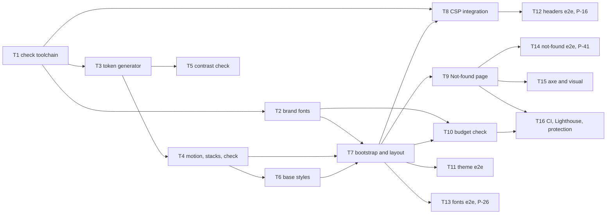

# Epic — fjord-foundation

> **Spec:** [spec.md](../spec.md) · **Design:** [sad.md](../sad.md) · **Screens:** [screens.md](../screens.md) · **UX flows:** [ux-flows.md](../ux-flows.md) · **API:** [api-sync-report.md](../contracts/api-sync-report.md) (N/A: no external interface) · **Data model:** N/A (no datastore, repo ADR-0003) · **ADRs:** [adr/](../adr/)

## Goal

Ship the one Fjord layer every v2 page starts from: generated tokens, self-hosted brand fonts with metric-matched fallbacks, the Dag/Natt theme settled before the first frame (also with scripts off), the shared `BaseLayout` head contract and the Fjord Not-found page ([spec §2](../spec.md)). The build guards the layer (contrast, token-only styles, a CSP that names exactly the bootstrap), and stub-parity items P-16, P-26 and P-41 flip to passing tests.

## Scope

- **In:** `web-frontend` surface only (`target_surfaces` in [sad.md](../sad.md)): `ui` tasks for styles, layout and the two screens (SCR-01, SCR-02), plus the build-time modules of that surface (token generator, CSP integration, checks) as `wiring` / `tests` tasks. No backend layers (domain / infra / app / ports) and no migrations.
- **Out** ([spec §3](../spec.md)): ThemeToggle, Header, Footer, SkipLink and other base components (step 3); the styleguide page (step 3); animated theme and page transitions (step 3); Prose and code highlighting (step 7); real Home and CV content (steps 4, 5); "See projects" on the Not-found page (step 7).

## Task map

The same DAG as [tasks.json](../tasks.json). Parallel branches: T2 ∥ T3 after T1; T4 ∥ T5 after T3; T8, T9, T10, T11, T13 after the T7 hub; T12, T14, T15 in the last wave.

## Tasks

See [tracker.md](./tracker.md) for status. Machine contract: [tasks.json](../tasks.json).

| # | Task | Layer | Blocked by | DoD (short) |
|---|---|---|---|---|
| T1 | [Install the check toolchain: Vitest and Stylelint with the ADR-0003 rule set](./t01-check-toolchain.md) | wiring | — | npm run lint runs stylelint over src/**/*.{css,astro} with the ADR-0003 rule set and exits 0 on the repo |
| T2 | [Ship the seven brand faces and their metric-matched fallback faces](./t02-brand-fonts.md) | wiring | T1 | public/fonts holds the 7 brand woff2 files, each ≤ 30 KB with æ ø å and the en/em dashes (Vitest reads their cmap) |
| T3 | [Generate tokens.css from the design sources with Dag, Natt and the no-JS Natt block](./t03-token-generator.md) | wiring | T1 | node scripts/tokens/build.ts writes src/styles/tokens.css with the ADR-0001 block layout |
| T4 | [Extend the generator with reduced-motion tokens, fallback font stacks and --check mode](./t04-generator-motion-fonts-check.md) | wiring | T3 | tokens.css carries the reduced-motion overrides and --fjord-duration-fade and the font stacks with the fallback faces |
| T5 | [Add the contrast check over the generated tokens](./t05-contrast-check.md) | tests | T3 | scripts/check-contrast.ts computes every manifest pair in Dag, Natt and on-spruce and runs in npm run lint |
| T6 | [Port the handoff base.css as token-only element styles](./t06-base-styles.md) | ui | T4 | src/styles/base.css covers the element base (box sizing, page background and text, type, headings, links, :focus-visible, selection) using only --fjord-* tokens and allowlisted keywords |
| T7 | [Add the theme bootstrap and the BaseLayout head contract, with the home placeholder on it (SCR-01)](./t07-bootstrap-and-layout.md) | ui | T2, T4, T6 | BaseLayout renders the sad §8 head order with the ADR-0001 bootstrap inlined first and exactly two font preloads |
| T8 | [Generate the bootstrap hash into a single /* CSP rule with a fail-closed build integration](./t08-csp-integration.md) | wiring | T1, T7 | npm run build writes dist/_headers with one CSP line under /* carrying the bootstrap sha256 and no 'unsafe-inline' |
| T9 | [Build the Fjord Not-found page (SCR-02) with the page-local home-link and ridge contours](./t09-not-found-page.md) | ui | T7 | src/pages/404.astro renders every SCR-02 state from screens.md (code line 404 · Ikke funnet with lang=no, h1 Page not found, the body copy, the single primary Back to home link, static aria-hidden ridge), noindex, no See projects, no echoed path, no inline style |
| T10 | [Add the budget check for bootstrap, JS and font sizes](./t10-budget-check.md) | tests | T2, T7 | scripts/check-budgets.ts runs after npm run build in CI and fails, naming file and size, when the bootstrap exceeds 1 KB, a page's initial JS exceeds 50 KB gzip, a page preloads other than exactly 2 fonts or more than 60 KB combined, or any shipped font exceeds 30 KB |
| T11 | [Cover the theme matrix end to end, including blocked storage and scripts off](./t11-theme-e2e.md) | tests | T7 | tests/e2e/theme.spec.ts passes for the 6 stored-choice × device combinations plus unknown value and blocked storage (data-theme set once, dag or natt, equal at first rAF and at load, color-scheme matching) and for scripts off with device light and dark. |
| T12 | [Verify the delivered security policy end to end and flip P-16](./t12-headers-e2e-p16.md) | tests | T8 | tests/e2e/headers.spec.ts asserts exactly one CSP header with the bootstrap hash and no 'unsafe-inline' on /, on a 404 response and on the EN CV PDF, and that an injected inline script is refused while the bootstrap runs |
| T13 | [Verify font loading end to end and flip P-26](./t13-fonts-e2e-p26.md) | tests | T7 | tests/e2e/fonts.spec.ts proves only Schibsted 400 and 600 are requested before render, other weights load only when used, æ ø å render from the brand files at every design weight with no synthesized bold, and the Roboto fallback face renders while brand fonts are blocked |
| T14 | [Verify the Not-found page and reduced motion end to end and flip P-41](./t14-not-found-e2e-p41.md) | tests | T9 | tests/e2e/not-found.spec.ts asserts a 404 status, the SCR-02 content, noindex, a single link to / that reaches home, no See projects and no echoed path (also for a crafted path with markup), and that under reduced motion neither page has running animations |
| T15 | [Add axe checks in Dag and Natt and the Not-found visual baselines; capture the Natt references](./t15-a11y-visual.md) | tests | T9 | axe reports 0 violations on / and the Not-found page in Dag and Natt |
| T16 | [Run Lighthouse on both pages with the Roboto-only runner and protect v2 and main](./t16-ci-lighthouse-protection.md) | wiring | T9, T10 | CI installs Roboto and no Arial before tests and Lighthouse |

## AC coverage

| AC | Tasks |
|---|---|
| AC-01 | T3, T7, T11, T15 |
| AC-02 | T3, T7, T11 |
| AC-03 | T7, T11 |
| AC-04 | T3, T6, T11, T15 |
| AC-05 | T2, T4, T13, T16 |
| AC-06 | T7, T10, T13, T16 |
| AC-07 | T9, T14, T15 |
| AC-08 | T9, T14 |
| AC-09 | T8, T12 |
| AC-10 | T5 |
| AC-11 | T1 |
| AC-12 | T8, T12 |
| AC-13 | T7 |
| AC-14 | T4, T6, T14 |
| AC-15 | T2, T13 |

## Risks / Hard rules

- **Tokens only** ([ADR-0003](../adr/0003-enforce-token-only-styles-with-stylelint-built-in-rules.md), `CLAUDE.md`): no literal color, size, space, radius, duration or easing in any page or component style. Design values without a token are mapped to tokens (T9 lists the mapping) and listed in the PR design-deviation list — never written as literals.
- **CSP** ([ADR-0002](../adr/0002-generate-the-bootstrap-hash-into-a-single-csp-rule-at-build.md)): no `'unsafe-inline'`, no inline `<style>`, `style=` or `on*=` anywhere; one CSP line under `/*`; framing by other origins stays forbidden.
- **Theme invariant** ([ADR-0001](../adr/0001-pair-a-validating-theme-bootstrap-with-generated-natt-blocks.md)): with scripts on, `data-theme` is always `dag` or `natt`; the bootstrap never writes storage in this feature.
- **Read-only sources:** `design/` is never edited; the only addition is the roadmap-D1 Natt reference screenshots in `design/screenshots/` (T15).
- **Zero client JS** beyond the bootstrap (repo ADR-0002); bootstrap ≤ 1 KB; zero running cost; every new dependency (Vitest, Stylelint, postcss-html, any font tool) is explained in its PR.
- **Visual baselines are Linux-only** ([sad §11](../sad.md)); never commit Windows snapshots.
- **Branch protection** (T16) is an outward-facing repository setting: applied only after the Owner confirms.
- **Parity gate:** P-16, P-26, P-41 flip from `test.fixme` to `test` in this feature (T12, T13, T14); open `fixme` count goes 14 → 11 ([spec §7](../spec.md)).
