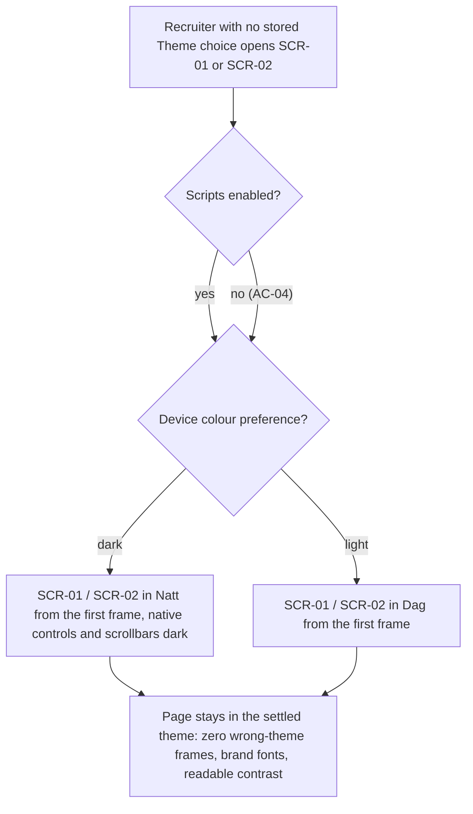
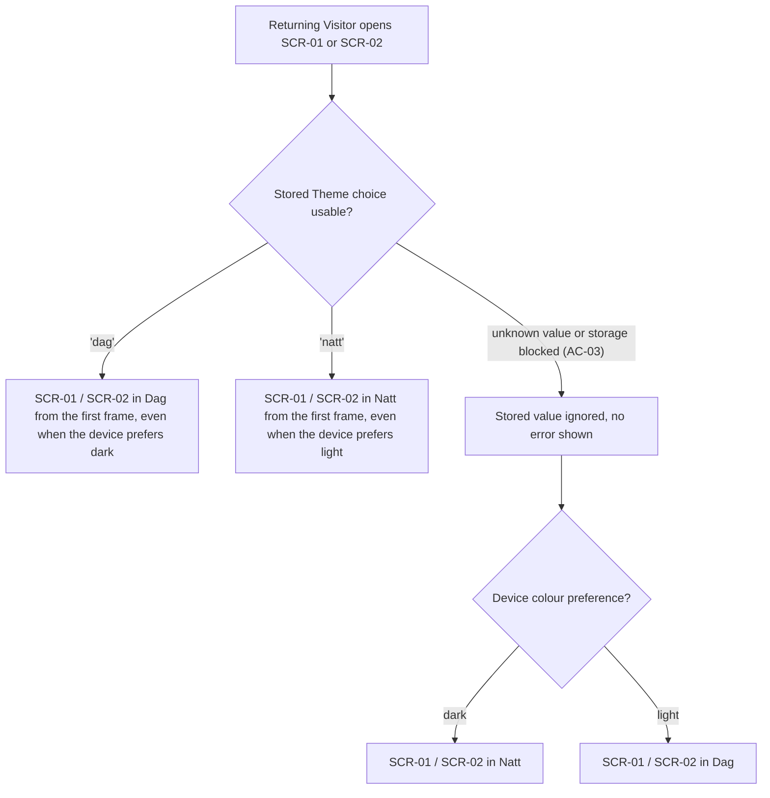
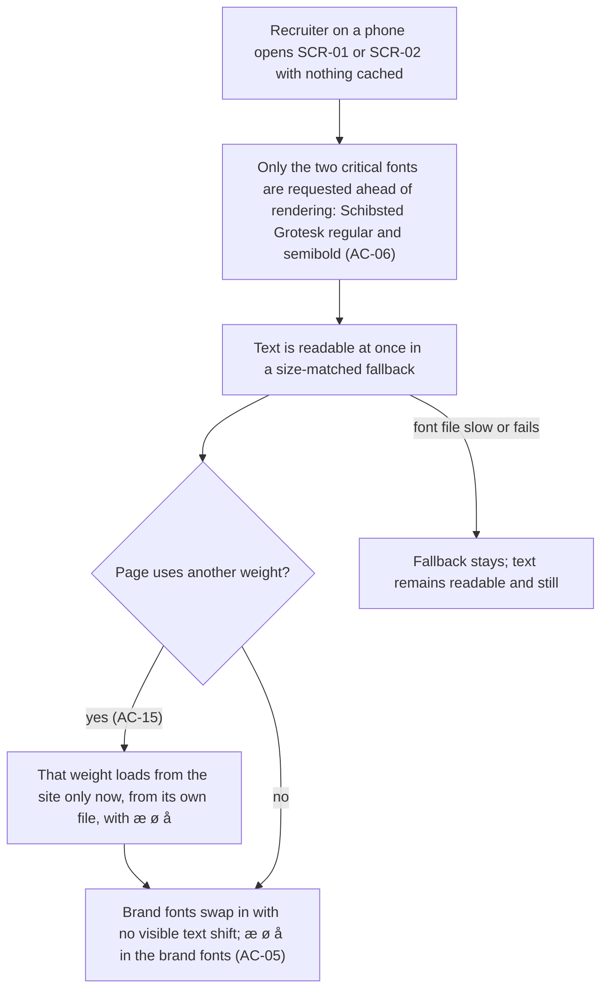
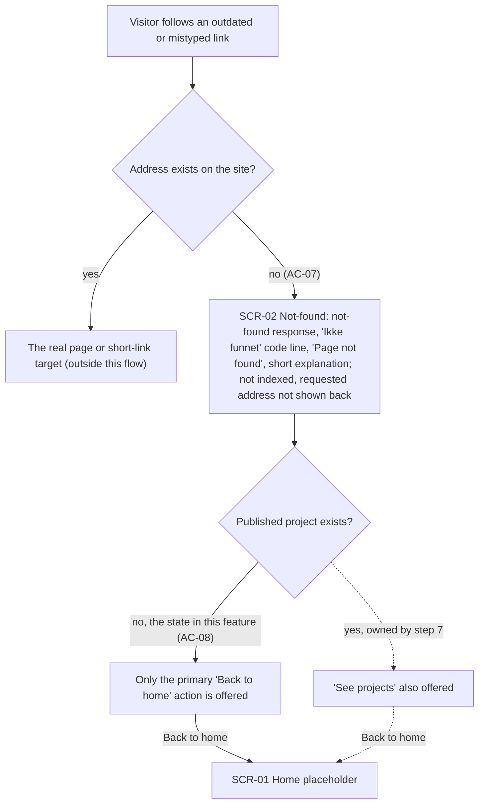
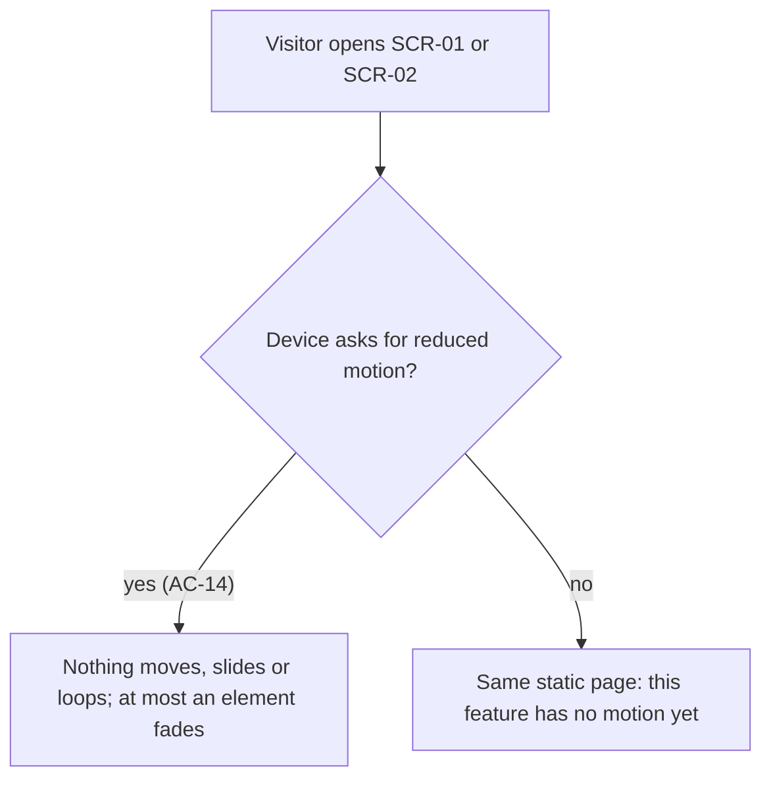

# UX flows — fjord-foundation

> User flows for every UI-touching §4 user story of [spec.md](./spec.md), produced by `ux-flows`
> (after `specify`, before `design`) and read by `design` (target-surface evidence), `sequences`,
> `screens` (details every inventory row) and `plan-tests` (the e2e-through-UI paths).
> Flow altitude only: movement between screens and the branches the ACs demand — no layout, no
> components, no styling.

## Platform decisions

- **Posture:** mobile-first, responsive across 360 / 768 / 1024 / 1440 — `docs/design-system.md` does not exist yet, so there is no canon default; chosen because the Recruiter often scans on a phone (`CONTEXT.md`) and the mobile Lighthouse budget is the binding one (spec §6). Every flow below is identical at every width: nothing in this feature branches by screen size.
- **Navigation shape:** flat. Two standalone screens, no header, menu or footer yet (step 3). The only link between them is "Back to home" on the Not-found page.
- **Not-found modality:** a full page delivered with a not-found response for any unknown address — not an overlay or a redirect.
- **Theme:** resolved before the first frame on every screen, from the stored Theme choice, else the device preference. Read-only in this feature: there is no visible switch, so a Theme choice can only come from an earlier visit (the switch arrives in step 3).
- **Scripts off:** every flow still completes without scripts; the theme then follows the device preference (AC-04).
- **Motion:** none. Nothing in this feature moves, so the reduced-motion flow ends in the same static page either way.
- **Design input (not decided here):** the theme must resolve with scripts off and before first paint; the not-found response must be returned per unknown address by the hosting layer; the second Not-found action depends on whether a Published project exists. `design` decides how.

## Screen inventory

| ID | Screen | Purpose | Entry | Exit |
|---|---|---|---|---|
| SCR-01 | Home placeholder | Temporary home page on the shared Fjord layout until the real Home (step 4); proves a page gets the Fjord base with no per-page setup | Direct visit to `/`; "Back to home" on SCR-02 | Visitor leaves the site (no navigation yet) |
| SCR-02 | Not-found page ("Ikke funnet") | Turns a dead or mistyped link into a calm Fjord page with one clear way back | Any address the site does not have (outdated or mistyped link) | "Back to home" to SCR-01; or Visitor leaves |

## Flows

### Flow: US-01 — Theme from the first frame

A Recruiter who never picked a theme opens either screen. Whether scripts are on or off, the device colour preference decides the theme: dark gives Natt from the very first frame, with native controls and scrollbars dark too; light gives Dag. In both cases the page settles in that theme and never shows a frame of the other one. The scripts-off branch joins the same path, so a Visitor without scripts still gets the right theme, the brand fonts and readable contrast.

### Flow: US-02 — Remembered Theme choice

A Visitor who picked a theme on an earlier visit comes back. A stored "dag" wins over a dark device and gives Dag from the first frame; a stored "natt" wins over a light device and gives Natt. If the stored value is anything else, or the browser blocks site storage, it is silently ignored and the device preference decides, exactly as in US-01. The page renders normally and the Visitor sees no error.

### Flow: US-03 — Brand type that holds still

A Recruiter opens either screen on a phone with an empty cache. Only the two critical font files are fetched before rendering, and the text appears at once in a fallback sized to match the brand font. If the page uses any other weight (medium, bold, or a JetBrains Mono weight), that file is fetched from the site only at that point, from its own file rather than a synthesized bold, and it includes æ ø å. When the fonts arrive they swap in without the text visibly moving. If a font file is slow or fails, the matched fallback simply stays and the page remains readable.

### Flow: US-04 — A way back from a dead link

A Visitor follows a link to an address the site does not have. Known addresses and short links go to their real target and are outside this flow. Any unknown address returns a not-found response with the Fjord Not-found page: the "Ikke funnet" code line, the "Page not found" title, a short explanation and the primary "Back to home" action. The page tells search engines not to index it and never repeats the requested address. Because no Published project exists in this feature, "Back to home" is the only action; the dashed branch, where "See projects" appears once a project is published, belongs to step 7. "Back to home" leads to the Home placeholder.

### Flow: US-07 — Calm for reduced motion

A Visitor opens either screen. When the device asks for reduced motion, nothing moves, slides or loops, and at most an element fades. When it does not, the page is the same and still static, because this feature adds no motion; animated theme and page transitions arrive with the theme switch in step 3.

### Out of scope (no human-facing UI flow)

- **US-05 — Only allowed scripts run:** the browser enforces the security policy without any visible step or screen change. The only thing a Visitor sees is the page rendering normally with the right theme, which is already the US-01 happy path. Checked by e2e (headers + refused script), not by a UI flow.
- **US-06 — Guardrails for the Owner:** the Owner works in the repository and CI. Contrast, token and policy checks and the shared layout are build-time behaviour with no screen the Owner moves through.

## AC coverage

| AC | Shown by | Notes |
|---|---|---|
| AC-01 | Flow US-01, branches `dark` and `light` of the device preference | Native controls and scrollbars follow the theme on the Natt branch |
| AC-02 | Flow US-02, branches `'dag'` and `'natt'` | Stored choice wins over the opposite device preference |
| AC-03 | Flow US-02, branch `unknown value or storage blocked`, then device preference | No error shown to the Visitor |
| AC-04 | Flow US-01, branch `no (AC-04)` of "Scripts enabled?" | Joins the same device-preference path |
| AC-05 | Flow US-03, node "Brand fonts swap in with no visible text shift" | æ ø å in brand fonts |
| AC-06 | Flow US-03, node "Only the two critical fonts are requested" + branch `yes` of "Page uses another weight?" | Other weights load only on use |
| AC-07 | Flow US-04, branch `no (AC-07)` to SCR-02 | Not-found response, noindex, address not echoed |
| AC-08 | Flow US-04, branch `no, the state in this feature (AC-08)` | The `yes` branch is dashed: step 7 owns it |
| AC-09 | N/A: browser-level enforcement with no visible step; covered by e2e in plan-tests | US-05 out of scope here |
| AC-10 | N/A: build-time contrast check, Owner in CI, no UI | US-06 out of scope here |
| AC-11 | N/A: build-time token check, Owner in CI, no UI | US-06 out of scope here |
| AC-12 | N/A: build-time policy and bootstrap sync, no UI | US-06 out of scope here |
| AC-13 | N/A: build-time shared-layout guarantee; its visible result is SCR-01 on the shared layout (Flows US-01, US-03) | US-06 out of scope here |
| AC-14 | Flow US-07, branch `yes (AC-14)` | |
| AC-15 | Flow US-03, branch `yes (AC-15)` of "Page uses another weight?" | Own file, no synthesized bold, æ ø å |
