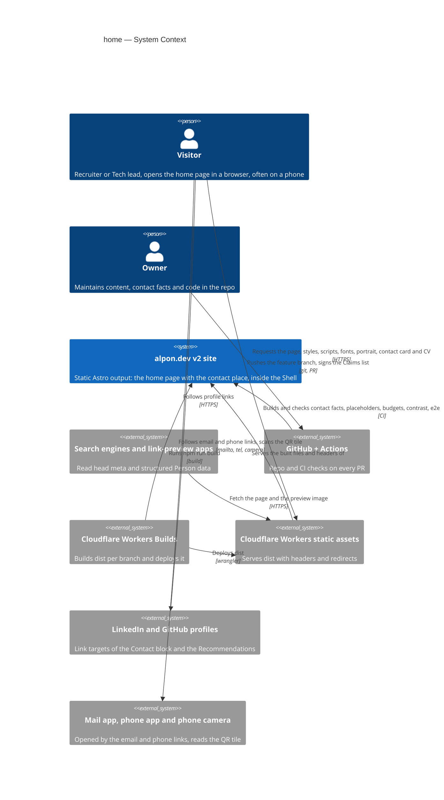
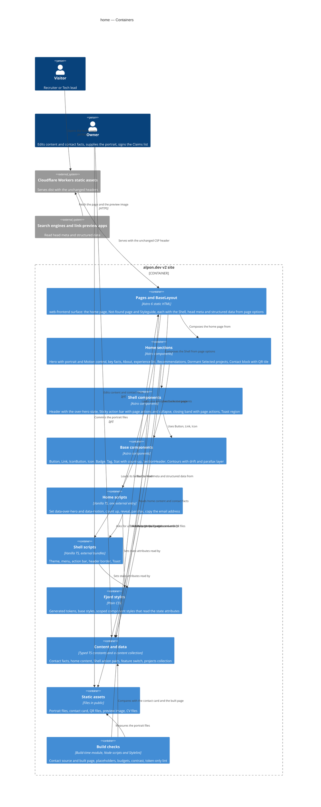
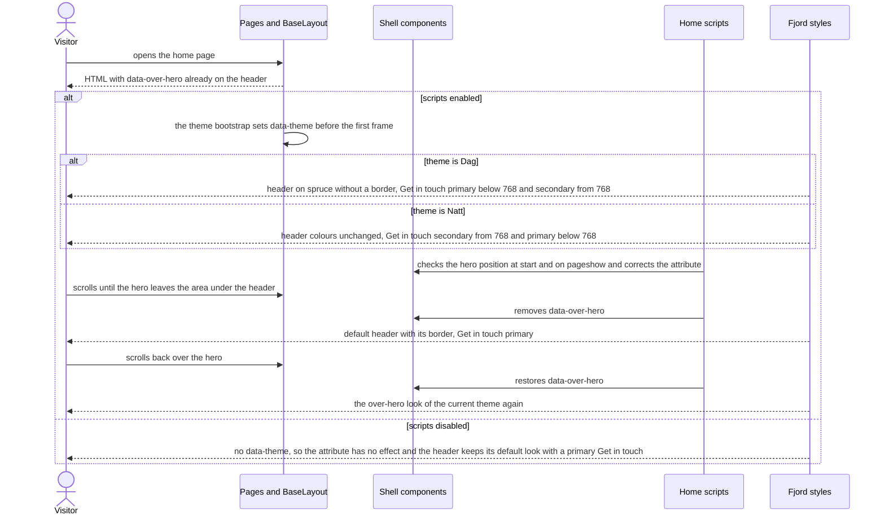
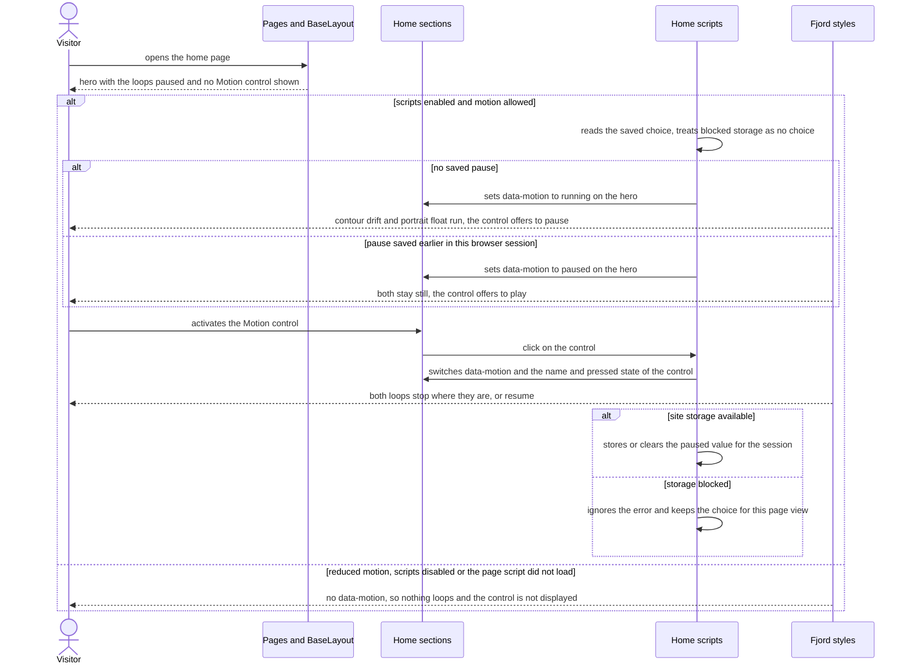

# Software Architecture Document — home

> **Upstream:** [spec](./spec.md) · [ux-flows](./ux-flows.md) · [CONTEXT](../../../CONTEXT.md) (repo root; no feature-level CONTEXT) · [base-components SAD](../base-components/sad.md) and its ADRs [0002](../base-components/adr/0002-open-the-mobile-menu-as-a-native-modal-dialog.md), [0003](../base-components/adr/0003-keep-shell-state-in-dom-attributes-and-let-css-derive-the-rest.md), [0004](../base-components/adr/0004-enforce-token-only-styles-with-targeted-rules.md) · fjord-foundation ADRs [0001](../fjord-foundation/adr/0001-pair-a-validating-theme-bootstrap-with-generated-natt-blocks.md), [0002](../fjord-foundation/adr/0002-generate-the-bootstrap-hash-into-a-single-csp-rule-at-build.md) · repo ADRs [0001](../../adr/0001-build-a-static-astro-site-served-by-workers-static-assets.md), [0002](../../adr/0002-ship-zero-client-js-by-default-with-vanilla-ts-islands.md), [0003](../../adr/0003-keep-all-content-in-the-repo-with-no-datastore.md). `docs/architecture-map.md` reflects `812f46f` and is stale; the current code was scanned for this document (§3).

## 1. Introduction and goals

**Intent.** Home rebuilds the home page of alpon.dev from its page design, content first. A Recruiter who lands on it, mostly on a phone, learns from the first screen who Alexander is, his role and his Work region, and reaches the CV or a contact action without searching; every contact route (the Contact block, the contact card, the QR) works and tells the truth. A Tech lead finds the page complete without scripts, calm under reduced motion and with looping motion that can be stopped. The feature also fits the Shell to each page: the header follows the page design over the hero, and the Sticky action bar and the closing band take their actions from the page. It turns stub-parity P-20 to P-24 and P-50 on, which moves v2 towards Release 1.

**Top-3 quality goals (1-liners; full scenarios in §10):**

1. **The first phone screen answers, and every contact fact is true** — everything AC-01 lists fits the first screen at 390 × 844, and contact facts come from one source that the checks compare with the contact card and the built page.
2. **Complete without scripts, calm with them** — every section and contact route works with scripts off; Ambient motion runs only where the Visitor can stop it; one primary action per screen.
3. **Light and guarded** — the page-own scripts and the portrait stay inside their budgets, Lighthouse and the layout-shift limit hold, and build checks stop a placeholder or a design difference before a Visitor sees it.

**Stakeholders.**

| Role | Interest | Sign-off owner? |
|---|---|---|
| Recruiter | Who, what role, where and how to reach him within a minute on a phone; useful actions in the Sticky action bar | No |
| Tech lead | Experience and Recommendations behind the claims; a page that works without scripts and adds motion with care | No |
| Visitor | A readable header over the hero in both themes; motion that can be paused; none under reduced motion | No |
| Owner | Contact facts in one place, no placeholder on a page, a Claims list to sign; steps 5 and 7 can set their own Shell actions | Yes (architect and approver of this SAD) |

<!-- Decision overrides (¶4) — populated by the critic resolution loop, empty otherwise. -->

## 2. Constraints

**Technical.**
- TypeScript 5.9 (`strict`), Node 24 LTS, npm. Astro 6.4.8, `output: 'static'`, `build.format: 'file'`, `trailingSlash: 'never'` (repo ADR-0001).
- Cloudflare Workers static assets; headers only through `public/_headers`; no Worker script. Running cost stays zero.
- The security policy is fixed and this feature does not change it (spec §6.1, AC-32): `script-src 'self'` plus the theme-bootstrap hash, `style-src 'self'`, `img-src 'self' data:`, `form-action 'none'`. `public/_headers` and `tests/contracts/csp.contract.json` stay as they are. The CSP integration (`src/integrations/csp.ts`) fails the build on any inline executable script other than the bootstrap, any inline `<style>`, `style=""` or `on*=""` attribute; it allows `application/ld+json` data blocks. `build.inlineStylesheets: 'never'` and `vite.build.assetsInlineLimit: 0` keep scripts and styles external (fjord-foundation ADR-0002).
- Zero client JS by default; interactivity is vanilla TS in Astro `<script>` (repo ADR-0002). No React, no UI kit, no QR, icon or image library.
- Token-only styles enforced by Stylelint 17.16.0 with the rules of base-components ADR-0004. Motion only through motion tokens; the tokens this feature needs already exist in `src/styles/tokens.css` (`--fjord-duration-drift`, `--fjord-duration-float`, `--fjord-duration-parallax`, `--fjord-parallax-max`).
- Theme invariant (fjord-foundation ADR-0001): with scripts on, `data-theme` is set before the first frame; with scripts off it is never set. Shell state lives in DOM attributes and CSS derives the rest (base-components ADR-0003).
- Test toolchain: Playwright 1.63.0 against `wrangler dev` on `dist/` (projects desktop and mobile, both Chromium today), `@axe-core/playwright`, Vitest 5.0.3 for pure logic, Lighthouse CI. Visual baselines are Linux only.

**Organisational.**
- Single maintainer (the Owner); size S at its upper edge, route quick. Roadmap wave 3; Release 1 waits for this step. No fixed date.
- If the task breakdown goes above about 25 tasks, `tasks` proposes the 4a / 4b split of spec §1 before writing tasks.
- Lane rule: the Shell changes of this feature stay in its PR while step 5 has not started; step 5 should start after they are in `v2` (spec §1 "Shared files").
- The Owner supplies during implement: the four portrait files (§8 Portrait), the Now line's project, two Recommendations, and the ticks of the Claims list (AC-29).
- At most two review rounds (`CLAUDE.md` Review policy). Every new dependency is explained in its PR; this design adds no npm dependency.

**Conventions.**
- `CLAUDE.md` is the authored architecture doc. The page design `design/handoff/site/project/site/Home.jsx` (with `App.jsx`, `data.js`, `site.css`) is the source of truth for the page; `BRAND.md` wins over it; `design/` is read-only.
- Components are `.astro` files with typed `Props` and a scoped `<style>`; a page is `src/pages/<route>.astro` on `BaseLayout`; pure logic sits in `.ts` modules with a `*.test.ts` next to it.
- A page changes the Shell through page options only (base-components AC-24).
- Parity gate: this feature flips its six `test.fixme` items in `tests/e2e/parity.spec.ts` (AC-35).

**Regulatory / external.**
- Data classification public; the page takes no input from Visitors (spec §6.1). Third-party personal data: the name, role and words of each person behind a Recommendation, shown only with their agreement (AC-10).
- The only Visitor data is one `paused` value in `sessionStorage` for the Motion control, never sent anywhere; no cookie.
- WCAG 2.2 AA, including 2.2.2 Pause, Stop, Hide for the hero loops (spec §1.3 D-01).
- Security review: N/A, the policy contract is unchanged and the page takes no input (spec §6.1).

## 3. Context and scope

alpon.dev is the Owner's public professional home during a job search in Norway. The home page is where a Recruiter lands from a search, from LinkedIn or from the QR on a card, and it holds the contact place that the Shell's "Contact" and "Get in touch" lead to from every page. This feature adds no external system the site loads from: it changes what the static site delivers on `/`, what the Shell renders on every page, and what CI checks. Search engines and link-preview apps are a new reader of the page's head meta and structured data. The trust boundary is the browser: everything shipped is static, and the only untrusted input is the Visitor's stored Motion choice, which is compared with one fixed value.

<!-- brownfield: scanned at 9d90205. index.astro is a placeholder inside the Shell; BaseLayout has options title/description/lang/noindex/current/headerVariant/headerCta/mobileBar/ctaBand/cvLang and renders title and description only (no canonical, og or JSON-LD, no head slot); MobileBar and CtaBand hardcode their actions; the header's "Get in touch" turns secondary below 768 through :has([data-shell-bar]:not([inert])); Toast listens to fjord:toast {message, meta?, lang?} and has no icon; Stat and Contours are static; contact.ts has workRegion as a string and no Work region coordinates; src/content.config.ts does not exist; no portrait file in public/; check-budgets.ts compares one total with both the 50 KB and the 5 KB limit (B-09); Playwright has Chromium projects only. -->

**External systems (in / out):**

| Actor or system | Type | Interaction |
|---|---|---|
| Visitor (incl. Recruiter, Tech lead) | Person | Opens the home page over HTTPS; reads, follows contact routes, downloads the contact card and the CV, may pause the motion |
| Owner | Person | Edits content and contact facts, supplies the portrait files and Recommendations, signs the Claims list, pushes branches |
| Search engines and link-preview apps | System (external) | Read the title, description, canonical address, preview card and structured Person data of the home page |
| GitHub (repo + Actions CI) | System (external) | Runs lint, contact, placeholder, budget and contrast checks, Playwright e2e / axe / visual and Lighthouse CI on every PR |
| Cloudflare Workers Builds | System (external) | Builds `dist/` per branch and deploys it |
| Cloudflare Workers static assets (edge) | System (external) | Serves `dist/` with `_headers` and `_redirects`; `/cv` answers with the English PDF until step 5 (IS-01) |
| LinkedIn, GitHub profile pages | System (external) | Link targets from the Contact block and the Recommendations, opened in the same tab; nothing is loaded from them |
| Visitor's mail and phone apps, phone camera | System (external) | Opened by the email and phone links; the camera reads the QR tile and offers the contact |

External: none new that the site loads from. No third-party script, style, font or image origin.

**C4 Context (L1):**



## 4. Solution strategy

**Top strategic choices (the seeds for ADRs):**

1. **One web surface, rendered at build time** — `target_surfaces: [web-frontend]`. ux-flows.md lists four screens (SCR-01 to SCR-04) and no other surface; there is no backend, worker or API. The UI architecture is inherited: static HTML from Astro (repo ADR-0001), zero client JS by default with vanilla TS scripts (repo ADR-0002), built from the existing Fjord tokens and base components. *(Single surface, inherited UI architecture: below the ADR gate, inline.)*
2. **Content first, motion on top** — every section is plain HTML that is visible by default: experience entries are native `<details>`, the contact place is a fragment target, key facts hold their final numbers. Scripts only add: count-up, reveal, the hero loops, parallax, copy. A script never hides something that is already visible (spec §1.3 D-04, `CONTEXT.md` invariant). Serves quality goal 2. *(Fixed by the spec and the invariant: inline.)*
3. **The header over the hero is one state attribute, already in the HTML** — the home page asks for `data-over-hero` on the header through a page option; styles apply it only under `:root[data-theme]`, so the first frame is right with scripts on and the header is the default one with scripts off; the home page script removes and restores it as the hero leaves and returns. Serves quality goals 2 and 3. → [ADR-0001](./adr/0001-mark-the-header-over-the-hero-with-a-server-rendered-state-attribute.md)
4. **Shell actions are data the page passes** — the Sticky action bar and the closing band take a pair of typed action descriptors through `BaseLayout`; the bar's type has no style field, so it cannot hold a primary button. Steps 5 and 7 use the same contract. Serves quality goal 2. → [ADR-0002](./adr/0002-pass-shell-actions-as-typed-descriptors-through-page-options.md)
5. **Ambient motion runs only where its control runs** — the hero loops are paused in CSS by default and run only under `data-motion="running"`, which the home page script sets after it has read the saved choice and the device setting. If that script does not run, the page is still and shows no control. Serves quality goal 2. → [ADR-0003](./adr/0003-run-ambient-motion-only-under-a-state-attribute-the-page-script-sets.md)
6. **Facts have one source and a check** — contact facts stay in `src/data/contact.ts` and feed the Contact block, the mail-link sentence, the hero coordinates and the structured data; home content sits in typed data next to it; build checks compare the built page with the source and refuse bracketed placeholders. Serves quality goals 1 and 3. *(Extends the existing convention: inline.)*

Each tactical decision in later sections traces to one of these seeds. Tactical decisions that contradict a strategic choice are red flags and go to §11.

## 5. Building block view

Astro's file-based layering, unchanged: the page composes `BaseLayout` and the home sections, sections compose base components and read typed data, the layout composes the Shell. The home sections are a new component group, `src/components/home/`, because they belong to one page and are not Shell or base components. Their client logic is a set of pure modules in `src/scripts/home/`, loaded by one `<script>` in `index.astro`, so the page adds one script entry and each module is unit-testable. Shell changes stay in the Shell's own files. Build-time code stays in `scripts/`.

**Internal decomposition:**

```
public/img/portrait-v1-{340,680}.{avif,webp}   four files committed by the Owner (§8 Portrait)
scripts/
├── check-budgets.ts        Shell scripts apart from page-own scripts (B-09); portrait files ≤ 40 KB each
├── check-contact.ts        source half (contact.ts vs the .vcf) in lint; built half on dist/index.html (AC-27)
├── check-placeholders.ts   new: bracketed placeholders in dist/*.html, Styleguide exempt (AC-28)
└── contrast-pairs.ts       + pairs of the new components and of the header over the hero
src/
├── content.config.ts       new: `projects` collection, empty; step 7 fills and extends it
├── content/projects/       stays empty in this feature
├── data/
│   ├── contact.ts          + workRegionGeo (locality, country, coordinates)
│   ├── home.ts             new: key facts, intro, quick facts, experience, recommendations, nowProject
│   ├── person.ts           new: structured Person data built from contact.ts
│   ├── shell-actions.ts    new: action types and ready pairs                              ADR-0002
│   ├── site.ts             new: features.projects = false, the switch step 7 owns
│   └── samples.ts          new: marked sample projects for the Styleguide (AC-12)
├── scripts/
│   ├── home/               new, pure modules, one entry
│   │   ├── index.ts        entry imported by index.astro
│   │   ├── hero-header.ts  hero observer → data-over-hero on the header                   ADR-0001
│   │   ├── motion.ts       saved choice + device setting → data-motion, Motion control    ADR-0003
│   │   ├── parallax.ts     pointer → --fj-px / --fj-py on the hero contours layer
│   │   ├── count-up.ts     key facts count once when first in view
│   │   ├── reveal.ts       sections outside the viewport fade in once
│   │   ├── copy-email.ts   clipboard write → fjord:toast
│   │   └── sections.ts     numbers the sections that are rendered (used at build time)
│   └── shell/
│       ├── action-bar.ts   does nothing while the bar is collapsed
│       └── toast.ts        + optional icon in the payload (B-25)
├── components/
│   ├── home/               new: Hero, Portrait, MotionControl, KeyFacts, About, ExperienceList, Recommendations,
│   │                       SelectedProjects + ProjectCard (Dormant), ContactBlock, QrTile
│   ├── ui/                 Stat (+ countUp), Toast (+ check icon), Icon (+ play, pause, check, chevron, copy and contact icons)
│   ├── brand/              Contours (+ ambient drift, parallax layer)
│   └── layout/             Header (+ over-hero state, bar rule removed), MobileBar (+ actions, collapse),
│                           CtaBand (+ actions, scroll-driven contours, top margin)
├── layouts/BaseLayout.astro   + head meta, structuredData, headerOverHero, mobileBarActions, ctaBandActions; main min height
└── pages/
    ├── index.astro         the home page (SCR-01)
    ├── 404.astro           unchanged source; gets the new bar through the default pair (SCR-02)
    └── styleguide.astro    + a section per new component, the Dormant section with sample data, changed Shell samples (SCR-04)
tests/
├── e2e/                    home, contact, header-states, motion, action-bar (collapse), primary-count, parity (six items on)
├── a11y/                   axe on the home page: Dag and Natt, scripts on and off, an experience entry open
└── visual/                 home per section + new Styleguide sections + Not-found re-baselined, 390 / 834 / 1440 × Dag / Natt
```

`CLAUDE.md` "Project structure" gains `components/home/` and `scripts/home/` with this feature.

**Page options (changes to the AC-24 contract of `BaseLayout`).** Existing options keep their meaning unless listed.

| Option | Values | Default | Effect |
|---|---|---|---|
| `headerOverHero` | boolean | `false` | Renders `data-over-hero` on the header; the page's script keeps it in step with its hero (ADR-0001). Home sets `true` |
| `mobileBarActions` | pair of `BarAction` | the bar's default pair ("View CV", "Save contact (.vcf)") | The two actions of the Sticky action bar, always secondary (ADR-0002) |
| `ctaBandActions` | pair of `BandAction` | the band's default pair ("Get in touch" primary, "Download CV") | The two actions of the closing band; home passes "Save contact (.vcf)" and "Download CV", both secondary (ADR-0002) |
| `structuredData` | object | none | Rendered as one `application/ld+json` data block in the head; home passes the Person object |
| `headerCta` | `'auto'` \| `'secondary'` | `'auto'` | Changed: `auto` is now always primary outside the over-hero state; the "secondary while the bar is on screen" rule is removed (spec §1.3 D-14) |
| `noindex` | boolean | `false` | Extended: also decides the head meta rule of §8 (no canonical, preview card or `og:url` on a noindex page) |

**C4 Container (L2):**



The one declared surface (`web-frontend`) is **Pages and BaseLayout**; the other containers ship inside it and are drawn separately to show what depends on what. Build checks run at build time only.

## 6. Runtime view

Participants are the §5 containers; the Visitor's browser runs the scripts and applies the styles. These two flows seed the stage; `sequences` covers every §5 AC.

**Critical flow 1: the header over the hero** (AC-33, AC-34)



**Critical flow 2: Ambient motion and the Motion control** (AC-30, AC-31, AC-32)



## 7. Deployment view

<!-- N/A: reuses the existing deployment unit, no infra change -->

No topology change: the same Worker serves `dist/` as static assets, built and deployed by Workers Builds; the build command, `wrangler.jsonc`, `_headers` and `_redirects` are unchanged. The feature replaces `dist/index.html`, adds four portrait files under `/img/` (served with the existing `/img/*` cache rule, §8 Portrait) and one more external script file for the home page. Monitoring stays as before: Lighthouse CI and the budget script in CI, no runtime alerting.

## 8. Crosscutting concepts

Everything not listed here is inherited unchanged from the base-components SAD §8 and the fjord-foundation SAD §8 (tokens, theme bootstrap, fonts, security policy, Shell state, mobile menu, icons, Styleguide states, token-only styles).

| Concept | Convention | Where defined |
|---|---|---|
| Header over the hero | `data-over-hero` on the header, rendered through `headerOverHero`, applied only under `:root[data-theme]`; the home page script removes and restores it, with a synchronous check at start and on `pageshow`. Dag: spruce, no border, primary below 768 and secondary from 768. Natt: only "Get in touch" turns secondary from 768. The 18 states are tested by computed styles and visual tests at fixed scroll positions, not by timing | ADR-0001; AC-33 |
| One primary | Per visible screen at most two primary buttons, at most one from page content (AC-34). The header "Get in touch" is primary except in the over-hero states above; the Sticky action bar has none on any page; the home band has none. The header rule that depended on the bar is removed (D-14). The e2e count runs on every Visitor page at the positions of spec §6 "Primary buttons" | ADR-0001; ADR-0002; AC-34 |
| Shell actions | `mobileBarActions` and `ctaBandActions` take a pair of typed descriptors from `src/data/shell-actions.ts`; the bar's type has no style field. No page edits the bar or the band | ADR-0002; AC-38, AC-40 |
| Sticky action bar collapse | The bar is a native `<details open>`; its `<summary>` is the tab: at the end edge of the bar, at least 44 × 44 px, with a chevron icon and a name, its state announced by the platform. It works with scripts off. The scroll script does nothing while the bar is collapsed, so scrolling never brings a collapsed bar back; a bar brought back with the tab scrolls as before. The collapse holds for the page view (no storage). Under reduced motion it changes at once. The look of the tab is drawn by `screens` | spec §1 notes; AC-39 |
| Bar clearance and Toast offset | The end-of-page space and `scroll-padding-bottom` below 768 follow the bar's state through `:has()`: the bar's height when open, the tab's height when collapsed, so neither covers the last lines or the focused element. The Toast sits above the bar, or above the tab when the bar is collapsed | AC-39; ux-flows "Design input, decided" |
| Ambient motion | Drift and float are paused by default and run only under `[data-motion='running']` on the hero; the Motion control is displayed only when `data-motion` exists. Storage key `fjord-motion`, value `paused`, in `sessionStorage` inside try and catch. The script sets nothing under reduced motion and removes the attribute if the device setting changes; the global reduced-motion rule of `base.css` applies as well | ADR-0003; AC-30, AC-31 |
| Motion control | An `IconButton` in the hero with play and pause icons; its name says the action it will take ("Pause animation", "Play animation"), with `aria-pressed`, a visible focus ring and a 44 px target. Its place in the hero is reserved, so showing it shifts nothing | spec §1 notes; AC-30 |
| Hero parallax | Pointer follow, as in the prototype: `parallax.ts` sets `--fj-px` and `--fj-py` on the hero contours layer from the pointer position, limited by `--fjord-parallax-max` and eased by `--fjord-duration-parallax`. It runs only under `(hover: hover) and (pointer: fine)` and without reduced motion; nothing happens on touch screens. It is not Ambient motion, so the Motion control does not govern it. This is the one place where a script writes a style value: two custom properties through the CSSOM, which `style-src 'self'` allows; no class and no `style` attribute in the HTML | here; `CONTEXT.md` Ambient motion |
| Closing band contours | CSS scroll-driven animation (`animation-timeline: view()`) under `@supports` and `prefers-reduced-motion: no-preference`, in the band's own style; no script, so it behaves the same with scripts off. Still where the browser has no support. Applies on every page with the band | spec §1.3 D-13; AC-41 |
| Count-up | `Stat` with `countUp` renders the final value as the text assistive technology reads and a second copy, hidden from it, that the script counts from zero once when the panel first comes into view. Tabular numerals and a width reserved for the final value keep everything around it still. Without the script, or under reduced motion, only the final value is shown | AC-05, AC-06 |
| Section reveal | Sections are visible by default. At start the script marks only sections that lie outside the viewport (`data-reveal="pending"`) and sets `data-reveal="in"` when each first comes into view; it never marks the target of the address's fragment and does nothing under reduced motion | spec §1.3 D-04; AC-36 |
| Experience entries | Native `<details>` per entry, the first with `open`; they open and close independently, with scripts off too, and the platform announces the state | AC-08 |
| Contact place | The contact section has `id="contact"`, `tabindex="-1"` and a `scroll-margin-top` of the header height; the Shell target stays `/#contact`. Focus comes from native fragment navigation, as with the skip link. The AC-18 e2e asserts that `document.activeElement` is the contact section in Chromium, Firefox and WebKit, both from another page and from the home page itself. Where native navigation does not move focus, the smallest script that does is added (the menu script already does it for same-page links) and named in this row | AC-18 |
| Copy email | The "Copy" button sits behind `data-needs-script`. It writes the address with the Clipboard API. Success: `fjord:toast` with "Kopiert" (`lang="no"`), the address as meta and the check icon. Refusal: a Toast without the check icon that tells the Visitor to copy the address by hand. No confirmation is ever shown for a copy that did not happen; the address stays a selectable mail link | AC-14, AC-15; B-25 |
| Head meta | `BaseLayout` renders title and description on every page. Canonical (from `Astro.site` and the page address), `og:*` with `https://alpon.dev/og.png` at 1200 × 630 and the large Twitter card render only on indexable pages: one rule on `noindex`, no per-page switch. The Not-found page and the Styleguide get no canonical and no `og:url` | AC-26; P-24 |
| Structured data | The home page passes a Person object built by `src/data/person.ts` from `contact.ts` (name, job title "Software Engineer", email, phone, address Oslo, Norway, `sameAs` LinkedIn and GitHub). It is rendered as one `application/ld+json` data block with `<` escaped; the CSP integration allows data blocks and the policy is unchanged | AC-26, AC-27 |
| Contact data | `contact.ts` keeps `workRegion` ("Oslo, Norge") and gains `workRegionGeo` (locality Oslo, country NO, 59.91, 10.75) for the hero coordinates and the structured address; the Residence stays a separate field. `check-contact.ts` has two halves: the source half compares `contact.ts` with the contact card in lint, as before; the built half reads `dist/index.html` after the build and fails, naming the field, if the structured data, the mail-link sentence of IS-03 or the hero coordinates differ from the source | AC-27 |
| Home content | `src/data/home.ts` holds key facts, intro, quick facts, experience and Recommendations as typed data. A Recommendation has `consent`; one without it is left out and never edited, and the section is left out when none remains. `nowProject` is optional; without it the Now line shows only the MSc part. Section numbers are computed from the sections that are rendered, so there is never a gap | AC-03, AC-09, AC-10; D-05 |
| Dormant Selected projects | `SelectedProjects` and `ProjectCard` take projects as a prop. The Styleguide passes marked sample data from `src/data/samples.ts`. The home page renders the section and the hero's "See projects" only when `features.projects` in `src/data/site.ts` is true and at least one Published project exists; step 7 flips the switch. The `projects` collection is defined in `src/content.config.ts` (glob loader over `src/content/projects/*.md`) with the fields AC-12 names and is empty here | AC-04, AC-11, AC-12 |
| Portrait | Four files committed by the Owner in `public/img/`: `portrait-v1-340.avif`, `portrait-v1-340.webp`, `portrait-v1-680.avif`, `portrait-v1-680.webp`; square, centred on the face, original colours (the design's photo filter is applied in CSS), each ≤ 40 KB. No build script and no `astro:assets`. The component writes `<picture>` with AVIF and WebP sources, `srcset` with the 340w and 680w files, `sizes` of 200px below 768, 260px from 768 and 340px from 1024, and `width` and `height` by hand. The portrait is not lazy-loaded: from 1024 it sits beside the heading on the first screen and can be the LCP element; `loading` and `fetchpriority` are decided from the Lighthouse LCP element at 390 and 1440, not by default. Cache: `public/_headers` serves `/img/*` with `Cache-Control: public, max-age=604800` (seven days, not immutable); `v1` in the names means a new photo gets new names, so `_headers` needs no change | AC-02; spec §6 "Portrait" |
| Budgets | `check-budgets.ts` measures Shell scripts apart from page-own scripts (B-09): a script file that more than one built page loads is a Shell script, a file only one page loads is that page's own. It also fails, naming the file, if any of the four portrait files is missing or larger than 40 KB | spec §6 "Initial JS", "Portrait"; B-09 |
| Placeholders | `scripts/check-placeholders.ts` runs after the build over the text of every page in `dist/`, fails with the page and the text on square brackets that stand for a missing value, and exempts the Styleguide's marked sample data | AC-28 |
| Layout fixes | The closing band gets the design's top margin; `main` gets `min-height: 60vh` and no outline (B-18) | B-18 |
| Testing | Vitest for `src/scripts/home/*`, `src/data/person.ts`, the section numbering and the new checks. Playwright e2e with reduced motion emulated by default; motion-allowed tests for the loops, the Motion control, count-up and reveal; a scripts-off context for AC-32; computed-style and visual tests for the header states; Firefox and WebKit projects that run the AC-18 focus spec only. Axe on the home page in Dag and Natt, scripts on and off, with an experience entry open. Visual tests per section with motion off | spec §6 |
| Error handling | Build time: checks fail closed and name the page, field or file. Run time: storage and clipboard errors are caught; a missing API (`IntersectionObserver`, scroll-driven animation) leaves the static state. If the home page script does not run, the page is still, shows no Motion control, and the header keeps the over-hero look (ADR-0001, ADR-0003) | here |
| ID strategy / events / persistence / observability | N/A — no entities or datastore (repo ADR-0003); the only event is the in-page `fjord:toast`; the only new stored value is `fjord-motion` in the Visitor's own session storage | — |

## 9. Architecture decisions

| # | Title | Status | Section |
|---|---|---|---|
| 0001 | Mark the header over the hero with a server-rendered state attribute | Accepted | §4 |
| 0002 | Pass Shell actions as typed descriptors through page options | Accepted | §4 |
| 0003 | Run Ambient motion only under a state attribute the page script sets | Accepted | §4 |

ADR files live under `docs/features/home/adr/NNNN-<title>.md`. Inherited decisions: repo ADR-0001 to 0003, fjord-foundation ADR-0001 and 0002, base-components ADR-0002 to 0004 (links at the top).

## 10. Quality requirements

Each top-3 goal from §1 expanded into scenarios. Numbers are quoted from spec §6.

**QG-1. The first phone screen answers, and every contact fact is true**
- **When:** a Recruiter opens the home page on a phone "at 390 × 844, the size of the page design", in Dag or Natt, and does not scroll; and when the Owner changes a contact fact.
- **Then:** "everything AC-01 lists lies fully inside the first screen"; "every interactive element of the page content ≥ 44 × 44 px at 390, counting its overlay"; the Contact block, the mail-link sentence of IS-03, the structured data and the hero take the fact from `src/data/contact.ts`, and the checks fail, naming the field, when the contact card or the built page disagrees (AC-27); the six parity items of this step pass as real tests (AC-35).
- **How verify:** e2e box measurement at 390 × 844 for AC-01 and for the touch targets; `scripts/check-contact.ts` (source half in `npm run lint`, built half after the build) with a passing and a failing fixture per field in Vitest; `tests/e2e/parity.spec.ts` with P-20 to P-24 and P-50 switched from `fixme` to `test`.

**QG-2. Complete without scripts, calm with them**
- **When:** a Tech lead opens the home page with scripts off; a Visitor pauses the motion, or uses a device that asks for reduced motion; and when the checks count primary buttons and compare the header states.
- **Then:** every section is readable and every contact route works (AC-32); "0 axe violations on the home page in Dag and Natt, with scripts on and off, and with an experience entry open"; Ambient motion: "0 loops running when paused, with reduced motion, or with scripts off; pausing takes effect within 100 ms; 0 animations in the closing band that advance without scrolling"; primary buttons "on every page except the Styleguide: visible screen ≤ 2, of which page content ≤ 1, at 390 / 834 / 1440; on the home page counted at the top, over the contact section and at the end; Sticky action bar 0 on every page, closing band 0 on the home page"; header states: "the 3 widths × 2 themes × 3 positions (top of the page, scrolled over the hero, after it) of AC-33 each match the page design, border included"; the collapsed bar: "the tab is ≥ 44 × 44 px; at 390, at the end of the page and with focus on the last footer link, it overlaps 0 px of the last line and of the focused element"; contrast "body ≥ 4.5:1; large text, control boundaries and the focus ring ≥ 3:1" for every pair the new components render, "including the header over the hero".
- **How verify:** Playwright context with `javaScriptEnabled: false`; axe in `tests/a11y/`; an e2e check of `document.getAnimations()` in the paused, reduced-motion and scripts-off cases and after activating the Motion control; the primary-count spec; computed-style and visual tests of the 18 header states at fixed scroll positions (ADR-0001); e2e box measurement of the tab; `scripts/check-contrast.ts` with the extended pair manifest.

**QG-3. Light and guarded**
- **When:** the built site is measured in CI and reviewed in the PR.
- **Then:** Lighthouse mobile "Performance, Accessibility, Best Practices, SEO each ≥ 95 on the home page" with "≤ 2.0 s / ≤ 0.02 / ≤ 100 ms on the home page, with the count-up, reveal and portrait included" for LCP / CLS / TBT; initial JS "≤ 50 KB gzip in total; the home page's own scripts together ≤ 10 KB gzip, measured apart from the Shell scripts (B-09)"; portrait "≤ 40 KB at the largest size served; width and height reserved"; "0 bracketed placeholders on pages for Visitors"; token-only styles "0 findings over all page and component styles"; visual regression "≤ 0.1 % differing pixels per screenshot; home page per section at 390 / 834 / 1440 in Dag and Natt with motion off; new and changed Styleguide sections; the Not-found page re-baselined for its bar"; design match "0 differences between the home page and `design/screenshots/{dag,natt}_home.png` (and the standalone design at 390 and 834) other than those listed in §1.2 and §1.3".
- **How verify:** `npm run lhci` on `dist/`; `scripts/check-budgets.ts` after the build (Shell and page-own scripts apart, the four portrait files); `scripts/check-placeholders.ts` after the build; Stylelint in `npm run lint`; Playwright visual tests in CI; manual side-by-side review in the PR, with the Claims list ticked by the Owner (AC-29).

## 11. Risks and technical debt

| Risk / debt | Severity | Mitigation | Owner |
|---|---|---|---|
| The breakdown may exceed about 25 tasks: the feature is at the upper edge of size S after the Shell changes | Medium | `tasks` proposes the 4a / 4b split of spec §1 before writing tasks; the Release 1 tasks (Shell changes, hero, Contact block, head meta, parity) come first and can merge on their own | Owner |
| Shell files change in a page feature (Header, MobileBar, CtaBand, BaseLayout, Toast, `contact.ts`), and step 5 touches the same files | Medium | The lane rule of spec §1: the Shell changes merge into `v2` before step 5 starts; if step 5 starts earlier, they go in a small separate PR first. ADR-0002 names the bar's language switch as a planned extension for step 5 | Owner |
| The hero cannot be finished until the Owner has committed the four portrait files | Medium | Adding the files is an Owner task placed before the hero task; `check-budgets.ts` fails and names a missing or oversized file | Owner |
| The portrait may be the LCP element at 1440 and could push LCP above 2.0 s if loaded late | Low | Not lazy-loaded; `loading` and `fetchpriority` are set from the Lighthouse LCP element measured at 390 and 1440 (§8 Portrait) | Owner |
| The home page script fails to load while other scripts run: the header keeps the over-hero look after the hero has left, and there is no motion and no Motion control | Low | Accepted (ADR-0001, ADR-0003): the header text stays readable on its own spruce background, navigation works, and a still page with no control is the safe state | Owner |
| After a reload or a back-button return at a scrolled position the first frame can show the over-hero header before the script corrects it | Low | Synchronous position check at start and on `pageshow` (ADR-0001); an e2e test covers the back-button case of AC-33 | Owner |
| The parallax script writes two custom properties through the CSSOM, an exception to "scripts never write styles" (base-components ADR-0003) | Low | Limited to `--fj-px` and `--fj-py` on one element; an e2e test asserts that the page raises no security-policy violation with the pointer moving; the CSP contract file stays unchanged | Owner |
| Native fragment navigation may not move focus to the contact section in every browser | Low | The AC-18 e2e asserts `document.activeElement` in Chromium, Firefox and WebKit; a minimal focus script is added only where it fails (§8 Contact place). Playwright's WebKit is not Safari itself, so one manual check on a real iPhone goes into the PR | Owner |
| Firefox and WebKit projects add browser downloads and time to CI | Low | They run the AC-18 focus spec only; the rest of the suite stays on Chromium | Owner |
| Scroll-driven animation is not available in every browser, and `animation-timeline` may not pass the token-only Stylelint lists as they are | Low | The band is still without support, which the spec accepts (D-13); a needed addition to the lists is made in the lists of base-components ADR-0004 and named in the PR | Owner |
| "A script more than one page loads is a Shell script" would misfile a future script shared by two pages that is not part of the Shell | Low | It can only make the Shell budget stricter, never looser; revisit when the first such script appears | Owner |
| The empty `projects` collection may log a build warning for a folder with no entries | Low | A warning does not fail the build; step 7 adds the first entry. If the warning becomes an error in a later Astro version, check the Astro Docs MCP before changing the loader | Owner |
| The Styleguide shows the home components as static samples; the home scripts do not run there | Low | Behaviour is covered by e2e on the home page itself; the Styleguide stays the visual reference | Owner |
| Recommendations and the Now line's project depend on content the Owner supplies during implement | Low | Both have a defined state without it: the section is left out and numbers close the gap (AC-10); the Now line shows the MSc part only (AC-03) | Owner |
| `docs/architecture-map.md` is stale (reflects `812f46f`) | Low | Run `/sdd:survey` after this feature merges; this SAD was drafted from a fresh scan | Owner |

**Accepted debt (acceptable in v1, plan to fix later):**
- Interim surfaces IS-01 to IS-03 (spec §1.2): the CV address answers with the English PDF, the legacy `#cv` addresses do nothing, and the mail-link sentence stands where the Message form will be.
- With scripts off the header on the home page has its default look over the hero and no scroll border (spec §1.3 D-08).
- The portrait has no JPEG or PNG fallback; a browser without AVIF and WebP support shows the alternative text.
- A new portrait needs new file names and a manual export by the Owner.

## 12. Glossary

| Term | Meaning |
|---|---|
| Ambient motion | Movement that starts by itself and keeps looping: the contour drift behind the home hero and the float of the portrait. Not count-up, reveal, parallax or the closing band's contours |
| Motion control | The single play and pause button in the home hero that stops and resumes all Ambient motion on the home page |
| Contact block | The list in the home page's contact section with email, phone, LinkedIn, GitHub and the Work region, plus the copy-email action, "Save contact" and the QR tile |
| Now line | The hero line that starts with "Nå:" and says what Alexander is working on at present |
| Recommendation | A quote from a person who worked with Alexander, word for word, shown with their name and role and with their agreement |
| Claims list | The table in the pull request that names every number and status on the page with its source, each ticked by the Owner |
| Dormant section | A part of a page that is built and shown on the Styleguide with marked sample data, but not rendered for Visitors until the owning step turns it on |
| Interim surface | A part knowingly shipped unfinished because a later roadmap step owns it (spec §1.2) |
| Message form | The short form of the page design's contact section; not built here, roadmap step 12 |
| Shell | The parts every page shares around its content: skip link, header, mobile menu, closing band, footer and Sticky action bar |
| Sticky action bar | The two-action bar fixed to the bottom of the screen on phones, whose actions each page sets and which the Visitor can collapse to a small tab |
| Work region / Residence | "Oslo, Norge", the hiring fact, and "Nittedal, Norge", the place of residence; kept as separate fields |
| Published project | A portfolio project ready to be presented; none exist in this feature |
| Dag / Natt | The light and the dark Fjord theme |
| Styleguide / Not-found page | The page that shows every Fjord component in every state; the "Ikke funnet" page for unknown addresses |
| Owner / Visitor / Recruiter / Tech lead | Roles as defined in the root `CONTEXT.md` glossary |
| Over-hero state | The header while `data-over-hero` is set and applied: the home hero reaches below the header (ADR-0001) *(technical term)* |
| Motion state | The `data-motion` attribute on the hero, `running` or `paused`; absent when the page script has not run or motion is reduced (ADR-0003) *(technical term)* |
| Action descriptor | The typed object a page passes to set one action of the Sticky action bar or the closing band (ADR-0002) *(technical term)* |
| Page-own script | A script file that only one built page loads; measured apart from the Shell scripts (§8 Budgets) *(technical term)* |
| Page options | The optional `BaseLayout` props through which a page chooses its Shell and head (§5) *(technical term)* |
