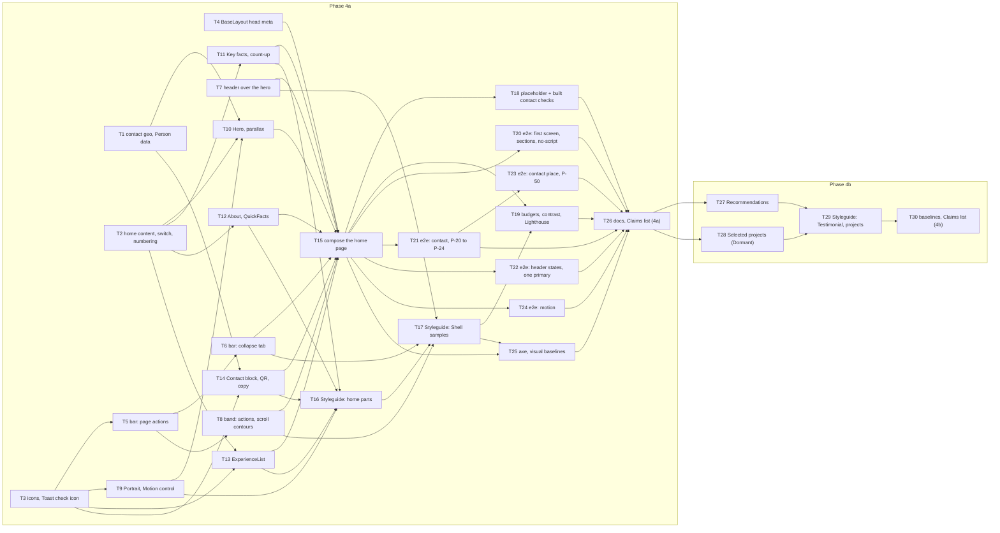

# Epic — home

> **Spec:** [spec.md](../spec.md) · **Design:** [sad.md](../sad.md) · **Screens:** [screens.md](../screens.md) · **UX flows:** [ux-flows.md](../ux-flows.md) · **API:** N/A (static site, no external interface) · **Data model:** N/A (no datastore, repo ADR-0003) · **ADRs:** [adr/](../adr/)

## Goal

Rebuild the home page from its page design, content first, so that a Recruiter on a phone learns who Alexander is, his role and his Work region from the first screen and reaches the CV or a contact action without searching ([spec §2](../spec.md)). Fit the Shell to each page: the header follows the page design over the hero, and the Sticky action bar and the closing band take their actions from the page. Turn on stub-parity P-20 to P-24 and P-50, which moves v2 to Release 1.

## Scope

- **In:** the `web-frontend` surface only (`target_surfaces` in [sad.md](../sad.md)): `ui` tasks for the home sections, the Shell changes and the screens SCR-01 to SCR-04; typed content and contact data as `domain`; page composition, `BaseLayout` options and build checks as `wiring`; e2e, axe, visual, budget and contrast work as `tests`; one `docs` task. No backend layers (infra / app / ports) and no migrations.
- **Out** ([spec §3](../spec.md)): the CV pages, the language switch and the `#cv` hand-off (step 5); the Projects pages, the "Projects" link and turning Selected projects on (step 7); the command palette (step 8); analytics (step 6); a Norwegian home page; the Message form (step 12, IS-03 stands in its place).

## Split decision

30 tasks, above the "about 25" limit of [spec §1 Task order](../spec.md) and [sad §11](../sad.md). Decided by the Owner on 2026-10-05: **one breakdown in two phases**, along the 4a / 4b line of the spec. No new slug and no spec change.

- **Phase 4a (T1 to T26):** the Shell changes, hero, key facts, About, experience, the Contact block, motion, head meta, the build checks, the six parity items and their tests. It depends on nothing in 4b and ends with T26; after T26 the branch can go to a pull request on its own.
- **Phase 4b (T27 to T30):** Recommendations, the Dormant Selected projects section with the projects collection, their Styleguide sections and baselines. Every 4b task depends on T26.

Until 4b lands, AC-09 and AC-12 are open; AC-10 and AC-11 already hold in 4a because neither section is rendered (T2, T15, T20).

## Task map

The same DAG as [tasks.json](../tasks.json). Waves by dependency:

1. T1 ∥ T2 ∥ T3 ∥ T4 ∥ T7
2. T5 ∥ T9 ∥ T11 ∥ T12 ∥ T13 ∥ T14
3. T6 ∥ T8 ∥ T10 ∥ T16
4. T15 ∥ T17
5. T18 ∥ T19 ∥ T20 ∥ T21 ∥ T22 ∥ T24 ∥ T25
6. T23
7. T26
8. T27 ∥ T28
9. T29
10. T30

Lanes that `implement` serializes because the files overlap:

- T1 → T18: `scripts/check-contact.ts`, `scripts/check-contact.test.ts`
- T2 → T27: `src/data/home.ts`, `src/data/home.test.ts`
- T3 → T6: `src/components/ui/Toast.astro`
- T4 → T5 → T7 → T8: `src/layouts/BaseLayout.astro`, `src/layouts/BaseLayout.test.ts`
- T4 → T6: `src/styles/base.css`
- T5 → T8: `src/data/shell-actions.ts`
- T5 → T6: `src/components/layout/MobileBar.astro`, `src/components/layout/bar.test.ts`, `tests/e2e/action-bar.spec.ts`
- T5 → T7 → T22: `tests/e2e/primary-count.spec.ts`
- T9 → T19: `src/components/home/Portrait.astro`
- T15 → T27 → T28: `src/pages/index.astro`, `src/pages/_index.test.ts`
- T16 → T17 → T29: `src/pages/styleguide.astro`, `src/pages/_styleguide.test.ts`
- T18 → T29: `scripts/check-placeholders.test.ts`
- T18 → T23: `.github/workflows/ci.yml`
- T21 → T23: `tests/e2e/parity.spec.ts`, `docs/stub-parity.md`
- T25 → T30: `tests/a11y/home.spec.ts`, `tests/visual/home.spec.ts`, `tests/visual/__screenshots__/`
- T26 → T30: `docs/design-system.md`, `docs/features/home/pr-body.md`

## Tasks

See [tracker.md](./tracker.md) for status. Machine contract: [tasks.json](../tasks.json).

| # | Task | Layer | Blocked by | DoD (short) |
|---|---|---|---|---|
| T1 | [Add the Work region coordinates to contact.ts and build the structured Person data from it](./t01-contact-geo-and-person.md) | domain | — | src/data/person.test.ts proves that every field of the Person object is read from contact.ts (changing a contact value changes the output) and that the address is Oslo, NO |
| T2 | [Add the typed home content, the projects feature switch and the section numbering](./t02-home-content-data.md) | domain | — | src/scripts/home/sections.test.ts proves the numbers have no gap with and without Recommendations and with and without Selected projects |
| T3 | [Add the icons the home page needs and the optional check icon of the Toast](./t03-icons-and-toast-check.md) | ui | — | src/scripts/shell/toast.test.ts proves that a fjord:toast event with icon "check" shows the check icon before the message, that an event without it shows none, and that a second event without the icon clears the icon of the first |
| T4 | [Render head meta, the structured-data block and the main minimum height in BaseLayout](./t04-layout-head-meta.md) | wiring | — | src/layouts/BaseLayout.test.ts builds fixture pages and asserts that an indexable page has the canonical address, the og tags with image width 1200 and height 630 and the large Twitter card, that a noindex page has none of them, that structuredData renders exactly one ld+json block whose text parses |
| T5 | [Give the Sticky action bar its actions from a page option, all secondary](./t05-bar-page-actions.md) | ui | T3 | src/components/layout/bar.test.ts proves the bar renders the default pair and a custom pair, never with the primary variant, and that "Save contact (.vcf)" has download and the contact card address |
| T6 | [Make the Sticky action bar collapsible with a native details tab and move the clearance to the tab](./t06-bar-collapse.md) | ui | T5 | tests/e2e/action-bar.spec.ts on the Not-found page at 390 proves, with scripts on and with scripts off, that the tab is at least 44 × 44, collapses and restores the bar by pointer and by keyboard, that a collapsed bar is not brought back by scrolling, and that at the end of the page with focus on the last footer link the tab overlaps 0 px of the last line and of the focused element |
| T7 | [Add the over-hero state to the header and drop the bar-dependent secondary rule](./t07-header-over-hero.md) | ui | — | src/scripts/home/hero-header.test.ts proves the attribute is removed when the hero bottom is at or above the header bottom and restored below it, at start, on scroll and on pageshow |
| T8 | [Give the closing band its actions from a page option, its top margin and scroll-tied contours](./t08-band-actions-and-contours.md) | ui | T5 | src/components/layout/static-parts.test.ts proves the band renders the default pair and the home pair (no "Get in touch", no primary variant), that "Download CV" follows cvLang in both, and that the scroll-driven animation is declared only inside @supports (animation-timeline: view()) and prefers-reduced-motion: no-preference |
| T9 | [Build Portrait, the Motion control and the Ambient motion of the hero under data-motion](./t09-portrait-and-motion.md) | ui | T3 | src/scripts/home/motion.test.ts proves: no saved value gives data-motion="running" |
| T10 | [Build the Hero section with the Now line and the pointer parallax](./t10-hero.md) | ui | T1, T2, T9 | src/components/home/hero.test.ts proves the hero content of AC-01 in the built HTML (one h1 with the name, both roles, the lead, lang="no" on "Hei.", "Oslo, Norge" and "Nå:", coordinates equal to workRegionGeo, exactly one primary button "View CV", no "See projects" while features.projects is false) and the Now line with and without a project without square brackets |
| T11 | [Build the key facts panel with the Stat count-up](./t11-key-facts.md) | ui | T2 | src/scripts/home/count-up.test.ts proves each value counts once from zero to its final number keeping prefix and suffix ("3+", "~2 000"), never runs twice, and does nothing under reduced motion |
| T12 | [Build the About section with the QuickFacts list](./t12-about-quick-facts.md) | ui | T2 | src/components/home/about.test.ts proves the heading, the introduction and a <dl> with the four keys "Based in", "Focus", "Stack" and "Languages", "Nittedal, Oslo area" with the work permit, the three plain language labels without level codes, and no img, svg logo, meter or progress element inside t |
| T13 | [Build the experience list from native details entries](./t13-experience-list.md) | ui | T2, T3 | src/components/home/experience.test.ts proves four 
, only the first with open, each summary holding role, organisation and period, summary, points and tags inside the body, no empty <ul> for an entry without points or tags, and a "Full CV" link to /cv |
| T14 | [Build the Contact block with the copy-email action, Save contact, the mail-link sentence and the QR tile](./t14-contact-block.md) | ui | T1, T3 | src/scripts/home/copy-email.test.ts proves a resolved clipboard write dispatches fjord:toast with "Kopiert", lang "no", the address and icon "check", and that a rejected write or a missing clipboard dispatches the refusal message without an icon and never "Kopiert" |
| T15 | [Compose the home page from its sections, page options, the script entry and the contact place](./t15-compose-home-page.md) | wiring | T4, T6, T7, T8, T10, T11, T12, T13, T14 | src/pages/_index.test.ts proves dist/index.html holds, in order, hero, key facts, About 01, Experience 02 and Contact 03 with id="contact" and tabindex="-1", no Recommendations, no Selected projects and no "All projects", data-over-hero on the header, the home pair in the band, one ld+json Person block, exactly one page-own script file and no inline script or style |
| T16 | [Add the home component sections to the Styleguide](./t16-styleguide-home-sections.md) | ui | T9, T11, T12, T13, T14 | src/pages/_styleguide.test.ts asserts one data-section block for each of Portrait, Motion control, Key facts, Quick facts, Experience list, Contact list, QR tile and Mail-link sentence with the states of screens.md SCR-04 (both Motion control names, an open entry, a closed entry, an entry without po |
| T17 | [Update the changed Shell and base samples on the Styleguide](./t17-styleguide-shell-samples.md) | ui | T6, T7, T8, T16 | src/pages/_styleguide.test.ts asserts the three over-hero header samples and the absence of the bar-dependent one, the bar samples open with the tab and collapsed, both band pairs, the Toast success sample with the check icon and the refusal sample without it, and every new icon name |
| T18 | [Add the placeholder check and the built half of the contact check, and run both after the build](./t18-placeholder-and-contact-checks.md) | wiring | T15 | scripts/check-placeholders.test.ts proves the check fails naming page and text for "[current project]" on a Visitor page, passes for the same text inside a marked Styleguide sample, and ignores brackets in script, style and ld+json content |
| T19 | [Split the script budgets, add the portrait and contrast checks and hold the Lighthouse budget on the home page](./t19-budgets-contrast-lighthouse.md) | tests | T15, T17 | scripts/check-budgets.test.ts proves the check files a script loaded by two pages under the Shell budget and one loaded by a single page under that page's budget, fails naming file and size above 5 KB, 10 KB or 50 KB gzip, and fails naming a missing or larger than 40 KB portrait file |
| T20 | [Verify the first phone screen, the sections, touch targets and the scripts-off page end to end](./t20-home-e2e.md) | tests | T15 | tests/e2e/home.spec.ts passes: at 390 × 844 in Dag and Natt the bounding boxes of the badge, the eyebrow with coordinates, the h1, both roles, the lead, "View CV" and the Now line lie fully inside the first screen above the bar |
| T21 | [Verify the Contact block and head meta end to end and turn on P-20 to P-24](./t21-contact-e2e-parity.md) | tests | T15 | tests/e2e/contact.spec.ts passes for the five rows with their mailto, tel and profile links in the same tab, a copy that puts the address on the clipboard and shows a Toast with the check icon, "Kopiert" (lang="no") and the address in a role="status" region that leaves by itself, a refused copy that shows the English message and never "Kopiert", a "Save contact (.vcf)" download whose file holds the name, TITLE "Software Engineer", phone, email, both profiles and the Oslo address, and the QR tile shown from 1024 per theme and absent below |
| T22 | [Verify the 18 header states and the primary-button count on every Visitor page](./t22-header-states-primary-count-e2e.md) | tests | T15 | tests/e2e/header-states.spec.ts passes for all 18 states by computed style (background, border, wordmark and link colour, the variant of "Get in touch") at fixed scroll positions, for a back-button return at a scrolled position, and for scripts off (default header, primary "Get in touch" throughout) |
| T23 | [Verify the Shell contact links and focus at the contact place in three browsers and turn on P-50](./t23-contact-place-focus-p50.md) | tests | T21 | tests/e2e/contact-place.spec.ts passes in Chromium, Firefox and WebKit: from / and from the Not-found page, each of the four links ends with the contact heading in view below the header, the menu panel closed and document.activeElement equal to the contact section |
| T24 | [Verify Ambient motion, the Motion control, count-up, reveal, parallax and the band contours end to end](./t24-motion-e2e.md) | tests | T15 | tests/e2e/motion.spec.ts passes: with motion allowed the hero drift and the portrait float run, the Motion control pauses both within 100 ms and resumes them, its name and aria-pressed follow, a paused choice survives a navigation away and back and is gone in a new browser context, and with storage blocked it holds for the page view |
| T25 | [Add the home axe checks and the visual baselines for the home page, the Styleguide and the Not-found page](./t25-axe-and-visual-baselines.md) | tests | T15, T17 | tests/a11y/home.spec.ts reports 0 axe violations on / in Dag and Natt, with scripts on, with scripts off and with a second experience entry open |
| T26 | [Close the document pointers, register the built components and draft the pull request with the Claims list](./t26-docs-and-claims-4a.md) | docs | T18, T19, T20, T21, T22, T23, T24, T25 | docs/features/home/pr-body.md holds a Claims list with a row and a source for each of the four key facts, the attendee figure, the availability badge, the marker on the most recent role, each period, the language levels and the Now line, all ticked by the Owner |
| T27 | [Build the Recommendations section and show it only with agreed quotes](./t27-recommendations.md) | ui | T26 | src/components/home/recommendations.test.ts proves each card shows the quote unchanged, the name, the role and an "On LinkedIn" link to the profile of contact.ts without target, and that a quote without consent is not rendered |
| T28 | [Define the projects collection and build the Dormant Selected projects section with ProjectCard](./t28-selected-projects-dormant.md) | ui | T26 | src/components/home/projects.test.ts proves a card renders status, year, title, summary, one result with its label, tags and only the links that exist, that the section shows at most three projects with the first as the large card, and that the collection schema rejects an entry missing a required field |
| T29 | [Show Testimonial and the Dormant Selected projects on the Styleguide with marked sample data](./t29-styleguide-testimonial-projects.md) | ui | T27, T28 | src/pages/_styleguide.test.ts asserts a Testimonial section with two sample cards and a Selected projects section with a visible "Sample data" label, three cards with the first large, and one card without a live link |
| T30 | [Add the baselines and axe cases of phase 4b and complete the Claims list and the inventory](./t30-close-4b.md) | tests | T29 | With FJORD_VISUAL=compare the Styleguide visual spec passes in CI for the Testimonial and Selected projects sections, and tests/visual/home.spec.ts for the Recommendations and contact sections when Recommendations is rendered, against Linux baselines the Owner has reviewed |

## AC coverage

| AC | Tasks |
|---|---|
| AC-01 | T10, T15, T20 |
| AC-02 | T9, T16, T19, T20 |
| AC-03 | T2, T10, T20 |
| AC-04 | T10, T15, T20 |
| AC-05 | T2, T11, T16, T20 |
| AC-06 | T11, T24 |
| AC-07 | T2, T12, T16, T20 |
| AC-08 | T13, T16, T20 |
| AC-09 | T27, T30, T31 |
| AC-10 | T2, T27 |
| AC-11 | T2, T15, T20, T28 |
| AC-12 | T28, T29, T30 |
| AC-13 | T14, T16, T21 |
| AC-14 | T3, T14, T17, T21 |
| AC-15 | T3, T14, T21 |
| AC-16 | T14, T21 |
| AC-17 | T14, T16, T21 |
| AC-18 | T15, T23 |
| AC-26 | T1, T4, T21 |
| AC-27 | T1, T18 |
| AC-28 | T18, T29 |
| AC-29 | T26, T30 |
| AC-30 | T9, T24 |
| AC-31 | T9, T10, T24 |
| AC-32 | T15, T20, T25 |
| AC-33 | T7, T17, T19, T22 |
| AC-34 | T5, T7, T22 |
| AC-35 | T21, T23 |
| AC-36 | T15, T24 |
| AC-38 | T5, T17, T25 |
| AC-39 | T6, T17 |
| AC-40 | T8, T15, T17, T22 |
| AC-41 | T8, T24 |
| AC-42 | T31 |
| AC-43 | T31 |

NFR rows of [spec §6](../spec.md) without an AC of their own: Lighthouse, LCP / CLS / TBT, initial JS, portrait weight and contrast are T19; first phone screen and touch targets T20; Ambient motion T24; primary buttons and header states T22; the collapsed bar T6; visual regression and axe T25 and T30; placeholders T18; token-only styles every `ui` task; Design match is the manual review in the PR, prepared by T25 and T26.

## Owner inputs

| Input | Needed by | Without it |
|---|---|---|
| The four portrait files | T9 | Already committed (`public/img/portrait-v1-*`, commit 6b331c4) |
| The Now line project | T2 | Supplied: "alpon.dev", see [owner-inputs.md](../owner-inputs.md) |
| Review of the Linux visual baselines, `visual-baselines` label | T25, T30 | The task stays in `review` |
| Ticks on the Claims list | T26, T30 | The feature is not done (AC-29) |
| Two Recommendations with each person's agreement | T27 | Supplied with both agreements confirmed, see [owner-inputs.md](../owner-inputs.md). Entered into `src/data/home.ts` in T27, word for word, not earlier |
| One focus check on a real iPhone | T23, recorded in T26 | Named as not done in the PR |

## Risks / Hard rules

- **Tokens only** (`CLAUDE.md`, base-components ADR-0004): no literal colour, size, space, radius, duration or easing in any style. A function, unit or media form outside the allow lists (`animation-timeline`, `env()`, a `:has()` form) enters only with a recorded row in that ADR and a rejecting fixture (T6, T8), and is named in the PR.
- **Security policy is not changed** ([spec §6.1](../spec.md), AC-32): `public/_headers` and `tests/contracts/csp.contract.json` are not edited; no inline script, inline style, `style=` or `on*=`. If a task needs to change the contract, stop and tell the Owner.
- **Scripts never add classes or inline styles** (base-components ADR-0003). The one exception is `src/scripts/home/parallax.ts`: `--fj-px` and `--fj-py` on the hero contours layer, with `style.setProperty` only ([sad §1 Decision override](../sad.md), T10). Any other script that wants to write a style needs its own Owner decision.
- **Content first** (spec §1.3 D-04): every section is visible by default; a script never hides something that is already visible. Script-only controls ("Copy", the Motion control) sit behind the existing scripts-off gate or a state attribute the script sets.
- **Ambient motion runs only under `data-motion="running"`** ([ADR-0003](../adr/0003-run-ambient-motion-only-under-a-state-attribute-the-page-script-sets.md)); a still page with no control is the safe state.
- **One primary** (AC-34): the Sticky action bar's type has no style field ([ADR-0002](../adr/0002-pass-shell-actions-as-typed-descriptors-through-page-options.md)); the home band and the contact section hold no primary button.
- **Facts:** contact facts only from `src/data/contact.ts`; no bracketed placeholder on a Visitor page; every number and status is a Claims row the Owner ticks (T26, T30). The EPAM client and its events are never named. A Recommendation without agreement is omitted, never edited.
- **Read-only sources:** `design/` is never edited. The `.vcf` and the QR files are not regenerated. No QR, icon or image library; no new npm dependency is planned, and one that turns out to be needed is explained in the PR.
- **Lane rule** ([spec §1 Shared files](../spec.md)): the Shell changes (T4 to T8) stay in this feature's PR while step 5 has not started. If step 5 starts first, tell the Owner: the files step 5 also touches go in a small separate PR to `v2`.
- **Visual baselines are Linux-only:** written by the `visual-baselines` workflow, reviewed by the Owner, never committed from Windows and never updated locally.
- **Pushes and stale baselines:** from T5 the Not-found and Styleguide baselines are stale, and from T15 the home page has none, so the CI visual check is red until T25. `implement` does not push between T5 and T25. At T25 it pushes once (visual red is expected), stops, and asks the Owner to add the `visual-baselines` label. The same applies between T27 and T30. Every push goes in the same command chain as a green local gate; a failure that passes on rerun is recorded in `docs/backlog.md` with its output.
- **Budgets are reported, not bent** ([spec §6](../spec.md)): home scripts above 10 KB gzip, a portrait above 40 KB or a failed Lighthouse number goes to the Owner before any limit changes (T19).
- **Astro and Cloudflare APIs:** check the Astro Docs MCP before using an Astro option (T4 canonical, T28 content collection).
- **Parity gate:** P-20 to P-24 flip in T21 and P-50 in T23; the open `fixme` count goes 12 → 6 ([spec §7](../spec.md)). P-50 and P-51 are reworded in T23.
- **Decisions T-1 to T-6** ([screens.md](../screens.md)) and the two items decided in [sad §6 "Flagged by the flows"](../sad.md) are built and tested as written and are not reopened.
