# UX flows — home

> User flows for every UI-touching §4 user story of [spec.md](./spec.md), produced by `ux-flows`
> (after `specify`, before `design`) and read by `design` (target-surface evidence), `sequences`,
> `screens` (details every inventory row) and `plan-tests` (the e2e-through-UI paths).
> Flow altitude only: movement between screens and the branches the ACs demand. No layout, no
> components, no styling.

## Platform decisions

- **Posture:** mobile-first, per `docs/design-system.md`. The phone path is drawn first; the flows branch at 768 (Sticky action bar, header navigation) and at 1024 (portrait beside the text, QR tile).
- **Page shape:** the home page is one long page. Its sections (hero, key facts, About, Experience, Recommendations, Contact) are places on one screen, not screens of their own; a Visitor moves between them by scrolling or by a link to the contact section.
- **Contact place:** the contact section of the home page. "Contact" and "Get in touch" in the header and in the Mobile menu panel lead there from every page: on the home page the page moves to it, from another page the home page opens at it. Focus is placed at the section in both cases.
- **Message form modality:** inline in the contact section. Its idle, invalid, sending, success and failure states replace each other in place; no dialog and no page of its own. The success state stays until the page is opened again.
- **Experience entries:** each entry opens and closes in place and independently of the others; nothing navigates.
- **Copy confirmation:** a Toast, transient and non-blocking, as in base-components. On a phone it is the first Toast shown together with the real Sticky action bar.
- **Motion control:** one control in the hero, changing the page in place. It exists only where scripts run and the device does not ask for reduced motion.
- **Sticky action bar:** below 768 only; its two actions come from the page and it can be collapsed to a tab. Collapsing holds for the page the Visitor is on; a newly opened page shows the bar again.
- **Closing band:** on the home page it follows the contact section directly and carries no contact action.
- **Scripts off:** every section is readable and every contact route works. The actions that need a script (the Motion control, "Copy") are not offered, and the place of the Message form never holds a control that does nothing.
- **Motion:** with reduced motion every flow ends in the same state; changes are instant or a fade and nothing loops, counts or follows scrolling.
- **Interim and dormant targets:** the CV address is an exit of these flows, not a screen of this feature (spec §1.2 IS-01). The Selected projects section and "See projects" are dormant until step 7; their branches are dashed.
- **Design input, decided (Owner, 2026-10-05):** `design`, `screens` and `plan-tests` take these as given.
  - Sticky action bar brought back with the tab: it behaves like a bar that was never collapsed, so it again leaves on the way down and returns on the way up. AC-39's "scrolling does not bring it back" holds while the bar is collapsed.
  - A Toast while the bar is collapsed sits above the tab, as it sits above the bar when the bar is visible (base-components AC-30).
  - Leaving the page while "Sending…" is shown: no special handling and no leave warning.
  - A submission that filled the trap field gets the same response as a delivered message, and nothing is delivered (AC-24).
  - Message length: the form limits it and shows a visible character count; the delivery side checks the length again (AC-24).
  - The success state has no "send another" action, as in the prototype; a second message needs the page opened again.
  - Experience entries open and close independently, as in the prototype.
- **Design input (not decided here):**
  - The Message form's delivery path, the security-policy change that goes with it, and which of the two scripts-off variants of AC-22 is built (the form works, or a sentence with the mail link replaces it).
  - How the header follows the hero (AC-33), including the state after returning with the back button at a scrolled position.
  - The look and position of the collapse tab of the Sticky action bar (D-11).

## Screen inventory

Ids match the base-components inventory where the screen is the same.

| ID | Screen | Purpose | Entry | Exit |
|---|---|---|---|---|
| SCR-01 | Home page | Answers who, what role, where and how to reach Alexander; holds the contact place | Direct visit to `/`; the wordmark; "Back to home" on SCR-02; "Contact" and "Get in touch" from any page (opens at the contact section) | The CV address ("View CV", "Full CV"); the mail and phone apps; LinkedIn and GitHub; the contact card and CV downloads; SCR-03 |
| SCR-02 | Not-found page ("Ikke funnet") | Unchanged page content; its Sticky action bar now carries the home pair of actions, and its "Contact" and "Get in touch" reach a real place | Any address the site does not have | "Back to home", "Contact" and "Get in touch" to SCR-01; the CV address; the contact card download; SCR-03 |
| SCR-03 | Mobile menu panel | Phone navigation; "Contact" and "Get in touch" now lead to the contact section | The menu button below 768 on SCR-01, SCR-02 or SCR-04 | A link to its target (the contact section of SCR-01, the CV address); Escape or the close button back to the page |
| SCR-04 | Styleguide | Shows every new component in every state, the Dormant Selected projects section with marked sample data, and the changed Shell samples | Typing its address; nothing links to it | The header and footer links; SCR-03 |

## Flows

### Flow: US-01 — Know who this is at a glance

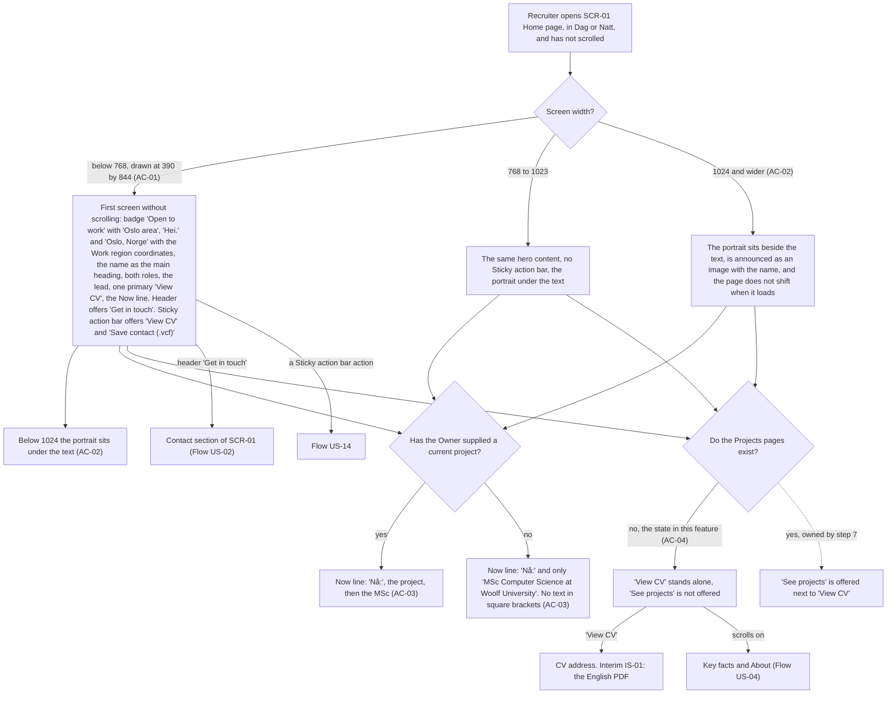

A Recruiter opens the home page and has not scrolled. On a phone (drawn at 390 by 844) the first screen shows, without scrolling, the availability badge, "Hei." and "Oslo, Norge" with the Work region coordinates, the name as the main heading, the two roles, the lead, one primary "View CV" and the Now line; the header offers "Get in touch" and the Sticky action bar offers "View CV" and "Save contact (.vcf)". From 768 the bar is gone; below 1024 the portrait sits under the text and from 1024 it sits beside it, is announced as an image with Alexander's name and does not shift the page. The Now line shows the project first if the Owner supplied one, and only the MSc otherwise, never text in square brackets. Because the Projects pages do not exist, "View CV" stands alone; the dashed branch with "See projects" belongs to step 7. "View CV" leads to the CV address (for now the English PDF), the header's "Get in touch" to the contact section, and scrolling on to the key facts.

### Flow: US-02 — Reach him the way I prefer

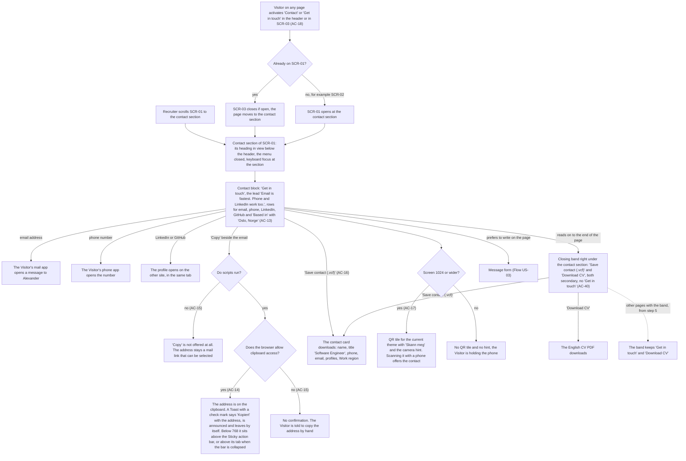

A Recruiter reaches the contact section by scrolling, or a Visitor on any page activates "Contact" or "Get in touch" in the header or the Mobile menu panel. On the home page the menu closes and the page moves to the section; from another page, such as the Not-found page, the home page opens at it. Either way the section's heading is in view below the header and keyboard focus is at the section. The Contact block shows the heading, the lead and rows for email, phone, LinkedIn, GitHub and "Based in" with "Oslo, Norge". The email opens the mail app, the phone number the phone app, and the profiles open on the other site in the same tab. "Copy" depends on the browser: with scripts off it is not offered and the address stays a selectable mail link; with scripts on and clipboard access, the address is copied and a Toast confirms "Kopiert" with the address, announced, and leaves by itself (on a phone it sits above the Sticky action bar, or above its tab when the bar is collapsed); where clipboard access is refused no confirmation appears and the Visitor is told to copy by hand. "Save contact (.vcf)" downloads the contact card. From 1024 the QR tile with "Skann meg" and the camera hint is shown and scanning it offers the contact; below 1024 neither is shown. At the end of the page the closing band offers "Save contact (.vcf)" and "Download CV" (the English PDF), both secondary and without "Get in touch"; on other pages the band keeps its usual pair (dashed, from step 5). A Recruiter who would rather write on the page goes on to the Message form.

### Flow: US-03 — Send a short message

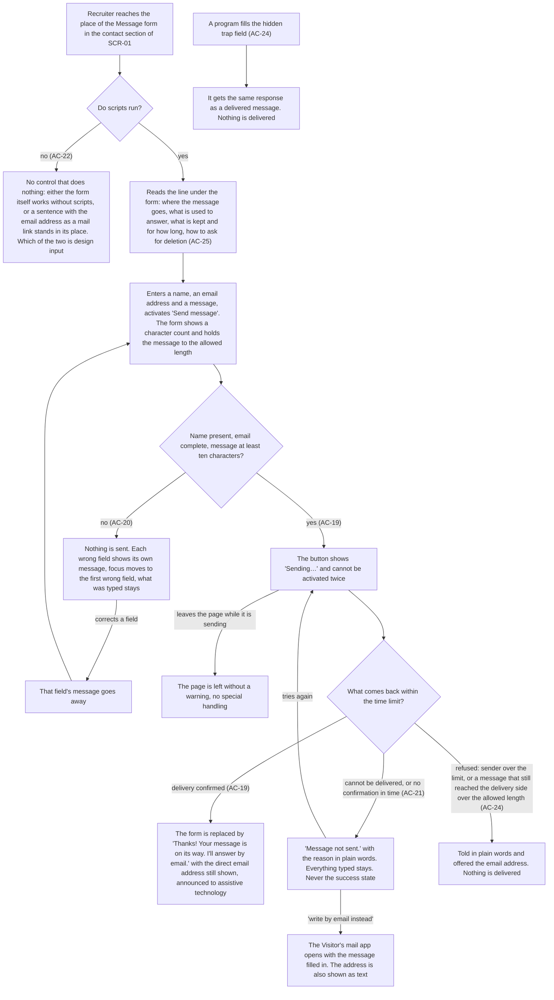

A Recruiter reaches the Message form. With scripts off there is no control that does nothing: either the form works without scripts or a sentence with the email address as a mail link stands in its place; `design` decides which. With scripts on, the line under the form tells them before they send where the message goes, what is used to answer, what is kept and for how long, and how to ask for deletion. They fill in name, email and message, with a visible character count that holds the message to the allowed length, and activate "Send message". If the name is empty, the email incomplete or the message shorter than ten characters, nothing is sent: each wrong field shows its own message, focus moves to the first wrong field, the typed text stays, and a field's message goes away once it is corrected. With valid input the button shows "Sending…" and cannot be activated twice; a Visitor who leaves the page at this point simply leaves, with no warning. Three outcomes follow within the time limit. Delivery confirmed: the form is replaced by the thanks line with the direct email address still shown, announced. Not delivered or no confirmation in time: "Message not sent." with a plain reason, everything typed kept, and two ways on, trying again or "write by email instead", which opens the mail app with the message filled in. Refused because the sender is over the limit, or because a message over the allowed length still reached the delivery side, which checks the length again: the Visitor is told in plain words and offered the email address, and nothing is delivered. Separately, a program that fills the hidden trap field gets the same response as a delivered message, and nothing is delivered.

### Flow: US-04 — Get the background in numbers and a paragraph

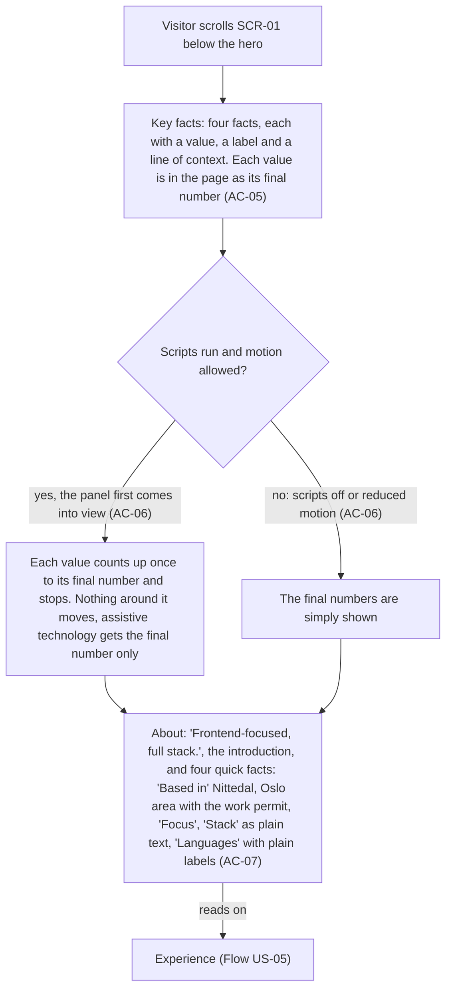

A Visitor scrolls below the hero and reads the key facts: four facts, each with a value, a label and a line of context, and every value is in the page as its final number. Where scripts run and motion is allowed, each value counts up once when the panel first comes into view and stops, nothing around it moves, and assistive technology is given the final number only; with scripts off or reduced motion the final numbers are simply there. The About section follows with its heading, the introduction and four quick facts: "Based in" with the Residence, the Work region and the work permit, "Focus", "Stack" as plain text, and "Languages" with plain labels. Nothing in these two sections is activated; the Visitor reads on to the experience.

### Flow: US-05 — See where he has worked

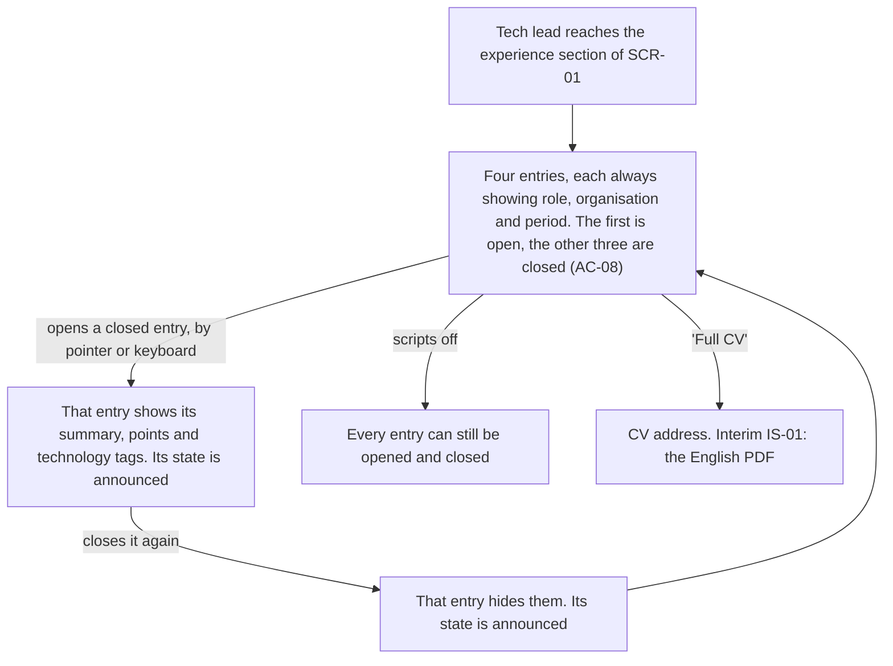

A Tech lead reaches the experience section. It lists four entries; each always shows the role, the organisation and the period, the first is open on arrival and the other three are closed. Opening an entry with a pointer or the keyboard shows its summary, points and technology tags, closing it hides them, and the state is announced each time; entries open and close independently. With scripts off every entry can still be opened and closed. "Full CV" leads to the CV address, which for now answers with the English PDF.

### Flow: US-06 — Hear from people who worked with him

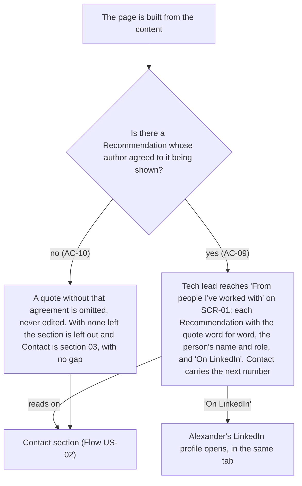

Whether a Tech lead meets this section is settled when the page is built. A quote whose author has not agreed to it being shown is omitted and never edited; if no Recommendation remains, the section is left out entirely and the Contact section takes the number 03 with no gap. With at least one Recommendation, the section "From people I've worked with" shows each quote word for word with the person's name and role and an "On LinkedIn" link, which opens Alexander's profile in the same tab, and the Contact section carries the next number.

### Flow: US-07 — See selected projects when there are some

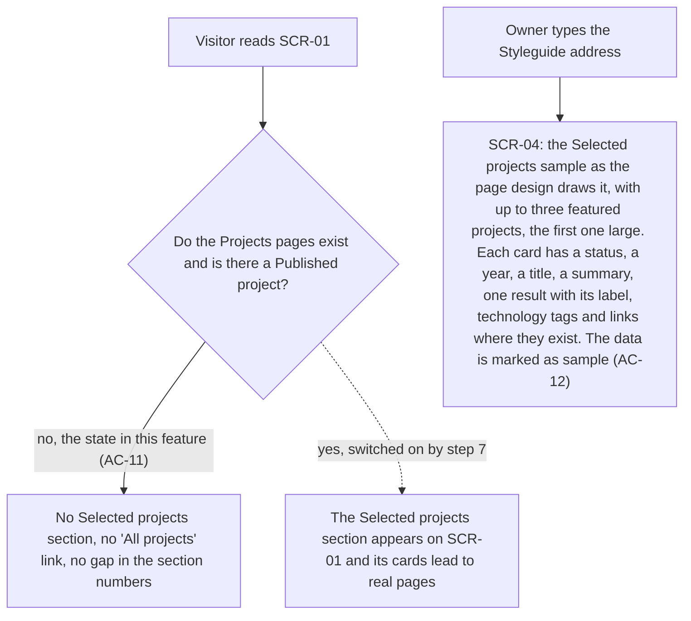

A Visitor reading the home page finds no Selected projects section, no "All projects" link and no gap in the section numbers, because the Projects pages do not exist; this holds whether or not a Published project exists. The dashed branch, where the section appears and its cards lead to real pages, is switched on by step 7. The Owner sees the section today only on the Styleguide: the sample as the page design draws it, up to three featured projects with the first one large, each card with its status, year, title, summary, one result, tags and links, and the data marked as sample.

### Flow: US-09 — Motion I can stop

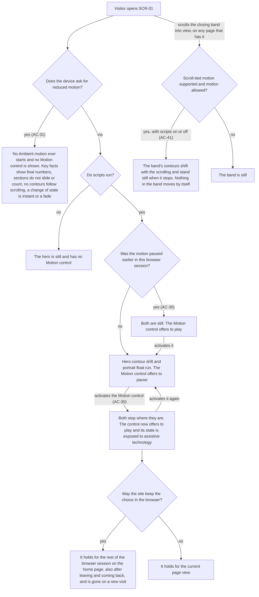

A Visitor opens the home page. If the device asks for reduced motion, no Ambient motion ever starts and no Motion control is shown; key facts show final numbers, sections do not slide or count, no contours follow scrolling, and a change of state is instant or a fade. Otherwise, with scripts off the hero is still and has no Motion control. With scripts on, the hero contour drift and the portrait float run and the Motion control offers to pause, unless the Visitor paused earlier in this browser session, in which case both are still and the control offers to play. Activating the control stops both where they are, the control then offers to play and exposes its state; activating it again resumes both. Where the browser lets the site keep the choice, it holds for the rest of the browser session on the home page, also after leaving and coming back, and is gone on a new visit; where it does not, it holds for the current page view. Apart from the hero, the closing band's contours shift only while the Visitor scrolls and stand still when they stop, with scripts on or off, where the browser supports motion tied to scrolling and motion is allowed; otherwise the band is still.

### Flow: US-10 — A page that needs no scripts

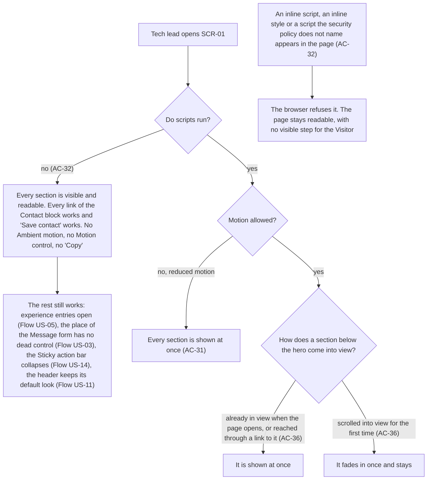

A Tech lead opens the home page. With scripts off every section is visible and readable, every link of the Contact block and "Save contact" work, and nothing that needs a script is offered: no Ambient motion, no Motion control and no "Copy". The rest still works: experience entries open, the place of the Message form holds no dead control, the Sticky action bar collapses and the header keeps its default look. With scripts on and reduced motion, every section is shown at once. With scripts on and motion allowed, a section that is already in view when the page opens, or that is reached through a link to it, is shown at once, and a section scrolled into view for the first time fades in once and stays. Separately, if an inline script, an inline style or a script the security policy does not name appears in the page, the browser refuses it and the page stays readable; the Visitor sees no step.

### Flow: US-11 — A header that fits the hero

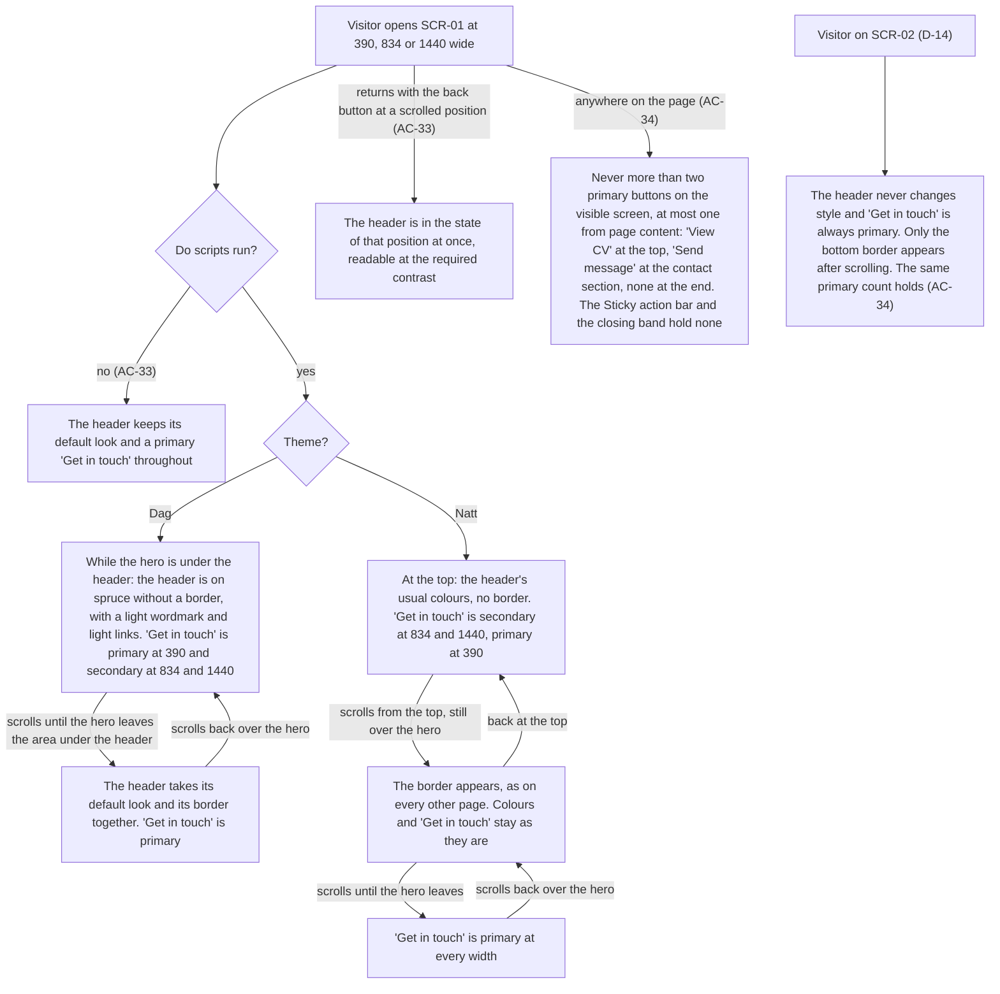

A Visitor opens the home page at 390, 834 or 1440 wide. With scripts off the header keeps its default look and a primary "Get in touch" throughout. With scripts on it follows the page design. In Dag, while the hero is under the header, the header is on spruce without a border, with a light wordmark and light links, and "Get in touch" is primary at 390 and secondary at 834 and 1440; exactly when the hero leaves the area under the header, it takes its default look and its border together and "Get in touch" is primary; scrolling back reverses this. In Natt the header's colours never change: the border appears as soon as the page is scrolled from the top, and "Get in touch" is secondary over the hero and primary after it at 834 and 1440, and primary throughout at 390. Returning with the back button at a scrolled position gives the header the state of that position at once, and it is readable in every state. At any scroll position the visible screen holds at most two primary buttons, at most one of them from page content: "View CV" at the top, "Send message" at the contact section and none at the end, since the Sticky action bar and the home page's closing band hold none. On the Not-found page the header never changes style, "Get in touch" is always primary and only the bottom border appears after scrolling.

### Flow: US-14 — Useful actions at my thumb, out of the way when I want

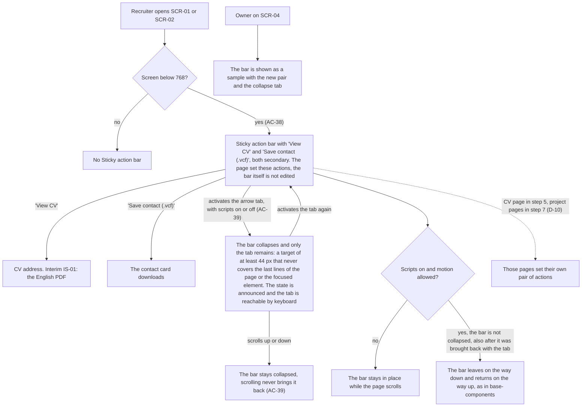

A Recruiter opens the home page or the Not-found page. At 768 and wider there is no Sticky action bar. Below 768 the bar offers "View CV" and "Save contact (.vcf)", both in the secondary style; the page sets these actions and the bar itself is not edited. "View CV" leads to the CV address (for now the English PDF) and "Save contact" downloads the contact card. Activating the bar's small arrow tab, with scripts on or off, collapses the bar so that only the tab remains, at least 44 px, never covering the last lines of the page or the focused element; the state is announced and the tab is reachable by keyboard. While the bar is collapsed, scrolling never brings it back; only the tab does. A bar that is not collapsed, including one brought back with the tab, behaves as in base-components: it stays in place with scripts off or reduced motion, and otherwise leaves on the way down and returns on the way up. The CV page (step 5) and the project pages (step 7) set their own pairs (dashed). The Owner sees the bar with the new pair and the tab as a sample on the Styleguide.

### Out of scope (no human-facing UI flow)

- **US-08 — Recognise the page before opening it:** the title, description, preview card and structured data are read by search engines and other apps; the Recruiter sees them outside the site and there is no screen to move through.
- **US-12 — Facts that stay true:** the Owner works in the repository, CI and the pull request (contact source check, placeholder check, Claims list, parity suite). The visible results are the Contact block (Flow US-02), the Now line (Flow US-01) and the Recommendations (Flow US-06).
- **US-13 — Messages that reach me, and only me:** the fixed recipient, the trap field, the limits and the separation of preview and test runs are enforced on the delivery side; the release check is the Owner sending one message through Flow US-03 on production. What a Visitor sees of the limits is drawn in Flow US-03.

## AC coverage

| AC | Shown by | Notes |
|---|---|---|
| AC-01 | Flow US-01, branch `below 768, drawn at 390 by 844 (AC-01)` | The box measurement is an e2e check |
| AC-02 | Flow US-01, branch `1024 and wider (AC-02)` and node "Below 1024 the portrait sits under the text" | |
| AC-03 | Flow US-01, both branches of "Has the Owner supplied a current project?" | |
| AC-04 | Flow US-01, branch `no, the state in this feature (AC-04)` | The `yes` branch is dashed: step 7 owns it |
| AC-05 | Flow US-04, node "Key facts" | The overlap with the hero edge is layout, detailed in `screens` |
| AC-06 | Flow US-04, both branches of "Scripts run and motion allowed?" | |
| AC-07 | Flow US-04, node "About" | |
| AC-08 | Flow US-05, whole flow | Scripts-off branch included |
| AC-09 | Flow US-06, branch `yes (AC-09)` | |
| AC-10 | Flow US-06, branch `no (AC-10)` | Decided when the page is built |
| AC-11 | Flow US-07, branch `no, the state in this feature (AC-11)` | The `yes` branch is dashed: step 7 owns it |
| AC-12 | Flow US-07, node "SCR-04" | |
| AC-13 | Flow US-02, node "Contact block" and the email, phone and profile branches | |
| AC-14 | Flow US-02, branch `yes (AC-14)` of "Does the browser allow clipboard access?" | The Toast above the bar is base-components AC-30; above the tab when the bar is collapsed (Owner decision) |
| AC-15 | Flow US-02, branch `no (AC-15)` of "Do scripts run?" and branch `no (AC-15)` of "Does the browser allow clipboard access?" | |
| AC-16 | Flow US-02, branch `'Save contact (.vcf)' (AC-16)` | Also reached from the closing band and from Flow US-14 |
| AC-17 | Flow US-02, both branches of "Screen 1024 or wider?" | |
| AC-18 | Flow US-02, node "Visitor on any page activates 'Contact' or 'Get in touch'" and both branches of "Already on SCR-01?" | SCR-02 and SCR-03 are the other entry points |
| AC-19 | Flow US-03, branch `yes (AC-19)` and branch `delivery confirmed (AC-19)` | The message in the Owner's mailbox is a delivery-side check |
| AC-20 | Flow US-03, branch `no (AC-20)` and `corrects a field` | |
| AC-21 | Flow US-03, branch `cannot be delivered, or no confirmation in time (AC-21)`, then `tries again` and `'write by email instead'` | |
| AC-22 | Flow US-03, branch `no (AC-22)` | Which of the two variants is design input |
| AC-23 | N/A: enforced on the delivery side, with no step a Visitor sees | Contract test in `plan-tests`; US-13 out of scope here |
| AC-24 | Flow US-03, branch `refused: sender over the limit, or a message that still reached the delivery side over the allowed length (AC-24)` and nodes from "A program fills the hidden trap field" | Enforcement is on the delivery side; the form also limits the length with a character count (Owner decision) |
| AC-25 | Flow US-03, node "Reads the line under the form" | No cookie and nothing kept in the browser is an e2e check |
| AC-26 | N/A: head meta and structured data, read by search engines and apps, no screen of the site | US-08 out of scope here |
| AC-27 | N/A: build-time contact source check, Owner in CI | Visible result: Flow US-02 and Flow US-01 |
| AC-28 | N/A: build-time placeholder check, Owner in CI | Visible result: Flow US-01, Now line branches |
| AC-29 | N/A: Claims list in the pull request, no screen of the site | US-12 out of scope here |
| AC-30 | Flow US-09, branches `activates the Motion control (AC-30)`, `activates it again`, `yes (AC-30)` and both branches of "May the site keep the choice in the browser?" | |
| AC-31 | Flow US-09, branch `yes (AC-31)`; Flow US-10, branch `no, reduced motion` | Also Flow US-04, branch `no: scripts off or reduced motion` |
| AC-32 | Flow US-10, branch `no (AC-32)` and nodes from "An inline script, an inline style or a script the security policy does not name" | The refusal has no visible step; e2e in `plan-tests` |
| AC-33 | Flow US-11, branches `no (AC-33)`, `Dag`, `Natt` and `returns with the back button at a scrolled position (AC-33)` | The 3 widths × 2 themes × 3 positions are test cases for `plan-tests` |
| AC-34 | Flow US-11, node "Never more than two primary buttons on the visible screen" and node for SCR-02 | The count itself is an e2e check |
| AC-35 | N/A: the parity suite runs in CI | The six behaviours are drawn in Flows US-01, US-02 and US-14 |
| AC-36 | Flow US-10, both branches of "How does a section below the hero come into view?" | |
| AC-37 | N/A: the Owner's release check and the separation of preview and test runs are on the delivery side | What a Visitor sees is the same everywhere: Flow US-03 |
| AC-38 | Flow US-14, branch `yes (AC-38)` with the `'View CV'` and `'Save contact (.vcf)'` branches | On SCR-01 and SCR-02 |
| AC-39 | Flow US-14, branch `activates the arrow tab, with scripts on or off (AC-39)`, then `activates the tab again` and `scrolls up or down` | A bar brought back with the tab scrolls like a normal bar (Owner decision) |
| AC-40 | Flow US-02, node "Closing band right under the contact section" and its branches | Other pages: dashed, from step 5 |
| AC-41 | Flow US-09, both branches of "Scroll-tied motion supported and motion allowed?" | In this feature only SCR-01 shows the band |
