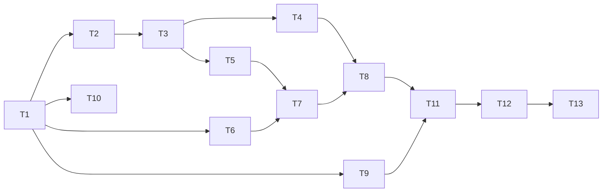

# Tracker — release-1

> Status of every task. `implement` updates `done` as it commits each task.
> States: `todo` · `in_progress` · `blocked` · `review` · `done`.

One branch, `feat/release-1`, and one pull request into `v2` (T1 to T11). T12 and T13 are the Owner's steps after it: the merge of `v2` into `main`, the settings outside the repository and the check on alpon.dev. The tasks and their definitions of done are in [tasks.json](../tasks.json); the decisions they cite are in the [spec](../spec.md) §1.3.

This feature is small (XS): like save-contact-hint it has no `sad.md` and no ADR of its own, and the test plan is in the spec (§7).

| # | Task | Layer | Blocked by | Status |
|---|---|---|---|---|
| T1 | Write the spec and the task list, close backlog B-61, add the two backlog items and the content rule | docs | — | done |
| T2 | Answer requests to the Web Analytics host locally in every Playwright test | tests | T1 | done |
| T3 | Add the Web Analytics script to every page and name it in the security policy | wiring | T2 | done |
| T4 | Block the address of the Web Analytics script in Lighthouse CI | infra | T3 | done |
| T5 | Load the Shell scripts as one file | wiring | T3 | todo |
| T6 | Generate the contour image in the spruce tone | infra | T1 | todo |
| T7 | Show the contours of the closing band and the mobile menu from the lazy image | ui | T5, T6 | todo |
| T8 | Measure the built levers and record the numbers | tests | T4, T7 | todo |
| T9 | Rewrite the three descriptions with the Owner's approval | ui | T1 | done |
| T10 | Set the shipped status in the five shipped specs | docs | T1 | done |
| T11 | Take the visual baselines, run the gate and open the pull request into `v2` | tests | T8, T9 | todo |
| T12 | Merge `v2` into `main`, switch the deploy command and protect `main` (Owner) | infra | T11 | todo |
| T13 | Check the release on alpon.dev and record it (Owner) | docs | T12 | todo |

Order of work: T2, T6 and T9 can start together after T1. T3 and T5 both change `BaseLayout.astro` and run one after the other.

