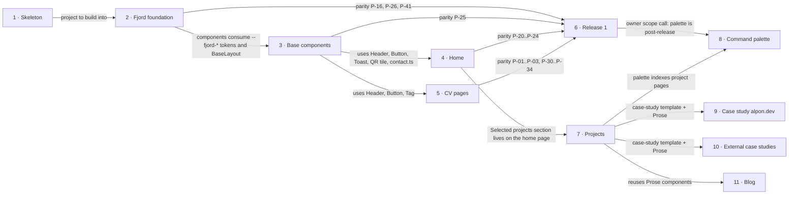

# Roadmap — alpon.dev

> **A decomposition, not a promise.** The overall idea broken into incremental steps: what each
> step is, where it comes from, how big it is — or that nobody has looked at it yet — and in which
> order, and parallel lanes, we walk them. **No dates** (except shipped history), **no scores** —
> order is the prioritization. The *solution* for any step lives in its `docs/features/<slug>/`
> spec, not here.

## Destination

A Norwegian recruiter can tell within 60 seconds on a phone who Alexander is and open his CV or contact him, while a tech lead can explore live projects through case studies on a fast, accessible Fjord site that costs nothing to run.

## Steps

| # | Step | Source | Size | Status |
|---|---|---|:---:|---|
| 1 | Project skeleton: Astro 6 static build, test harness, CI, Workers preview deploys ([`_scaffold`](features/_scaffold/)) | `architecture-map.md` Greenfield foundation | S | shipped |
| 2 | Fjord foundation: tokens, self-hosted fonts, Dag/Natt theme with no flash (inline theme script allowed by a CSP hash generated at build), `BaseLayout`, and the 404 "Ikke funnet" page | `idea-brief.md` §1 Raw idea | S | idea |
| 3 | Base components + `/styleguide`: only what Home and CV need — Button, Link, Badge, Tag, Stat, SectionHeader, Toast, Header/Footer, SkipLink, ThemeToggle, Contours; plus `src/data/contact.ts`, which the Footer reads | `reference/01-foundations.md` 8. Styleguide page | S | idea |
| 4 | Home with contacts: name, role, Oslo area, contact block from `contact.ts`, copy email ("Kopiert"), vCard, QR tile, meta + JSON-LD | `idea-brief.md` §3 Users | S | idea |
| 5 | CV pages EN/NO: `/cv`, `/cv/en`, `/cv/no` as HTML, language switch, page-image preview, Download PDF, legacy `#cv`/`#cv-no` hand-off from home | `idea-brief.md` §7 Recommendation | S | idea |
| 6 | Release 1: parity gate green (no `test.fixme` in `parity.spec.ts`), cookieless Cloudflare Web Analytics on with matching CSP, v2 → `main`, production deploy command switched to `npm run build && npx wrangler deploy`, post-merge smoke check on alpon.dev | `idea-brief.md` §6 Risks | XS | idea |
| 7 | Projects templates: `/projects` index, `/projects/[slug]` case-study pages with the live-preview facade, "Selected projects" on home, Prose/CodeBlock/Callout components; the nav link and home block render only when at least one published project exists | `idea-brief.md` §7 Recommendation | M | idea |
| 8 | Command palette: search pages, projects and actions; island loaded lazily on first Ctrl/Cmd+K or trigger focus | `design/handoff/site/project/site/App.jsx` CommandPalette | S | idea |
| 9 | Case study #1: alpon.dev itself → see [Not yet specified](#not-yet-specified) | `idea-brief.md` §7 Recommendation | fog | idea |
| 10 | External case studies #2+ → see [Not yet specified](#not-yet-specified) | `idea-brief.md` §8 Open questions | fog | idea |
| 11 | Blog `/thoughts` → see [Not yet specified](#not-yet-specified) | `idea-brief.md` §5 Out of scope | fog | idea |

## Not yet specified

| Area | What we'd have to learn | Blocks | How it gets sharpened |
|---|---|:---:|---|
| Craft proof on the alpon.dev case study | Which numbers and artifacts (Lighthouse, axe, specs, the agentic process) go on the page, and how they stay true after every deploy | 9 | Conversation with the owner (D3), then `/sdd:specify` |
| External portfolio projects | Which projects are live, frameable (`frame-ancestors https://alpon.dev`) and ready to present, and when | 10 | Owner inventory of the other repos (D4) |
| Blog content pipeline | Content source, build-time loader, image handling, publish → Deploy Hook flow | 11 | Source decision (D5), then a recon pass with the full SDD route |

## Out of scope

- Hosting the portfolio projects in this repo — each lives in its own repository and deploys separately (`idea-brief.md` §5).
- Paid services of any kind — running cost stays at zero, only the domain is paid (`idea-brief.md` §5).
- Unverified numbers or claims — they stay `[placeholder]` until Alexander confirms them (`idea-brief.md` §5).
- Blog in the first release — it waits until there are posts to publish (`idea-brief.md` §5).

## Open decisions

| # | Question | Type | Owner | Blocks |
|---|---|:---:|:---:|:---:|
| D1 | Natt reference screenshots are missing in `design/screenshots/` (only `dag_*`); provide them or accept Dag-only design comparison for visual tests | task | human | — |
| D2 | How cookieless Cloudflare Web Analytics is enabled (dashboard toggle vs. beacon script) and what that means for the CSP in `public/_headers` | research | agent | 6 |
| D3 | What "craft proof" means on the alpon.dev case study and how its numbers are kept true | grilling | human | 9 |
| D4 | Which external projects are ready to be case studies #2 and onward | grilling | human | 10 |
| D5 | Blog content source (proposed: Notion) | grilling | human | 11 |
| D6 | Whether to run a 60-second recruiter comprehension test with 3–5 people alongside the craft metrics | grilling | human | — |

## Decisions so far

- Static Astro site served by Workers static assets → [`adr/0001`](adr/0001-build-a-static-astro-site-served-by-workers-static-assets.md)
- Zero client JS by default, vanilla-TS islands → [`adr/0002`](adr/0002-ship-zero-client-js-by-default-with-vanilla-ts-islands.md)
- All content in the repo, no datastore → [`adr/0003`](adr/0003-keep-all-content-in-the-repo-with-no-datastore.md)
- `main` gets v2 only at stub parity → [`stub-parity.md`](stub-parity.md)
- Short links `/cv`, `/cv/en`, `/cv/no` serve the HTML CV pages (200, no redirect; the three `/cv` rules leave `_redirects`); PDF URLs stay unchanged; `#cv`/`#cv-no` on home hand off to `/cv/en` and `/cv/no`. The CV spec updates P-01..P-03 and P-31 → [`stub-parity.md`](stub-parity.md)
- Parity ids flip where the behaviour is built: Fjord foundation owns the CSP hash for the inline theme script (P-16, generated in the build, never `'unsafe-inline'`), font preload (P-26) and the 404 page (P-41); Base components own the skip link (P-25) → [`stub-parity.md`](stub-parity.md)
- Analytics ships with Release 1 so measurement starts on launch day → step 6, D2
- Projects never go public empty: the section stays hidden until the alpon.dev case study (step 9) or an external project (step 10) is published → step 7
- The CV spec rewords P-32/P-33 (the stub's inline PDF viewer) for HTML CV pages, e.g. "PDF available via Open/Download", instead of re-implementing the viewer → [`stub-parity.md`](stub-parity.md)
- Command palette ships after Release 1, lazily loaded so it costs nothing on initial load → step 8
- Prose, CodeBlock and Callout are built with Projects, where they are first used → step 7

## Dependency graph

## Execution path

| Wave | Steps | Zone per step (why parallel-safe) | Unlocks |
|:---:|---|---|---|
| 1 | 2 | `src/styles/`, `public/fonts/`, `src/layouts/BaseLayout.astro`, `src/pages/404.astro`, `public/_headers` (CSP hash) | 3 |
| 2 | 3 | `src/components/{ui,layout,brand}/`, `src/pages/styleguide.astro` (new), `src/data/contact.ts` (new) | 4, 5 |
| 3 | 4 ∥ 5 | 4: `src/pages/index.astro`, home sections in `src/components/` · 5: `src/pages/cv/` (new), `public/_redirects` (disjoint pages) | 6, 7 |
| 4 | 6 ∥ 7 | 6: `tests/e2e/parity.spec.ts`, `public/_headers` (analytics CSP), Workers Builds deploy command · 7: `src/content/projects/` (new), `src/pages/projects/` (new), `src/components/prose/` | 8, 9, 10 |
| 5 | 8 | `src/components/layout/` (palette island) | — |

Lane rules (owner-confirmed):

- **Shared files belong to the shell (steps 2–3):** Header/Footer, `src/data/contact.ts`, `public/_headers`, `public/_redirects`, `tests/e2e/parity.spec.ts`, `docs/stub-parity.md`. In wave 3, a change to any of them goes first as a small separate PR to `v2`; the other worktree rebases on it.
- **A parity id flips in the step that builds the behaviour**, so no test sits as `fixme` while the behaviour already exists: Fjord foundation — P-16, P-26, P-41; Base components — P-25; Home — P-20..P-24; CV — P-01..P-03, P-30..P-34.
- **Projects (step 7) runs on its own branch off `v2` and merges into `v2` only after Release 1 is on `main`**, so the release never carries a half-built Projects section.
- Fog steps 9–11 enter a wave only after their recon pass gives them a size.

## Shipped

| Step | Shipped | Link |
|---|---|---|
| 1 · Project skeleton (on `v2`) | 2026-10-02 | commit `b4512ec` |
