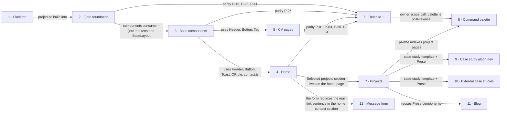

# Roadmap — alpon.dev

> **A decomposition, not a promise.** The overall idea broken into incremental steps: what each
> step is, where it comes from, how big it is — or that nobody has looked at it yet — and in which
> order, and parallel lanes, we walk them. **No dates** (except shipped history), **no scores** —
> order is the prioritization. The *solution* for any step lives in its `docs/features/<slug>/`
> spec, not here.

## Destination

A Norwegian recruiter can tell within 60 seconds on a phone who Alexander is and open his CV or contact him, while a tech lead can explore live projects through case studies on a fast, accessible Fjord site that costs nothing to run.

## Steps

| # | Step | Source | Size | Status |
|---|---|---|:---:|---|
| 1 | Project skeleton: Astro 6 static build, test harness, CI, Workers preview deploys ([`_scaffold`](features/_scaffold/)) | `architecture-map.md` Greenfield foundation | S | shipped |
| 2 | Fjord foundation ([`fjord-foundation`](features/fjord-foundation/)): tokens, self-hosted fonts, Dag/Natt theme with no flash (inline theme script allowed by a CSP hash generated at build), `BaseLayout`, and the 404 "Ikke funnet" page | `idea-brief.md` §1 Raw idea | S | shipped |
| 3 | Base components + `/styleguide` ([`base-components`](features/base-components/)): only what Home and CV need — Button, Link, Badge, Tag, Stat (final number, no count-up), SectionHeader, Toast, SkipLink, ThemeToggle ("Light / Dark"), Contours; the Shell: Header (no "Search Ctrl K" until step 8; border after scroll; static variants default, bordered, on spruce, secondary CTA), MobileMenu, CtaBand, Footer and MobileBar with the sticky action bar ("View CV / Get in touch" at 390, hides on scroll down); page and theme cross-fade as progressive enhancement; plus `src/data/contact.ts` (work region "Oslo, Norge", residence "Nittedal, Norge", last-updated date), which the Footer reads. Rebuild the 404 page per the site design (`Misc.jsx`), closing every fjord-foundation OQ-02 item and backlog B-01: two columns from 1024 (5fr / 7fr); below 1024, one column with the map under the text; map panel built on Terrain/Contours as static SVG (no JS, CSP-safe), heading and code line as in the site design, still no path echo; update fjord-foundation AC-07 / AC-08 and P-41 to the page design; re-baseline the 404 visuals together with Header/Footer. Extend the token-only allow lists in ADR-0003 with a reason per entry. Shell links use their final addresses; P-50 and P-51 are added for steps 4 and 5 to close. Not here: BackToTop (step 5); count-up, Contours drift and parallax, spruce header over the hero (step 4). If tasks go above about 25, split into 3a (components, contact data, styleguide) and 3b (404 rebuild and baselines) | `reference/01-foundations.md` 8. Styleguide page | S | shipped |
| 4 | Home ([`home`](features/home/)): the whole home page per the page design. Hero with portrait, availability badge, "Nå" line and a Motion control for the looping motion; key facts with count-up; About with quick facts; experience list; Recommendations (shown only with real quotes); contact block from `contact.ts` with copy email ("Kopiert"), vCard and QR tile; in the place of the page design's Message form, one sentence with the email as a mail link until step 12; head meta + JSON-LD; section reveal, hero parallax and contour drift. Selected projects and "See projects" are built as a Dormant section, shown only on the Styleguide until step 7 turns them on. Shell changes decided by the Owner on 2026-10-05: the header follows the page design over the hero (base-components D-06 dropped); the Sticky action bar takes its actions per page (home and 404: "View CV" and "Save contact") and can be collapsed; the closing band takes its actions per page and its contours follow scrolling. Move `id="contact"` to the real contact section (P-50, reworded to the header and the menu; the closing band's contact link moves to P-51, step 5). Closes backlog B-09, B-18, B-25. Split into two phases (30 tasks, Owner decision 2026-10-05): 4a (Shell changes, parity part, facts, About, experience, motion; tasks T1 to T26) is merged into `v2` (pull request [#3](https://github.com/Ponomaleks/alpon.dev/pull/3)); 4b (Recommendations, Selected projects, their Styleguide sections and baselines; T27 to T30) is built on `feat/home-4b`, branched from the updated `v2` (Owner decision 2026-10-07), and goes into `v2` as a separate pull request | `idea-brief.md` §3 Users; Owner scope decisions 2026-10-05 and 2026-10-07 | S | in progress: 4a merged into `v2`, 4b in a pull request (draft) |
| 5 | CV pages EN/NO: `/cv`, `/cv/en`, `/cv/no` as HTML, language switch, page-image preview, Download PDF, legacy `#cv`/`#cv-no` hand-off from home | `idea-brief.md` §7 Recommendation | S | idea |
| 6 | Release 1: parity gate green (no `test.fixme` in `parity.spec.ts`), cookieless Cloudflare Web Analytics on with matching CSP, v2 → `main`, production deploy command switched to `npm run build && npx wrangler deploy`, enable `main` branch protection (`check` + `visual` required; T16 option 2 command, right after the merge), post-merge smoke check on alpon.dev, including: verify 404 page and CSP on the production Worker (an unknown address returns the Fjord Not-found page with the `Content-Security-Policy` header; the Workers preview URL returns a bare `Not found`, see fjord-foundation [changelog](features/fjord-foundation/changelog.md)) | `idea-brief.md` §6 Risks | XS | idea |
| 7 | Projects templates: `/projects` index, `/projects/[slug]` case-study pages with the live-preview facade, "Selected projects" on home, Prose/CodeBlock/Callout components; the nav link and home block render only when at least one published project exists | `idea-brief.md` §7 Recommendation | M | idea |
| 8 | Command palette: search pages, projects and actions; island loaded lazily on first Ctrl/Cmd+K or trigger focus | `design/handoff/site/project/site/App.jsx` CommandPalette | S | idea |
| 9 | Case study #1: alpon.dev itself → see [Not yet specified](#not-yet-specified) | `idea-brief.md` §7 Recommendation | fog | idea |
| 10 | External case studies #2+ → see [Not yet specified](#not-yet-specified) | `idea-brief.md` §8 Open questions | fog | idea |
| 11 | Blog `/thoughts` → see [Not yet specified](#not-yet-specified) | `idea-brief.md` §5 Out of scope | fog | idea |
| 12 | Message form: the short form in the home page's contact section (name, email, message) that delivers to the Owner's own mailbox; replaces the mail-link sentence the `home` spec leaves there (IS-03). Lowest priority, set by its place in the table. Input for its spec, decided by the Owner at the `home` design stage on 2026-10-05 (no ADR written yet): (a) Delivery: the site's own Worker on `/api/*` (`run_worker_first`), mail sent with the `send_email` binding through Cloudflare Email Routing; zero cost, no third party, same origin, CSP `connect-src` unchanged. (b) Destination: a separate Gmail mailbox, not the email in `contact.ts`. The repo will become public, so the address never enters git (source, `wrangler.jsonc`, ADRs, tests, fixtures, commit messages): the binding is declared without a fixed address and the Worker reads it from a secret. The Cloudflare docs, checked on 2026-10-05, say a binding without a restriction can send only to destination addresses verified in the account while no sending domain is onboarded, and that such sends are free on every plan; the spec confirms this again before relying on it. (c) Sender limit of 5 per sender per hour: Workers KV with a 1-hour TTL, key = salted hash of the sender IP, salt in a Worker secret; a sender already at the limit is refused without a write; the ADR must state that it narrows repo ADR-0003. The Rate Limiting binding does not fit: its periods are 10 or 60 seconds. (d) Scripts off: the mail-link sentence of IS-03 stays in the HTML; only the form's own script hides it and enables the form; submit by fetch to the same origin; CSP unchanged (`form-action 'none'` stays). (e) Preview deployments and tests never reach the real mailbox or the production KV namespace. (f) Enabling Email Routing, the destination secret and the salt secret are manual Owner steps for the README and the release checklist of this step. Carried over from the `home` spec as it was before the form moved out (`docs/features/home/spec.md` as of the parent of the commit "spec: home, move Message form out"): US-03, US-13, AC-19 to AC-25, AC-37, D-07, the three "Message form" NFR rows | `design/handoff/site/project/site/Home.jsx` contact section; Owner scope decision 2026-10-05 | S | idea |

## Not yet specified

| Area | What we'd have to learn | Blocks | How it gets sharpened |
|---|---|:---:|---|
| Craft proof on the alpon.dev case study | Which numbers and artifacts (Lighthouse, axe, specs, the agentic process) go on the page, and how they stay true after every deploy | 9 | Conversation with the owner (D3), then `/sdd:specify` |
| External portfolio projects | Which projects are live, frameable (`frame-ancestors https://alpon.dev`) and ready to present, and when | 10 | Owner inventory of the other repos (D4) |
| Blog content pipeline | Content source, build-time loader, image handling, publish → Deploy Hook flow | 11 | Source decision (D5), then a recon pass with the full SDD route |

## Out of scope

- Hosting the portfolio projects in this repo — each lives in its own repository and deploys separately (`idea-brief.md` §5).
- Paid services of any kind — running cost stays at zero, only the domain is paid (`idea-brief.md` §5).
- Unverified numbers or claims — they stay `[placeholder]` until Alexander confirms them (`idea-brief.md` §5).
- Blog in the first release — it waits until there are posts to publish (`idea-brief.md` §5).

## Open decisions

| # | Question | Type | Owner | Blocks |
|---|---|:---:|:---:|:---:|
| D1 | Capture the missing Natt (and any other missing state/breakpoint) reference screenshots from `design/handoff/site/alpon.dev standalone.html` into `design/screenshots/`, done with the visual tests in Fjord foundation | task | agent | — |
| D2 | How cookieless Cloudflare Web Analytics is enabled (dashboard toggle vs. beacon script) and what that means for the CSP in `public/_headers` | research | agent | 6 |
| D3 | What "craft proof" means on the alpon.dev case study and how its numbers are kept true | grilling | human | 9 |
| D4 | Which external projects are ready to be case studies #2 and onward | grilling | human | 10 |
| D5 | Blog content source (proposed: Notion) | grilling | human | 11 |
| D6 | Whether to run a 60-second recruiter comprehension test with 3–5 people alongside the craft metrics | grilling | human | — |

## Decisions so far

- Static Astro site served by Workers static assets → [`adr/0001`](adr/0001-build-a-static-astro-site-served-by-workers-static-assets.md)
- Zero client JS by default, vanilla-TS islands → [`adr/0002`](adr/0002-ship-zero-client-js-by-default-with-vanilla-ts-islands.md)
- All content in the repo, no datastore → [`adr/0003`](adr/0003-keep-all-content-in-the-repo-with-no-datastore.md)
- `main` gets v2 only at stub parity → [`stub-parity.md`](stub-parity.md)
- Short links `/cv`, `/cv/en`, `/cv/no` serve the HTML CV pages (200, no redirect; the three `/cv` rules leave `_redirects`); PDF URLs stay unchanged; `#cv`/`#cv-no` on home hand off to `/cv/en` and `/cv/no`. The CV spec updates P-01..P-03 and P-31 → [`stub-parity.md`](stub-parity.md)
- Parity ids flip where the behaviour is built: Fjord foundation owns the CSP hash for the inline theme script (P-16, generated in the build, never `'unsafe-inline'`), font preload (P-26) and the 404 page (P-41); Base components own the skip link (P-25) → [`stub-parity.md`](stub-parity.md)
- Analytics ships with Release 1 so measurement starts on launch day → step 6, D2
- Projects never go public empty: the section stays hidden until the alpon.dev case study (step 9) or an external project (step 10) is published → step 7
- The home page's Selected projects section and the shape of a project entry are built in step 4 as a Dormant section; step 7 owns the switch and the Projects pages → [`home` spec](features/home/spec.md) AC-11
- The Sticky action bar's actions per page are fixed in the `home` spec D-10; steps 5 and 7 cite it → [`home` spec](features/home/spec.md)
- The CV spec rewords P-32/P-33 (the stub's inline PDF viewer) for HTML CV pages, e.g. "PDF available via Open/Download", instead of re-implementing the viewer → [`stub-parity.md`](stub-parity.md)
- Command palette ships after Release 1, lazily loaded so it costs nothing on initial load → step 8
- The Message form is its own step with the lowest priority; until it ships the home contact section shows the email as a mail link, and the security policy stays as it is → step 12, [`home` spec](features/home/spec.md) IS-03
- Prose, CodeBlock and Callout are built with Projects, where they are first used → step 7

## Dependency graph

## Execution path

| Wave | Steps | Zone per step (why parallel-safe) | Unlocks |
|:---:|---|---|---|
| 1 | 2 | `src/styles/`, `public/fonts/`, `src/layouts/BaseLayout.astro`, `src/pages/404.astro`, `public/_headers` (CSP hash) | 3 |
| 2 | 3 | `src/components/{ui,layout,brand}/`, `src/pages/styleguide.astro` (new), `src/data/contact.ts` (new) | 4, 5 |
| 3 | 4 ∥ 5 | 4: phase 4a (PR #3 into `v2`): `src/pages/index.astro`, `src/components/home/`, `src/scripts/home/`, `src/data/` (home content), and the Shell changes of the `home` spec (Header, MobileBar, CtaBand, 404 bar); phase 4b (a separate PR from the updated `v2`, after 4a is merged): Recommendations and Selected projects in `src/components/home/`, `src/content/projects/` (entry shape only), `src/pages/styleguide.astro`; step 5 starts after the Shell changes of 4a are in `v2` · 5: `src/pages/cv/` (new), `public/_redirects` (disjoint pages) | 6, 7 |
| 4 | 6 ∥ 7 | 6: `tests/e2e/parity.spec.ts`, `public/_headers` (analytics CSP), Workers Builds deploy command · 7: `src/content/projects/` (new), `src/pages/projects/` (new), `src/components/prose/` | 8, 9, 10 |
| 5 | 8 | `src/components/layout/` (palette island) | — |

Lane rules (owner-confirmed):

- **Shared files belong to the shell (steps 2–3):** Header/Footer, `src/data/contact.ts`, `public/_headers`, `public/_redirects`, `tests/e2e/parity.spec.ts`, `docs/stub-parity.md`. In wave 3, a change to any of them goes first as a small separate PR to `v2`; the other worktree rebases on it.
- **A parity id flips in the step that builds the behaviour**, so no test sits as `fixme` while the behaviour already exists: Fjord foundation — P-16, P-26, P-41; Base components — P-25; Home — P-20..P-24, P-50; CV — P-01..P-03, P-30..P-34, P-51.
- **Projects (step 7) runs on its own branch off `v2` and merges into `v2` only after Release 1 is on `main`**, so the release never carries a half-built Projects section.
- Fog steps 9–11 enter a wave only after their recon pass gives them a size.

## Shipped

| Step | Shipped | Link |
|---|---|---|
| 1 · Project skeleton (on `v2`) | 2026-10-02 | commit `b4512ec` |
| 2 · Fjord foundation (on `v2`) | 2026-10-03 | [PR #1](https://github.com/Ponomaleks/alpon.dev/pull/1) |
| 3 · Base components (on `v2`) | 2026-10-05 | [PR #2](https://github.com/Ponomaleks/alpon.dev/pull/2) · [changelog](features/base-components/changelog.md) |
